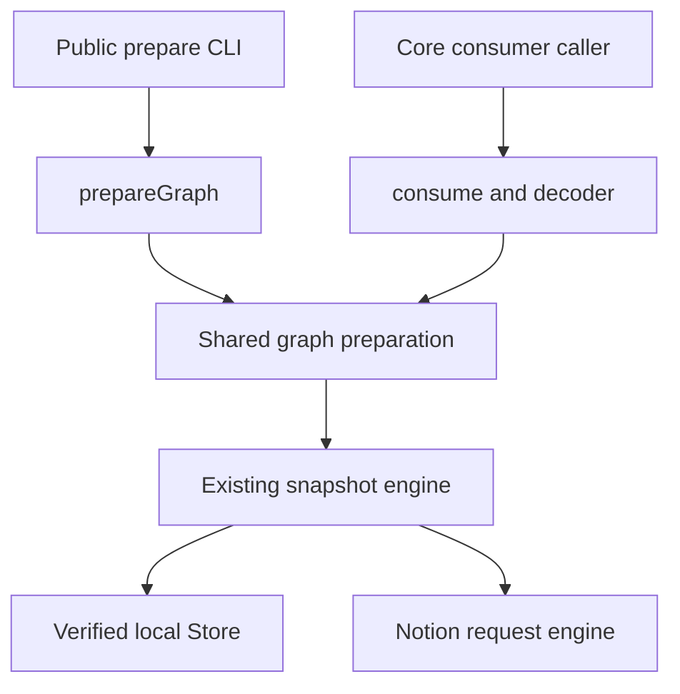

# Skill consumption contract v1

SC03 / AH-620 freezes the executable core boundary for `consume`. The implementation is
`packages/core/src/consumer.ts`; its runtime schemas are composed from the existing
prepare, snapshot and native File schemas in `consumer-model.ts`. The engine and the
decoder use those same schemas. The packaged Promise adapter is exported at
`ntn-skills/sdk`, using the same engine and runtime services. A locally packed artifact
is an installable candidate, not evidence that its version has been published.

## Entry point and supported work

`consume(input, options)` returns an Effect that requires the existing Notion, Store,
Crypto, filesystem, path and HTTP services. Importing it starts no process, opens no
connection, reads no environment and changes no global runtime. The caller owns the
scoped runtime. `ConsumeInput`, `ConsumeResult`, their runtime schemas,
`decodeConsumeResult`, and the contract/compiler version constants are exported from
this narrow module and the current core index.

```ts
import { consume, type ConsumeInput } from "../packages/core/src/consumer.ts"

const abortController = new AbortController()
const input = {
  version: 1,
  targets: ["shared_skill:library-id:skill-id"],
  purpose: "use",
  freshness: { policy: "default" },
} satisfies ConsumeInput

const operation = consume(input, { signal: abortController.signal })
// Run operation in the existing scoped runtime; inspect the result.status union.
```

The sample relative import is for this repository. Other repositories use the public
`ntn-skills/sdk` package export shown below. The private core package still exports
TypeScript source and is not a cross-repository distribution boundary. No new
consumer transport is introduced. SC25 adds the daily `use REF` command as a thin
adapter over this same engine; it does not loop over scalar reads.

## Daily discovery, inspection and consumption

`list [--query TEXT] [--limit N] [--cursor CURSOR]` returns metadata only. It searches
the authorized source scope unless an explicit View/Profile selection narrows it.
The default limit is 50 and the maximum is 500. `count` is the returned page length;
`total_count` is the matched observation length. Follow `next_cursor` until `has_more`
is false. Neither field upgrades `coverage.exhaustive`. A cursor binds scope, catalog
observation, selection and query; a changed observation returns `LIST_CURSOR_STALE`.

`read REF --json` inspects one original file without resolving Requires. `use REF`
loads the root and complete Requires closure once, leaving unselected Member bodies
unread. Canonical IDs and immutable refs bypass discovery. Human names resolve through
complete metadata before consumption; incomplete uniqueness evidence returns an exact
ref or explicit-database action. Resource-only and range reads use `read`, and package
materialization uses `export`.

`use` defaults to compact instructions and returned refs. `use --json` returns the
consumer v1 result with the CLI `ok` envelope: full bodies occur once in
`preparation.nodes`; `entries` carry machine evidence. Drop the CLI envelope before
calling the pure consumer decoder. Prepared content retains `delivery:not_observed`
and `activation:not_evaluated`. `list/read` keep their old JSON default while SC23
callers migrate; explicit `--json` is stable. `read --raw` remains exact text and is
incompatible with `--json`.

The Promise SDK exports `listCatalog(options): Promise<ListCatalogResult>` for a full
metadata directory, and `listSkills(options): Promise<ListSkillsResult>` for the same
bounded query/pagination contract. Both accept normal SDK `env/cwd/signal/metrics`
options and `database/view/defaultView/profile/refresh/offline/maxAge`; only `listSkills`
adds `query/limit/cursor`. Full results retain scope, records, count, fetched_at,
freshness, databases, coverage and applicable View/Profile metadata, without a CLI
envelope. Both use core catalog cache eligibility directly. They spawn no process
and need no separate cache-identity request or host-derived catalog cache.

Hosts needing both ordinary discovery and the current default directory can call
`listCatalog({ database, directory: {}, ...policy })` once. `directory: { view }`
selects an explicit View; `directory: { profile }` selects a Profile and requires
`database`. The selectors are mutually exclusive. The additive overload exports
`CATALOG_DIRECTORY_CONTRACT_VERSION = 1` and returns `ListCatalogDirectoryResult`:
`{ version: 1, catalog, directory }`. Each projection is either
`{ ok: true, value: ListCatalogResult }` or `{ ok: false, error: { code, message } }`.
A full-catalog error can therefore remain visible while an unrelated valid View
succeeds, and a View error does not hide a valid ordinary catalog. Cancellation
rejects the entire operation. Successful projections cannot mix credential scopes
or conflicting descriptors for the same database.

This one operation can reuse a complete raw six-property Skills inventory across
its two projections. Disabled and unselected rows still participate in the original
identity checks. Each projection keeps its existing permission, descriptor and
cache checks; a cached public catalog never substitutes for raw inventory. Reuse
requires matching scope and descriptor and an unexpired observation. `maxAge: 0`
does not reuse it. View freshness retains the earlier inventory observation time;
the later View query cannot reset that age. Observations end with this operation
and do not span separate calls, `consume`, sessions or processes. The ordinary
`listCatalog`, `listSkills` and CLI contracts remain unchanged.

`resolveCatalogReference(ref, directory)` is a synchronous, pure selection helper.
It returns `{ record, scope, ref }`, with the selected path carried into a canonical
identity ref. Supply the complete ordinary `listCatalog` result for the declared
source, without a View, Profile, search query or pagination projection. This ordinary
directory contains enabled consumable records; disabled stable-ID conflicts and
exact disabled-target admission retain their existing Core checks. Names and aliases
match exactly. Full coverage with no match returns `SKILL_NOT_FOUND`; two matches
return `SKILL_AMBIGUOUS`. Incomplete coverage, a failed source, a repeated identity or
a projected directory returns `CATALOG_INCOMPLETE`, even for zero or one match.

CLI `read` and `use` share this selection rule. The two normal snapshot name lookup
paths require complete evidence; the best-effort lookup used only to invalidate a
failed current observation does not grant consumption authority. `consume` itself
continues to require exact machine targets. A host resolves a human name first, then
passes the returned canonical ref unchanged to `consume` and its result decoder.
Known canonical IDs and session short refs retain their direct identity paths.

The SDK also exports `listSkill(ref, options): Promise<ListSkillResult>`, the existing
`files` operation. For a fixed ref it validates the historical manifest, name/alias,
scope, database constraint and known permission denials without preparing the main
or reading body objects. A locally complete manifest can be listed while every body
object is absent. A missing manifest may use the existing retained-pin lookup;
absence remains `SNAPSHOT_MISSING`, and a wrong historical name remains
`SNAPSHOT_CONFLICT`. Copy the returned canonical file ref for `readSkill` or
`readResources`. Current `listSkill` retains the existing current acquisition rules;
it is not a new metadata-only catalog operation.

| Input | Contract |
| --- | --- |
| `version` | Exactly `1`; unknown versions and extra input fields fail validation. |
| `targets` | Existing prepare exact-target semantics: exact identity/page URL or immutable pin. Historical aliases on an explicit verified pin retain their existing compatibility. Display names and short references do not grant authority. |
| `purpose` | `use` prepares every required Skill in the full closure; `inspect` reads only selected roots and returns related directory metadata. |
| `sessionBindings` | Existing immutable `PrepareBinding` records. Scope, identity, version and body hashes must agree; failed refresh cannot replace an old binding. |
| `freshness`, `budget` | The existing prepare schemas and semantics, without a second freshness owner. |
| `requestedFiles` | Reserved exact pinned file references. Absent or empty is supported. A nonempty list returns `CONSUME_UNSUPPORTED` before I/O. Use `readSkill` for one file or the independent [resource read contract](resource-read-contract.md) for a fixed resource batch; neither silently changes consume v1. |
| `projection.compiler` | Absent or `source-identity/v1`. Every other compiler returns `CONSUME_UNSUPPORTED` before I/O. |

Options derive the existing prepare options (`database`, `execution`, `metrics`) and
add an optional `AbortSignal`. There is no daemon, new scheduler, retry owner or separate
credential store.

## Consumption effects and strict read-only mode

The SDK exports `CONSUMPTION_EFFECTS_VERSION = 1`, `ConsumptionEffects` and
`ConsumptionRetentionEffect`. Every current `consume` outcome carries `effects` at
the top level, including failed and cancelled outcomes. Ready preparation results
carry the same receipt in `preparation.effects`; failed results also include it in
`error.details.effects`. `prepareGraph` and `readSkill` return `effects` on success
and attach it to `SkillsError.details.effects` on failure.

```ts
type ConsumptionEffects = {
  version: 1
  remote_writes: "none" | "retained" | "unknown"
  author_content: "unchanged" | "unknown"
  retention: readonly {
    skill_page_id: string
    file_id: string
    operation_id: string
    status: "confirmed" | "unknown"
  }[]
}
```

This receipt observes the requests already executed by this operation. It adds no
probe or remote request. Semantic queries, including POST queries, remain reads.
`none` means this operation dispatched no semantic remote write. `retained` means
all observed writes were acknowledged immutable history Records; the receipt names
the original Skill, File and observation operation for each root or required Skill.
It does not imply that graph preparation, delivery or activation succeeded. A lost
write response or cancellation during dispatch remains `unknown`, including when
some earlier Records were acknowledged. An unclassified write also leaves
`author_content` unknown. Missing effects in an older version 1 receipt mean
**unknown**, never zero writes; the additive fields remain optional in the decoder
for that compatibility.

`ConsumeOptions.readOnly` and `ReadSkillOptions.readOnly`, and CLI `read --read-only`,
`use --read-only` and `ctl prepare --read-only`, forbid every semantic remote write
before dispatch. Exact fixed history remains usable, and unchanged current content
can reuse existing retention. If current content needs a new observation Record,
the operation refuses before its first write and reports the existing Core error
with a `none` receipt. Normal consumption still retains newly observed author edits;
strict mode does not delete retention or pretend that it has happened. A host must
check the exported capability before relying on this option with an older SDK.

The default compact `use` output discloses its effect summary. JSON returns the
structured receipt. Explicit `read --raw` continues to return only the exact text.

## CLI command disposition and compatibility

The `agent-cli-ref-20261105` candidate keeps one parser/handler definition per
capability. Official `Command.unlisted` marks authoring and historical root paths as
on demand. Root help/completions omit them, and root `schema` returns one level of the
daily tree. A container with `has_subcommands:true` is expanded with an explicit
`schema ctl ...` request. Explicit schema/help for an unlisted command remains offline
and uses the same definition as execution.

| Previous root | Current path | Disposition |
| --- | --- | --- |
| `list` | `list` | Daily metadata discovery; `--view` remains a consumer filter |
| `views` | `ctl views` | View inspection; root path is compatibility only |
| `ctl` | `ctl` | Existing configuration, diagnostics, library/source/cache/builtin tree retained |
| `read` | `read` | Daily original-text and exact-resource inspection |
| `prepare` | `ctl prepare` | Advanced graph, session bindings, budgets and scheduler controls; root compatibility only |
| `files` | `files` | Optional resource inventory |
| `create` | `create` | Explicit authoring, discovered through its help or maintenance Skill |
| — | `adopt` | Explicit original-page registration for an unregistered native disabled draft; discovered on demand |
| `apply` | `apply` | Explicit pinned change submission, discovered on demand |
| `replace` | `replace` | Explicit whole-content replacement, discovered on demand |
| `export` | `export` | Optional complete package export |
| `write` | `write` | Explicit whole-file authoring, discovered on demand |
| `update` | `update` | Explicit metadata authoring, discovered on demand |
| `operation` | `ctl operation` | Original-operation show/reconcile/resume; root compatibility only |
| `sync` | `ctl sync` | Complete local/upstream orchestration subtrees; root compatibility only |
| `resolve` | `ctl resolve` | Relative-ref diagnostic/helper; root compatibility only |
| `schema` | `schema` | Daily summary by default, complete explicit command schema on demand |

`use` is the added daily consumer. It does not execute authoring commands such as
create, adopt, apply, replace, write or update. Normal consume retention and adoption of
newly observed author edits remain unchanged and can write Records; those writes
and their permissions stay in the actual request ledger. Dry-run, exact target/version
constraints, conflict handling and original-operation recovery are unchanged.

In-repository drivers, package Skills and newly generated `next.argv` use canonical
`ctl` paths. External command configurations and retained historical `next.argv` may
still use the old five root paths; these aliases select the same runtime commands,
not another implementation. Historical capture validators accept an optional `ctl`
segment while validating the original captured bytes and hashes unchanged.

Compatibility is supported by the 0.1.0 candidate carrying this contract. Removal is
eligible only in an explicitly declared breaking release after SC23 has inventoried
and migrated external commands, all actionable old recovery paths have settled or
have a verified read-time migration, and SC22 has passed independent installation and
two-machine restoration with the proposed removal. Archived receipts and pins are not
rewritten to satisfy that gate. List/read retain their JSON default until the separate
output-format caller migration is complete.

Rollback retains the prior CLI/SDK archive and its hashes with unchanged state,
credentials, pins and original operations. A pre-ctl CLI does not parse new ctl argv:
after selecting that prior package, inspect the original operation ID through its
supported `operation show` and use the freshly returned next action. Do not edit an old
receipt, start a replacement write or infer that a failed command never ran. SC22 must
exercise this rollback route before daily cutover; documenting it is not acceptance.

## Installed Node SDK

```ts
import {
  SDK_VERSION, PACKAGE_VERSION, CONSUMER_CONTRACT_VERSION,
  consume, readSkill, decodeConsumeResult, parseDuration,
  type ConsumeInput,
} from "ntn-skills/sdk"

if (SDK_VERSION !== 1 || CONSUMER_CONTRACT_VERSION !== 1)
  throw new Error("Unsupported ntn-skills SDK contract")

const input = {
  version: 1,
  targets: ["shared_skill:library-id:skill-id"],
  purpose: "use",
  freshness: { policy: "max_age", max_age_ms: parseDuration("5m") },
} satisfies ConsumeInput
const controller = new AbortController()
const result = await consume(input, {
  cwd: "/absolute/consumer/workspace",
  env: capturedEnvironment,
  signal: controller.signal,
})
// consume already validates its complete result with decodeConsumeResult.
// Use the public decoder separately when accepting a retained/transmitted receipt.
if (result.status === "ready") await decodeConsumeResult(result, input)
```

For a current human selector, use the same installed SDK for metadata selection and
consumption. This is two SDK operations within the caller's tool, with one graph
preparation and no CLI subprocess per node:

```ts
import { listCatalog, resolveCatalogReference, listSkill, consume, readResources } from "ntn-skills/sdk"

const source = { ...options, database: declaredDatabase }
const directory = await listCatalog(source)
const selected = resolveCatalogReference("skill://review-skill/SKILL.md", directory)
const consumed = await consume({ version: 1, targets: [selected.ref], purpose: "use" }, source)

// fixedRef comes from an earlier system response. Its historical name is checked
// against that pin; current discovery cannot rebind it to another owner.
const files = await listSkill(fixedRef, source)
const resource = files.files.find((file) => file.path === requestedPath)
if (!resource) throw new Error("The selected snapshot has no requested resource")
const bytes = await readResources({ version: 1, refs: [resource.ref] }, source)
```

`PACKAGE_VERSION` comes from the same package manifest that supplies the CLI binary.
An integrating host must select and pin one package artifact for both entrypoints;
it must reject a missing/incompatible SDK instead of silently selecting another CLI.
The declarations are emitted from the actual core schemas and their reachable type
dependencies. They do not import private workspace packages or checkout source paths.

`consume` returns `Promise<ConsumeResult>`. `readSkill` returns the existing core read
object, without the CLI `ok` wrapper. It accepts the same `database`, `path`, `from`,
`lines`, `output`, `refresh`, `offline` and millisecond `maxAge` options. A fixed main
or resource File ref uses the existing snapshot/read checks. Binary resources require
`output`; the result's output path and bytes have the existing Store contract.
`READ_OUTPUT_PROOF_VERSION === 1` additionally identifies output-mode `sha256`
(the verified selected bytes) and `entrypoint_sha256` (the entrypoint commitment
from the validated fixed manifest). Reading a resource does not acquire its main
object to supply that commitment. A host can compare a persisted owner binding
and verify the output file without preparing a Skill body or accepting the
resource batch's size budget. These machine fields are absent from ordinary
text/line reads and do not establish model delivery or instruction activation.

A fixed single-file read carries the selected, verified bytes from acquisition to
its output step within that invocation. A fully cached target needs one object
read instead of being read again after its manifest was selected. The final
file byte/hash check remains in place; the bytes are not added to the public
snapshot or SDK result, retained across calls, or used to extend current-state
freshness. Missing-object recovery and its persistence costs remain separate.

`readSkill` and `decodeConsumeResult` reject with the exported `SkillsError` for typed
domain failures, preserving `_tag`, `code`, `message` and optional `details`.
Unexpected implementation defects remain rejected promises.

Each operation captures a complete `env` map at invocation. Omitting `env` captures
the current process environment; supplying it replaces that source rather than merging
with it. Each operation also captures `cwd` (defaulting to the invoking directory).
Its Path service resolves relative configuration roots and output paths against that
directory. Neither `process.env` nor `process.cwd()` is changed. A fresh scoped runtime
per call preserves credential rotation and keeps concurrent calls in separate domains.
The caller does not create or close a persistent SDK client.

The optional `execution` object reuses prepare's `priority` (`required` or `prefetch`),
`queueBudgetMs`, `timeBudgetMs` and `rateShare` policy. `parseDuration` is the CLI's
existing parser: `0` or an integer followed by `s`, `m`, `h` or `d`, returning milliseconds.
`metrics: true` enables the existing safe bounded request trace with a default limit
of 10000; an explicit `NTN_SKILLS_REQUEST_TRACE_LIMIT` retains its existing validation.
Without this opt-in or an explicit environment trace setting, tracing stays off.
`onRequestMetrics(snapshot)` runs once after the operation's scope closes, including
failures and cancellation. Before the SDK acquires the Notion service, runtime
construction only builds services and local Store state; no HTTP-capable operation
can execute. Input rejection, pre-abort and cancellation during that initialization
therefore report a complete zero-attempt ledger from the existing metrics factory.
After acquisition the callback uses the transport's actual counters; unavailable
acquired-service metrics remain `null` and cannot prove zero work. A zero ledger does
not change a failed or cancelled operation into success. Callbacks should not throw.
Counters and trace contain no raw credentials, request paths or full bodies. Hosts
must count SDK calls separately from those HTTP measurements and retain truncation.

An already aborted signal does no acquisition. Aborting initialization, headers or
body work interrupts the operation and waits for its scope cleanup before settlement.
`consume` and `readResources` return `status: cancelled`; `readSkill`, `listSkill`,
`listCatalog` and `listSkills` reject with `SkillsError` code `CANCELLED`. Header/body cancellation
retains actual attempts and unknown response-byte counters after scope cleanup.
A host must not publish a late result after its own cancellation boundary.

## Module responsibilities and transport choice



The source engine owns authentication, freshness, retained pins and materialization.
The consumer owns the versioned result and consistency checks. The host owns session
selection, publication to safe local paths, assembled model input and activation.
The packaged SDK connects these existing owners; it does not create another
cache, scheduler or permission authority.

| Transport | Current boundary and decision |
| --- | --- |
| Per-command CLI subprocess | Explicit custom source commands retain their configured transport and existing JSON/error/exit contract. Full-export and historical management callers retain their exact operation semantics. They do not define the default Pi consumption path. |
| Shared packaged SDK | `ntn-skills/sdk` owns one scoped runtime per Promise operation. Broker's default directory uses `listCatalog`; its graph preparation uses `consume` without a per-node subprocess loop, and fixed scalar resources use `readSkill`. Installed artifact identity and actual provider delivery remain separately verified. |
| Session subprocess RPC | Would add process lifetime, message framing, request cancellation and version negotiation to maintain. It is not the selected architecture and is not introduced to avoid packaging the shared SDK. |

These are code boundary comparisons, not measured speedup claims. SC02 records
actual latency, process and request costs before an implementation is called faster.

## One preparation, two output views

`prepareGraphWithSnapshots` is an internal extraction of the current graph operation.
It returns the normal preparation and the verified snapshot observations already held
by that operation. `prepareGraph` maps this internal result back to its old output;
its CLI JSON shape, graph budget, permission checks and freshness behavior remain intact.

`consume` uses those observations and the already verified main text. It does not call
`readSkill` or `targetSnapshot` again for each node. The same-operation snapshot/object
read counts are covered by a regression comparison against ordinary `prepareGraph`.
The decoder hashes in-memory text and receipts again at the contract boundary. These
checks remain necessary when data crosses a future SDK/CLI transport boundary.

This does not promise one HTTP request, lazy materialization for every source adapter,
or zero remote work. Existing source acquisition and snapshot validation still apply.
Broker's default SDK path validates the selected source and retains its local
publication boundary when accepting the complete result.

## Result states and evidence ownership

| Result or receipt | What it establishes |
| --- | --- |
| `status: ready` | The whole requested prepare operation succeeded, and every prepared entry passed the consumption decoder. |
| `preparation` | Existing selected bindings, roots, required closure, full main text, directories, freshness, budgets and observed-version graph lock. Text is present exactly once here. |
| `entries[].manifest` | Complete immutable file metadata, canonical owner, scope/version/pin, optional stable File bindings and upstream source provenance. `manifest_sha256` binds the complete receipt. |
| `entries[].source_body` | The full selected effective snapshot entry, with matching ref/path/UTF-8 byte count/hash, inclusive line range and `has_more: false`. |
| `materialization.status: entry_ready` | The entry is local and verified; other manifest files may be absent. `paths` lists the files verified for this operation, without scanning unrequested objects. |
| `materialization.status: all_files_ready` | Every file in this selected manifest is locally available under the snapshot reader's checksum contract. |
| `projection.status: identity` | The only supported model projection retains the exact source entry bytes. Source and projection hashes happen to be equal under this compiler; they remain separate fields. |
| `export.status: not_requested` | No complete filesystem/ZIP export artifact was created or certified by this operation. |
| `delivery.status: not_observed` | This layer has no provider-input evidence. Cached or materialized content is not delivery. |
| `activation.status: not_evaluated` | The host owns instruction activation and must respect `use` versus `inspect`. |
| `status: failed` | Typed `code/message/details`, preserving core preparation errors and partial/deferred observations. There is no successful graph in the outer result. |
| `status: cancelled` | The explicit signal cancelled this operation and its owned work has finished cleanup. There is no preparation or delivery receipt. |

The graph lock remains `observed_version_vector`. It records the versions actually
observed; it is not an atomic Notion transaction across pages. Members and ordinary
references remain candidate metadata. The `use` closure never silently promotes them
to required or active instructions.

Fixed and eligible current-cache entry reads use the [selected snapshot consumption](selected-snapshot-consumption.md)
contract. Complete manifests and prior complete-reference validation do not imply
that every object is currently local. A full export still verifies every file;
current TTL, full-body deadlines, pending work and credential scope remain separate gates.

The existing `preparation.usage.context_bytes` still measures the old successful
prepare envelope. It does not measure this additional machine receipt or actual model
input. A host must budget its assembled provider input separately and keep machine
proof out of model instructions.

## Source bytes, projection bytes and actual delivery

`source_body.kind` is deliberately `verified_snapshot_entry`. Its hash identifies the
selected effective/generated snapshot file returned by the existing reader. It does
not rename that file to the original authored Notion/portable source. Existing
`read --raw` and export projection semantics are unchanged.

`manifest.source_projection`, when present, describes upstream source provenance.
It is not the model projection compiler. `source-identity/v1` records the verified
entry hash, the hash of the prepared node's Required/Member/reference directories,
the compiler identifier, and the identical output byte hash/count. No new reduced
projection is accepted by this implementation.

A future projection compiler must bind its precise source files and relation input,
compiler version and output bytes. A future delivery receipt must additionally bind
those output bytes to the host's actual provider input/span. A log saying loaded,
a summary, cached content, session selection, or marker surviving compaction cannot
replace full-content provider evidence. Missing/truncated traces cannot establish
zero requests or successful delivery.

## Checks formerly added by the per-node fixed read

The new response must carry these checks before a caller may remove its additional
read. `decodeConsumeResult` is the executable validator; schema decoding alone only
checks shape. Supply the original decoded input as its second argument when accepting
a response for a particular request. The producer always does so.

| Check | Source and validation |
| --- | --- |
| Exact selected record | The same verified snapshot supplies node, binding and manifest. Their record fields must agree; shared logical library/Skill IDs and physical page/database/data-source IDs are checked. Same names in different libraries remain distinct. |
| Enabled content and main kind/path | Existing graph selection rejects disabled content and non-Skill implicit requirements. Consumer additionally checks record kind/entrypoint, main existence and exact owner/ref. |
| Scope/credential domain | Graph preparation selects the existing authenticated or offline-cached opaque scope. Every manifest and binding must match that scope. No credential bytes are returned. |
| Snapshot/version pin | Manifest, binding and ref identify the same immutable snapshot/version. Snapshot identity and graph-lock digests are checked; session version/hash conflicts keep their existing errors. |
| Stable File bindings | File IDs, physical pages and paths are unique; every binding belongs to the complete manifest. When bindings are present, the main File must point to the selected shared Skill page and agree with the main ref's File ID. Legacy manifests without stable bindings remain explicitly without them. |
| Complete manifest | All files have normalized relative paths, safe byte counts and SHA-256 identities. The node's pinned file directory must exactly match the manifest. Manifest completeness is separate from byte availability. |
| Full text | UTF-8 byte count and source/body/binding/main-file hashes agree. NUL text is rejected. Range starts at 1 and ends at the actual total line count; `has_more` is exactly false. BOM and CRLF survive. |
| Freshness and access | The original snapshot observation/freshness is preserved in each prepared node. Consumer uses the same access owner, with no synthetic refreshed timestamp or second network permission check. |
| Required closure and graph lock | Roots, selected bindings, edges, complete use closure, usage/budget and lock digest agree. Missing/partial/deferred preparation never becomes ready. Inspect never gains dependency bodies. |
| Materialization | Available paths include the entry and are a subset of the manifest; `all_files_ready` agrees with the complete path set. A retained manifest with only entry bytes remains `entry_ready`. |
| Projection | Only source identity is implemented; body, relation input, compiler and projection hashes are checked. Unsupported compilers fail before acquisition. |

This receipt is not a signature or a new authorization grant. Offline decoding proves
internal consistency. Trust in scope/access still comes from the selected core runtime
and its verified snapshot reader. Consumers compare the response to the requested
targets and selected source before adopting it.

### Preserve the existing access boundary

A complete local immutable pin carries its manifest-bound historical scope. Scalar
reads retain the existing local-history capability across credential changes; that
does not prove current access under the newly selected credential. Current reads and
`use` separately enforce the selected credential scope. Default fixed reads need no
fresh request to the former remote page, but reject an explicitly known authentication
or access denial attached to the manifest's scope/target. If a retained pin lacks
bytes and must acquire them online, `openRetainedSnapshot` revalidates the current
library/Records identity and current Skill access before fetching exact old-pin
bytes. It never substitutes the current body.

`--refresh` and `--max-age 0` currently force a full current observation. Ordinary
positive TTL expiration can revalidate metadata while the separate body deadline is
still valid. The contract preserves the distinction and the reported freshness data.

A denied, hidden or disabled current target (`ACCESS_DENIED` / `NOT_FOUND` /
`CONTENT_DISABLED`) loses its old TTL
eligibility. An authentication rejection fences every known current binding and
directory in that credential scope. A subsequent ordinary read/list revalidates
online; it cannot turn the failed refresh into a fresh cache success. Explicit
offline retains the last complete snapshot or directory with its original timestamp
and `stale: true`. Other credential scopes remain independent, and network errors or
interruption do not become permission denials. Successful online revalidation restores
normal warm-cache eligibility.

Confirmed `AUTH_REQUIRED` fences online fixed reads for the credential scope, including
historical pins with no current observation. `ACCESS_DENIED` fences the exact target;
the same check applies before local object reads and retained-byte materialization.
This uses existing local observations and adds no authentication request per file.
Explicit offline can read retained historical bytes and reports pinned freshness as
stale when a denial is known. Fixed resource-batch proof remains proof of selected
bytes, not a grant of current authorization. `NOT_FOUND`, `CONTENT_DISABLED`, a version
change or cache clear does not revoke historical/archive authority or delete old pins.

Cache clearing preserves the latest explicit denial and its necessary scope association
within the existing retirement transaction. It fences earlier in-flight publishers.
A successful later scope authentication can clear the scope fact; successful current
target validation clears that target's fact. A directory metadata observation alone
does not clear a target denial. Neutral invalidations and clear cannot grant access.

## Errors, cancellation and CLI equivalence

The typed failure preserves the existing `SkillsError` code, message and details.
The current CLI maps the same underlying prepare failure to its existing
`ok: false/error` envelope (exit 2 for `INVALID_ARGUMENT`, otherwise 1). Successful
`preparation` is the same object ordinary `prepareGraph` returns. Transport metadata
and process exit status are not additional content evidence.

New input schema errors use `INVALID_ARGUMENT`; unsupported requested files or
projection compilers use `CONSUME_UNSUPPORTED`; inconsistent result evidence fails
`decodeConsumeResult` with `CONSUME_INVALID_PROOF`. Unknown versions fail closed.
Operational errors, required-content failures and deferred observations retain their
existing codes, including any partial preparation in `details`.

An explicit `options.signal` returns `cancelled` after interrupting and awaiting owned
request cleanup. A signal already aborted at entry does no work. External Effect
fiber interruption retains normal interruption semantics rather than being swallowed;
the current CLI continues to exit 130 for interruption. Defects remain Effect failures,
not successful or typed operational receipts. Hosts must never commit session bindings
or activation from failed/cancelled outcomes, and must retain old bindings after an
unsuccessful refresh.

## Caller migration and remaining boundaries

| Caller | Current disposition and retained obligation |
| --- | --- |
| CLI `list/read/use` | Thin daily adapters use the same catalog, scalar reader and consume/prepare core. `list/read` retain default JSON and explicit `--json`; `use --json` carries the negotiated consumer v1 result. |
| CLI `ctl prepare`, legacy root aliases, author commands | The same command AST/handlers preserve historical arguments, JSON, errors and exit codes. Help/schema expose management under `ctl`; author commands remain discoverable on demand. No wrapper changes old operation semantics. |
| CLI `read/files/export` | Exact source/read/export semantics and immutable pins remain. Raw/export output is not replaced with a model projection. |
| Broker default directory and exact lookup | `listCatalog` uses core metadata/cache qualification directly. The default source does not spawn `list` plus `ctl cache identity` or maintain a second derived catalog cache. |
| Broker `requestPreparedGraph` / `loadPreparedEntry` | The installed SDK `consume` result supplies roots, complete Requires, manifests and full entry bodies. No per-node CLI reader remains in this default path. Strict selected-source checks and safe local publication remain required. |
| Pi `notion_list`, native `read`, `notion_use`, `notion_ctl` | Discovery, inspection, complete use and explicit management retain separate intent. Broker commits bindings only from complete accepted results, and proves actual model delivery separately. Failed/cancelled operations cannot publish partial instructions. |
| Broker `loadNotionResource` | SDK `readSkill` reads the fixed File ref and output path; resource batches use `readResources`. Host hash/byte/path checks remain, since a manifest alone does not prove selected bytes were delivered. |
| OMP / `loadNotionSkill` full export | The compatibility caller retains a complete installed export and its existing adapter semantics. It is not evidence that Pi's SDK path needs a per-node process or that OMP provider delivery passed. |
| Explicit custom source commands | Preserve the user's configured command transport and its declared directory/selection boundaries. SDK defaulting cannot silently bypass explicit commands; paged results must be completed or rejected as incomplete. |
| Prefetch | No session binding, delivery or activation claim. It stays off by default pending full-task evidence; any selected prefetch work remains on the cost ledger. |
| Snapshot history, management writes and recovery | Keep exact fixed versions, original operation identities and unknown-write reconciliation. These operations are not moved into partial instruction consumption. |

Broker retains strict source matching, host path/symlink protection, local receipt/file
publication, resource output verification, session commit, actual provider delivery
and activation. The SDK result does not replace those responsibilities.

`consume` v1 still rejects a nonempty `requestedFiles` option. The separate `readResources`
API already supports a fixed owner/pin resource batch; this does not change the consume
input contract. Individual fixed resources also remain available through `readSkill`.

Management writes, history retention, snapshot export and publication recovery remain
their existing operations. This change does not move them into partial consumption.
Npm publication, a frozen production installation, new model projection and real model
acceptance remain separate from package/runtime checks and source caller migration.

## Regression entry points

```sh
bun test packages/core/test/consumer.test.ts packages/core/test/graph-prepare.test.ts --timeout 30000
bun test packages/cli/test/prepare.test.ts --timeout 30000
bun run typecheck
# Build without replacing checkout products, then pack/install the candidate separately.
bun packages/cli/build.ts --outdir /new/absolute/package-directory
npm pack /new/absolute/package-directory --pack-destination /absolute/artifacts --ignore-scripts
node scripts/sdk-fixture.ts --outdir /new/absolute/fixture-directory
node scripts/sdk-package-smoke.mjs --archive /absolute/artifacts/ntn-skills-0.1.0.tgz --fixture /new/absolute/fixture-directory/fixture.json --outdir /new/absolute/consumer-directory
```

Core tests exercise the actual consumer and decoder, identical read counts versus
prepare, exact fixed-read parity, same-name different-library ownership, wrong main
File binding, truncated/ranged/hash-corrupt proof, unknown schemas, missing required
pins, version conflicts, real retained partial materialization, unsupported capabilities,
and both cancellation paths. The existing packaged Node CLI fixture covers actual
SQLite pins, complete/inspect boundaries, error envelopes and BOM/CRLF raw/export bytes.
The SDK package smoke test independently installs the actual tarball, imports it with
real Node, checks generated declarations, compares one/two/three roots sharing a
Required dependency against the packaged CLI, and checks fixed binary resources,
proof negatives, cancellation and concurrent environment/cwd isolation. All network
fixtures are loopback only. These are package/contract/runtime checks, not published
release status or provider-delivery proof.

The same installed smoke exercises exact display-name and alias selection, rejects
View/query/page/incomplete uniqueness evidence, and passes the canonical selection
unchanged into the consumer decoder. A fixed-name resource case removes all objects
from an owned copy, lists only the real manifest, restores those objects, then reads
only the returned resource while observing zero main-object reads. Its HTTP and
object-read ledgers remain separate from actual Pi provider delivery.
