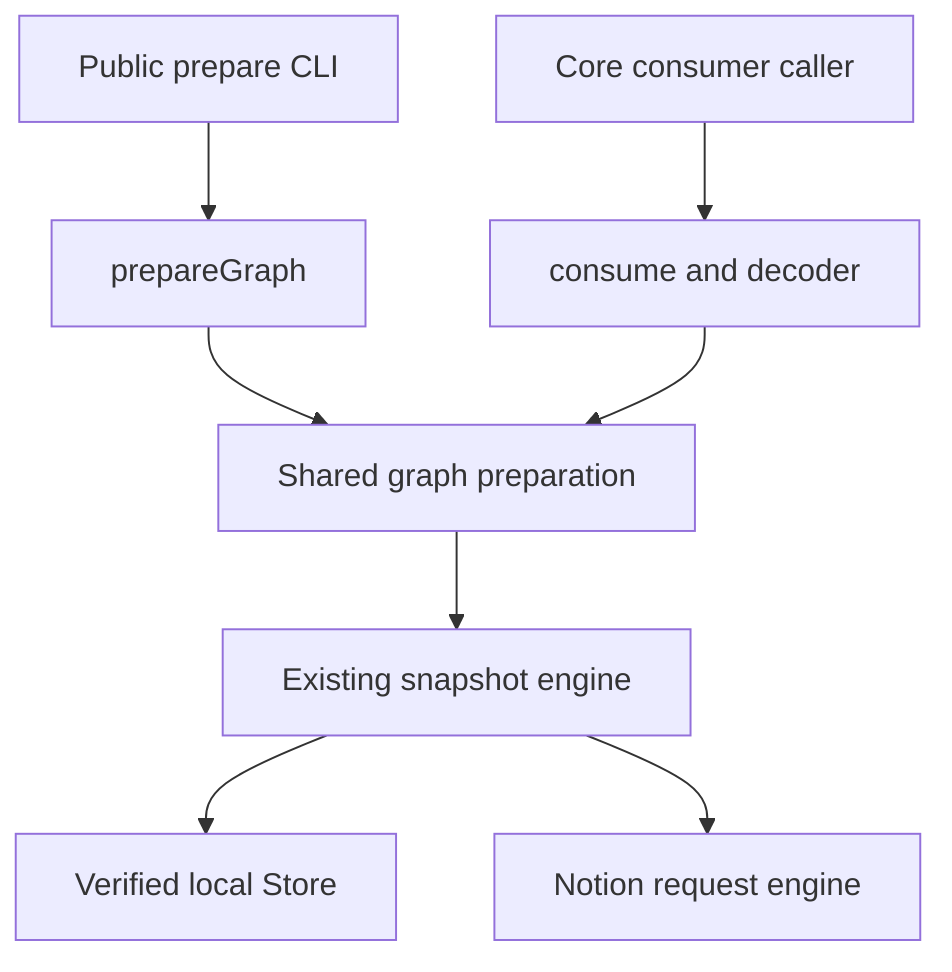

# Skill consumption contract v1

SC03 / AH-620 freezes the executable core boundary for `consume`. The implementation is
`packages/core/src/consumer.ts`; its runtime schemas are composed from the existing
prepare, snapshot and native File schemas in `consumer-model.ts`. The engine and the
decoder use those same schemas. This is not an installed npm SDK acceptance result.

## Entry point and supported work

`consume(input, options)` returns an Effect that requires the existing Notion, Store,
Crypto, filesystem, path and HTTP services. Importing it starts no process, opens no
connection, reads no environment and changes no global runtime. The caller owns the
scoped runtime. `ConsumeInput`, `ConsumeResult`, their runtime schemas,
`decodeConsumeResult`, and the contract/compiler version constants are exported from
this narrow module and the current core index.

```ts
import { consume, type ConsumeInput } from "../packages/core/src/consumer.ts"

const abortController = new AbortController()
const input = {
  version: 1,
  targets: ["shared_skill:library-id:skill-id"],
  purpose: "use",
  freshness: { policy: "default" },
} satisfies ConsumeInput

const operation = consume(input, { signal: abortController.signal })
// Run operation in the existing scoped runtime; inspect the result.status union.
```

The sample relative import is for this repository. SC10 will compile and distribute
the approved SDK surface and connect Broker to it. The current private core package
exports TypeScript source; another repository must not depend on a developer checkout
or pretend this is already the released `ntn-skills` SDK. No new CLI command is added.

| Input | Contract |
| --- | --- |
| `version` | Exactly `1`; unknown versions and extra input fields fail validation. |
| `targets` | Existing prepare exact-target semantics: exact identity/page URL or immutable pin. Historical aliases on an explicit verified pin retain their existing compatibility. Display names and short references do not grant authority. |
| `purpose` | `use` prepares every required Skill in the full closure; `inspect` reads only selected roots and returns related directory metadata. |
| `sessionBindings` | Existing immutable `PrepareBinding` records. Scope, identity, version and body hashes must agree; failed refresh cannot replace an old binding. |
| `freshness`, `budget` | The existing prepare schemas and semantics, without a second freshness owner. |
| `requestedFiles` | Reserved exact pinned file references. Absent or empty is supported. A nonempty list returns `CONSUME_UNSUPPORTED` before I/O until the SC10 read plan is implemented. |
| `projection.compiler` | Absent or `source-identity/v1`. Every other compiler returns `CONSUME_UNSUPPORTED` before I/O. |

Options derive the existing prepare options (`database`, `execution`, `metrics`) and
add an optional `AbortSignal`. There is no daemon, new scheduler, retry owner or separate
credential store.

## Module responsibilities and transport choice



The source engine owns authentication, freshness, retained pins and materialization.
The consumer owns the versioned result and consistency checks. The host owns session
selection, publication to safe local paths, assembled model input and activation.
The future packaged SDK connects these existing owners; it does not create another
cache, scheduler or permission authority.

| Transport | Current boundary and decision |
| --- | --- |
| Per-command CLI subprocess | Works with configured public/custom commands and the existing JSON/error/exit contract. Broker currently pays one prepare process plus a fixed read for each prepared node. Keep this compatibility route until its callers migrate. |
| Shared packaged SDK | Approved direction. One caller-owned scoped runtime executes `consume` and obtains the graph plus the proofs from the same observations. SC10 must prove installed artifact/version compatibility and Broker adoption. This ticket adds the core contract only. |
| Session subprocess RPC | Would add process lifetime, message framing, request cancellation and version negotiation to maintain. It is not the selected architecture and is not introduced to avoid packaging the shared SDK. |

These are code boundary comparisons, not measured speedup claims. SC02 records
actual latency, process and request costs before an implementation is called faster.

## One preparation, two output views

`prepareGraphWithSnapshots` is an internal extraction of the current graph operation.
It returns the normal preparation and the verified snapshot observations already held
by that operation. `prepareGraph` maps this internal result back to its old output;
its CLI JSON shape, graph budget, permission checks and freshness behavior remain intact.

`consume` uses those observations and the already verified main text. It does not call
`readSkill` or `targetSnapshot` again for each node. The same-operation snapshot/object
read counts are covered by a regression comparison against ordinary `prepareGraph`.
The decoder hashes in-memory text and receipts again at the contract boundary. These
checks remain necessary when data crosses a future SDK/CLI transport boundary.

This does not promise one HTTP request, lazy materialization for every source adapter,
or zero remote work. Existing source acquisition and snapshot validation still apply.
Broker still uses its existing prepare + fixed-read path until SC10 migrates it.

## Result states and evidence ownership

| Result or receipt | What it establishes |
| --- | --- |
| `status: ready` | The whole requested prepare operation succeeded, and every prepared entry passed the consumption decoder. |
| `preparation` | Existing selected bindings, roots, required closure, full main text, directories, freshness, budgets and observed-version graph lock. Text is present exactly once here. |
| `entries[].manifest` | Complete immutable file metadata, canonical owner, scope/version/pin, optional stable File bindings and upstream source provenance. `manifest_sha256` binds the complete receipt. |
| `entries[].source_body` | The full selected effective snapshot entry, with matching ref/path/UTF-8 byte count/hash, inclusive line range and `has_more: false`. |
| `materialization.status: entry_ready` | The entry is local and verified; other manifest files may be absent. `paths` lists available files. |
| `materialization.status: all_files_ready` | Every file in this selected manifest is locally available under the snapshot reader's checksum contract. |
| `projection.status: identity` | The only supported model projection retains the exact source entry bytes. Source and projection hashes happen to be equal under this compiler; they remain separate fields. |
| `export.status: not_requested` | No complete filesystem/ZIP export artifact was created or certified by this operation. |
| `delivery.status: not_observed` | This layer has no provider-input evidence. Cached or materialized content is not delivery. |
| `activation.status: not_evaluated` | The host owns instruction activation and must respect `use` versus `inspect`. |
| `status: failed` | Typed `code/message/details`, preserving core preparation errors and partial/deferred observations. There is no successful graph in the outer result. |
| `status: cancelled` | The explicit signal cancelled this operation and its owned work has finished cleanup. There is no preparation or delivery receipt. |

The graph lock remains `observed_version_vector`. It records the versions actually
observed; it is not an atomic Notion transaction across pages. Members and ordinary
references remain candidate metadata. The `use` closure never silently promotes them
to required or active instructions.

The existing `preparation.usage.context_bytes` still measures the old successful
prepare envelope. It does not measure this additional machine receipt or actual model
input. A host must budget its assembled provider input separately and keep machine
proof out of model instructions.

## Source bytes, projection bytes and actual delivery

`source_body.kind` is deliberately `verified_snapshot_entry`. Its hash identifies the
selected effective/generated snapshot file returned by the existing reader. It does
not rename that file to the original authored Notion/portable source. Existing
`read --raw` and export projection semantics are unchanged.

`manifest.source_projection`, when present, describes upstream source provenance.
It is not the model projection compiler. `source-identity/v1` records the verified
entry hash, the hash of the prepared node's Required/Member/reference directories,
the compiler identifier, and the identical output byte hash/count. No new reduced
projection is accepted by this implementation.

A future projection compiler must bind its precise source files and relation input,
compiler version and output bytes. A future delivery receipt must additionally bind
those output bytes to the host's actual provider input/span. A log saying loaded,
a summary, cached content, session selection, or marker surviving compaction cannot
replace full-content provider evidence. Missing/truncated traces cannot establish
zero requests or successful delivery.

## Checks formerly added by the per-node fixed read

The new response must carry these checks before a caller may remove its additional
read. `decodeConsumeResult` is the executable validator; schema decoding alone only
checks shape. Supply the original decoded input as its second argument when accepting
a response for a particular request. The producer always does so.

| Check | Source and validation |
| --- | --- |
| Exact selected record | The same verified snapshot supplies node, binding and manifest. Their record fields must agree; shared logical library/Skill IDs and physical page/database/data-source IDs are checked. Same names in different libraries remain distinct. |
| Enabled content and main kind/path | Existing graph selection rejects disabled content and non-Skill implicit requirements. Consumer additionally checks record kind/entrypoint, main existence and exact owner/ref. |
| Scope/credential domain | Graph preparation selects the existing authenticated or offline-cached opaque scope. Every manifest and binding must match that scope. No credential bytes are returned. |
| Snapshot/version pin | Manifest, binding and ref identify the same immutable snapshot/version. Snapshot identity and graph-lock digests are checked; session version/hash conflicts keep their existing errors. |
| Stable File bindings | File IDs, physical pages and paths are unique; every binding belongs to the complete manifest. When bindings are present, the main File must point to the selected shared Skill page and agree with the main ref's File ID. Legacy manifests without stable bindings remain explicitly without them. |
| Complete manifest | All files have normalized relative paths, safe byte counts and SHA-256 identities. The node's pinned file directory must exactly match the manifest. Manifest completeness is separate from byte availability. |
| Full text | UTF-8 byte count and source/body/binding/main-file hashes agree. NUL text is rejected. Range starts at 1 and ends at the actual total line count; `has_more` is exactly false. BOM and CRLF survive. |
| Freshness and access | The original snapshot observation/freshness is preserved in each prepared node. Consumer uses the same access owner, with no synthetic refreshed timestamp or second network permission check. |
| Required closure and graph lock | Roots, selected bindings, edges, complete use closure, usage/budget and lock digest agree. Missing/partial/deferred preparation never becomes ready. Inspect never gains dependency bodies. |
| Materialization | Available paths include the entry and are a subset of the manifest; `all_files_ready` agrees with the complete path set. A retained manifest with only entry bytes remains `entry_ready`. |
| Projection | Only source identity is implemented; body, relation input, compiler and projection hashes are checked. Unsupported compilers fail before acquisition. |

This receipt is not a signature or a new authorization grant. Offline decoding proves
internal consistency. Trust in scope/access still comes from the selected core runtime
and its verified snapshot reader. Consumers compare the response to the requested
targets and selected source before adopting it.

### Preserve the existing access boundary

A complete local immutable pin can be read under the existing locally selected scope
without requesting fresh access to its former remote page. If a retained pin lacks
bytes and must acquire them online, `openRetainedSnapshot` revalidates the current
library/Records identity and current Skill access before fetching exact old-pin
bytes. It never substitutes the current body. Neither behavior changes here.

`--refresh` and `--max-age 0` currently force a full current observation. Ordinary
positive TTL expiration can revalidate metadata while the separate body deadline is
still valid. The contract preserves the distinction and the reported freshness data.

## Errors, cancellation and CLI equivalence

The typed failure preserves the existing `SkillsError` code, message and details.
The current CLI maps the same underlying prepare failure to its existing
`ok: false/error` envelope (exit 2 for `INVALID_ARGUMENT`, otherwise 1). Successful
`preparation` is the same object ordinary `prepareGraph` returns. Transport metadata
and process exit status are not additional content evidence.

New input schema errors use `INVALID_ARGUMENT`; unsupported requested files or
projection compilers use `CONSUME_UNSUPPORTED`; inconsistent result evidence fails
`decodeConsumeResult` with `CONSUME_INVALID_PROOF`. Unknown versions fail closed.
Operational errors, required-content failures and deferred observations retain their
existing codes, including any partial preparation in `details`.

An explicit `options.signal` returns `cancelled` after interrupting and awaiting owned
request cleanup. A signal already aborted at entry does no work. External Effect
fiber interruption retains normal interruption semantics rather than being swallowed;
the current CLI continues to exit 130 for interruption. Defects remain Effect failures,
not successful or typed operational receipts. Hosts must never commit session bindings
or activation from failed/cancelled outcomes, and must retain old bindings after an
unsuccessful refresh.

## Caller migration and remaining boundaries

| Existing caller | Migration and retained obligation |
| --- | --- |
| CLI `commands-prepare.ts` | Continue to expose the existing `prepareGraph` JSON, errors and exit codes. Future public consume output must negotiate the contract version explicitly. |
| CLI `commands-content.ts` read/files/export | Keep exact source/read/export semantics and immutable pins. Do not replace raw/export output with model projection. |
| Broker `requestPreparedGraph` / `loadPreparedEntry` | SC10 adopts the installed consumer result and removes the per-node process only after equivalence. Preserve selected-source checks and safe local publication. |
| Broker explicit selection, native read and `skill_prepare` | Adopt a successful complete result before committing bindings. Failed/cancelled consumption must not publish partial instructions. |
| Broker prefetch | No session binding, delivery or activation claim; its source work remains on the cost ledger. |
| Broker `loadNotionResource` | Move to the requested-file plan once implemented. A manifest alone does not prove resource bytes are ready. |
| Broker `loadNotionSkill` and custom source commands | Preserve the full-export compatibility route and explicitly configured command behavior until migration is complete. |
| Snapshot history, management writes and recovery | Keep existing operation identities and unknown-write recovery. They are outside partial instruction consumption. |

SC10 should connect Broker's `requestPreparedGraph`/`loadPreparedEntry` owner to the
released consumer and remove per-node subprocess reads only after fixture equivalence.
`decodePreparedGraph` can then use this authoritative decoder/types. Broker still owns
strict source matching, host path/symlink protection, local receipt/file publication,
resource output verification, session commit, actual provider delivery and activation.
Those checks must not disappear with the additional read.

Prefetch continues to inspect without a session lock or delivery. `loadNotionResource`
will migrate when the requested-file read plan is implemented. The legacy
`loadNotionSkill` full-export route and custom source-command transports need explicit
migration; SDK adoption must not silently bypass their configured behavior.

Management writes, history retention, snapshot export and publication recovery remain
their existing operations. This change does not move them into partial consumption.
Formal package installation, SDK/CLI artifact negotiation, production Broker adoption,
new model projection and real model acceptance remain subsequent tasks.

## Regression entry points

```sh
bun test packages/core/test/consumer.test.ts packages/core/test/graph-prepare.test.ts --timeout 30000
bun test packages/cli/test/prepare.test.ts --timeout 30000
bun run typecheck
```

Core tests exercise the actual consumer and decoder, identical read counts versus
prepare, exact fixed-read parity, same-name different-library ownership, wrong main
File binding, truncated/ranged/hash-corrupt proof, unknown schemas, missing required
pins, version conflicts, real retained partial materialization, unsupported capabilities,
and both cancellation paths. The existing packaged Node CLI fixture covers actual
SQLite pins, complete/inspect boundaries, error envelopes and BOM/CRLF raw/export bytes.
These are contract/runtime checks, not formal published-SDK or provider-delivery proof.
