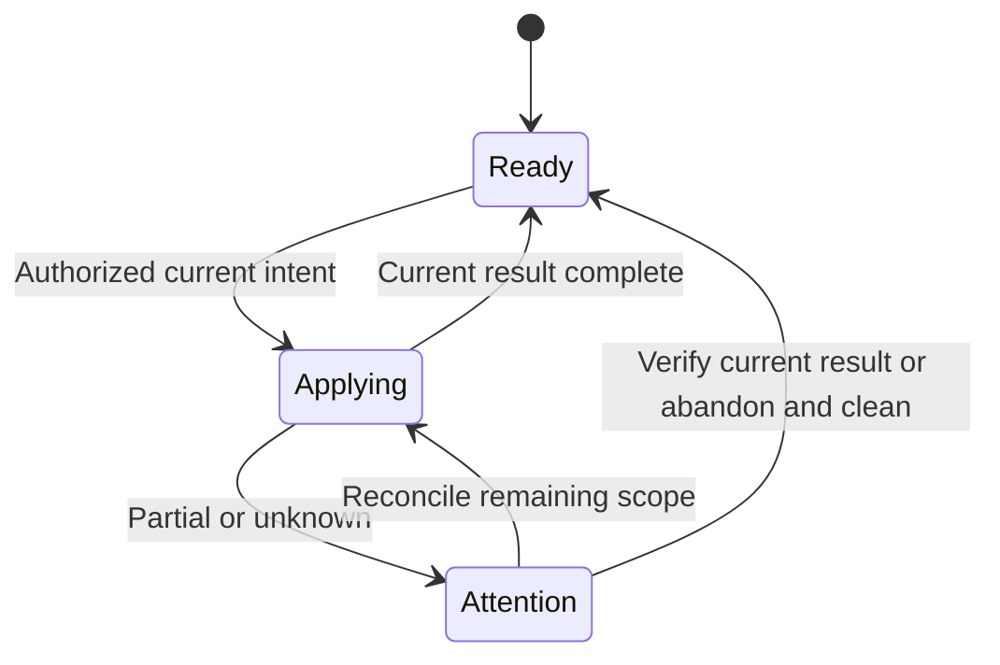

# Current library contract

This is the implementation contract for the single `next` line. Notion owns current
management decisions and Notion-authored content. Git-only, mixed and Notion-native
Skills share this contract. The system does not retain content versions, page
generations, historical graph releases or permanent recovery pins.

The work is tracked by [AH-499](https://linear.app/yoyooyooo/issue/AH-499) and its
[implementation parent](https://linear.app/yoyooyooo/issue/AH-498). This document
defines the current behavior and its remaining delivery scope. The installed Pro
CLI/SDK/Broker already has a bounded native, Git and resource consumption baseline.
That baseline does not establish that every daily Skill or the long tail has been
converted. Daily acceptance also requires complete readable main and supporting
text in Notion. The last section separates that work from non-daily projection,
binary presentation and unrelated cleanup.

## One current owner for each fact

| Table | Current responsibility | Authoritative writer | Rebuildable display |
| --- | --- | --- | --- |
| Skills | Stable Skill/Router/Prompt identity, management metadata, enablement, default discovery, main-file binding, Members and Requires | Human metadata edits and the current management kernel; identity and relationship changes use that kernel | Source-backed main-body rendering and supporting-file navigation |
| Files | Every supporting file, stable File ID, exact Skill owner, logical path, authority and current content locator | Current management kernel; native author bodies remain directly editable in Notion | Full source/resource text rendering, attachments and reading status |
| Sources | Current provider, location, selected revision, selected members, target mappings and file exclusions | Current source-management kernel | Last-check result and reciprocal navigation |
| Records | Necessary current exact-byte objects, one current Profile configuration, and unfinished management intents | The corresponding resource, Profile or operation writer | Human labels; no content history |

Every current registered library has all four tables, registered Members/Requires,
Skills and Records Origin relations, and the Files Origin rollup. A purely
Notion-authored library leaves Sources empty. Normal discovery, consumption,
management and initialization reject an incomplete older layout; the independent
read-only extractor does not admit it into the current runtime.

The main document lives on the Skills page. Its stable `Main File ID` participates
in the same file namespace, but Files does not contain another editable main
document. Every other effective path has one Files row, including files supplied
entirely by Git. A complete local or SDK directory is not a substitute for those
human-readable rows.

Use registered property IDs for access. Display names, including names ending in
`1`, are not identities or sufficient evidence for deletion. The cutover resolves
each actual property ID once, preserves the chosen binding, and removes duplicate
properties only after their current data and inbound relationships have been
accounted for.

## Fields and relationships

### Skills

Keep `Name`, `Description`, `Kind`, `Tags`, `Enabled`, `Default Context`, `Skill ID`,
`Main File ID`, `Members` and `Requires`. Name and Description manage discovery;
they do not silently rewrite source bytes or a file's authored frontmatter.

`Content` holds the main file's current descriptor. `Current State` and `Operation`
decode into either `ready` with no operation, or `applying` / `attention` with one
stable current operation ID. A normal reader stops before body acquisition when
the Skill is not ready. Inspection may return that state for explicit management;
it does not load an old operation journal or reconcile it as a read side effect.

The main file has the same current authority/content descriptor as a supporting
file. Its page body is either the current native author body or a generated reading
projection. The descriptor makes that distinction explicit. Editing a generated
page does not silently transfer authority.

`Supporting Files` is the reciprocal Files-to-Skill relationship. `Origin` names
current Source contributions; native Skills do not need an artificial Source.
Source membership and mount mappings belong to the current contribution, not to a
historical import or publication record. Multiple Sources may contribute to one
Skill, but two contributors cannot claim the same effective path without an
explicit whole-file override.

Retire old `Source` values that select snapshot/archive carriers, `Source Archive`
attachments, publication status/proof fields, and the old `Projection` ownership
marker. A display fingerprint may be retained as disposable projection metadata;
it cannot decide file ownership. Replace the text `References` mirror with current
typed Members/Requires and body references where those carry the intended meaning.
Do not keep both an editable relation and an independently authoritative JSON copy.

### Files and main-file descriptors

Keep `Name` as display, `File ID` as stable identity, `Path` as a canonical relative
path and `Skill` as exactly one owner. Store one `Content` JSON descriptor. Its
discriminant determines authority and representation, so a separately editable
Authority or Status column cannot drift from the locator:

| Current authority and representation | Bytes come from | What the Notion body means |
| --- | --- | --- |
| Notion native Markdown | Current page body plus explicitly stored current file metadata | Editable author content |
| Notion exact resource | Current Records resource locator and exact size/hash/mode | Generated full text for readable resources; non-text display is optional |
| Selected Source file | Current Source contribution, exact selected revision and source path | Generated full text; non-text display is optional |

The one accepted descriptor union is:

```ts
type Content =
  | { kind: "native"; mode: "100644" | "100755"; frontmatter: string }
  | { kind: "resource"; object_id: string; sha256: string; bytes: number; mode: "100644" | "100755" }
  | { kind: "source"; source_id: string; revision: string; source_path: string; sha256: string; bytes: number; mode: "100644" | "100755" }
```

`native` and `resource` are Notion-owned. A native header is exact current file
metadata; an empty string means known absence. It has no stored body hash to block
a human edit. Resource and Source descriptors require a complete hash, byte count
and mode before publication. An absent descriptor returns `CURRENT_SCHEMA_REQUIRED`
with `next=migrate_current_content`; no Projection, event or title fallback exists.

Authority describes who controls the file. Representation describes how its bytes
are stored. A resource managed by Notion is still Notion-owned even when its exact
bytes are in Records and its Files body is generated. The UI and CLI must say which
body is editable author content. They must never infer authority from whether a
page has Markdown, from its title, or from the presence of a projection hash.

The descriptor contains only applicable current facts: representation, mode,
current native frontmatter where needed, current resource locator or current
Source/path binding. Raw resource and source descriptors include exact byte size
and content identity. Native author bodies are hashed after reading; a stale
stored hash must not prevent a direct Notion edit from being read. Reading that edit
writes only disposable local cache data, never an adoption event or remote object.

For native text, specify normalization and round-trip behavior. Do not claim to
preserve arbitrary source bytes through a native representation that changes them.
If native transport cannot preserve the selected text, use its **current** exact
resource and render the entire readable text. Native import refuses invalid input
or leaves an unconfirmed round trip unfinished; it never silently changes authority.
Import never silently normalizes a
BOM, line ending or executable mode. An explicitly requested conversion is a new
current edit, not a reason to keep both past and present content.

`following/custom/tombstone` event-derived status is retired. Authority is direct.
Deletion removes the active row. If an upstream path still exists, its exclusion
is kept in the current Source contribution so refresh cannot resurrect it. This
exclusion contains no old file bytes. Renaming a source-backed file updates its
current mapping while preserving File ID; it does not leave an old-path file row.

An explicit whole-file takeover changes authority to Notion after writing and
checking the complete selected file. It preserves File ID, physical page and Path,
and excludes the exact member-relative path in its current contribution.
Restore-follow explicitly selects a Source/path and uses its currently selected
original. It may overwrite customization without keeping a backup. No permanent
old origin is retained: Skills.Origin is recomputed from effective Source files.

Current Source apply/refresh coordinates file mapping and exclusions through
`Sources.Contributions`. `Sources.Selection.exclude` selects member roots; it is
not a per-file exclusion mechanism. Source takeover/restore-follow and lifecycle
commands own their explicit management scope. Complete local import refuses to
replace Source-owned files or bypass their contributions.

### Sources

The current Source contains provider/location, a concrete selected revision,
member selection, contribution mapping and exact file exclusions.
`Ref` may express the desired upstream branch/tag; `Last Revision` identifies the
resolved content selection. Ordinary reads do not advance it. A source check may
report a newer revision; only authorized management applies it.

Reuse existing Provider, Location, Ref, Selection, Options, Enabled and Policy
bindings where their meanings fit. `Last Revision` becomes the current selected
revision rather than a history cursor. Policy admits only manual and pinned;
there is no automatic refresh scheduler or inert storage-selection option.
`Contributions` holds the complete member-to-stable-Skill assignments, mount paths,
exact member-relative mappings and persistent file exclusions. It is separate
from the provider plan: changing an exclusion does not change that plan's hash.
`Status` and `Operation` use the same ready/empty or applying/attention/one-intent
state as Skills. Ordinary Source acquisition rejects unfinished or invalid state.
Source definitions, member roots and contributions must be reconstructible from
Notion with an empty local cache. Machine paths and credentials remain local
bindings; a missing binding fails explicitly and does not authorize uploading
private local bytes.

A Source needs a complete current manifest. Keep a bounded manifest inline or use
a current exact-resource locator for a large manifest; do not add a manifest-history
table. Shared targets retain each Source's separate contribution. Enabled controls
ordinary consumption eligibility. Disabling a Source preserves file authority,
reading projections and each Skill's enabled value. It does not mean pausing a
scheduler. Removal requires no current Source Content or Origin references and
never silently deletes Skills or converts their files.

The current reader decodes Sources `Content` as `{version: 1, plan}`. The plan owns
the complete selected provider layout and exact upstream identities. `Last Revision`
is the SHA-256 fingerprint of its normalized current plan. Each source-owned File
selects the stable Source ID, that fingerprint and its source path. The underlying
Git commit or other provider identity remains inside the plan; the fingerprint is
not a content-version history or an instruction to follow a moving branch.

Routers retain their explicitly authored membership. Requires expands mandatory
Skill dependencies; Members provides candidates. Disabled content and permission-denied
content remain distinct results, and a failing dependency identifies its owner.

### Records

Only three durable kinds are needed at the target boundary:

| Kind | Current key and owner | Lifetime |
| --- | --- | --- |
| Resource | Exact current object/chunk identity plus the current Skill/File or Source owner | While referenced by current data or an unfinished authorized write |
| Profile | Stable library/Profile ID; current name, enabled state, default View and freshness rules | One current record, updated in place |
| Operation | Stable current intent ID and its exact affected owner/path set | Only while needed to finish, reconcile or abandon that intent |

Hash, size and mode verify current bytes. They do not promise historical retrieval.
The current resource implementation uses one Record. Readable originals of at
most 32 KiB may be inline Base64. Opaque files and larger originals use the
registered `Resource` attachment, up to 64 MiB of original bytes. Unsupported
upload types use a deterministic ZIP containing that one original path and mode.
The reader checks both the container and extracted original, and export restores
the original bytes. This is a current original, not a Skill bundle or history.
The payload describes current hash, size, mode and storage representation.
It never stores an expiring download URL as identity. The attachment response,
host, timeout, byte bound and final hash are checked before accepting bytes.
Replacing a resource may create its current object before switching the pointer;
unreferenced old objects are collected after checking current and unfinished-write
references. No old pointer or snapshot is retained to preserve a version.

A Profile has no parent revision or revision graph. A current fingerprint may
detect a changed baseline for a management action; it is not a stored predecessor
or a distributed compare-and-swap guarantee. Multiple current rows for one stable
Profile ID are a duplicate to reconcile, not competing branches to replay.

The target removes `file_event`, `snapshot`, `archive`, historical Source bundles,
original-review/completion chains and Profile revision rows. Old `object` rows are
not all garbage: first move any uniquely current bytes they still hold, then
remove the obsolete carrier and all its references.

## Current operations and state

The operation result distinguishes budget exhaustion, user cancellation, partial
success, conflict and unknown remote outcome. The persistent states stay small:



`Ready` is established from the actual current scope, required relationships and
usable content. A missing old ACK, ancestor event or historical completion cannot
invalidate an already-correct current result. An affected incomplete Skill cannot
be reported as a complete tree; unrelated ready members remain usable.

For unknown CREATE outcomes, query the exact stable current identity before any
retry. For replacement, compare current intended content and reconcile only the
remaining work. Do not reconstruct an old success claim. A completed or explicitly
abandoned intent is removed after its current effects and any late duplicate have
been accounted for. There is no second permanent acceptance/completion ceremony.

Notion property writes, `last_edited_time` and local mutexes are not distributed
CAS. Overlapping writers must stop or surface a conflict. The cutover stops old
writers before converting their data. This contract does not introduce a central
coordinator or promise atomic publication of an entire multi-Skill Source batch.

## Consumer and reading projection

List, read, use, resource read and export perform zero semantic remote writes.
They do not repair pages, retain history, update a selected Source or clear residue.
Management owns those actions. A current reader only needs current identities,
permissions, relationships, selected Source data and usable bytes.

Keep a complete file directory separate from the set of locally materialized
paths. Fetch the entry first, then exact requested files. Acquisition v5 has one
library binding and per-file source or resource routes. Each source route carries
its own stable Source ID, current revision and source path, so one Skill can read
multiple declared Sources. There is no singleton source or Git-only reader branch.
It has one accepted schema; old acquisition decoders are removed.
Protocol numbers identify incompatible wire formats, not content versions.

Validate local Markdown references against the complete current file tree. Ordinary
links may identify files or real directories derived from those file paths, with
or without a trailing slash; they do not require an invented README. Images must
identify files. Missing targets, unsafe paths and relative paths escaping the
Skill remain errors. Escaped HTML is literal authored text, not a link attribute.
Cross-Skill targets require explicit stable references rather than guessing from
adjacent display names.

The public SDK is version 2. Hosts must require this exact SDK contract before
using current consumption. Source management methods and the public `readOnly`
input are removed; all consumption is already read only. Consumer and resource
result formats remain version 1. SDK v1 is not an alternate current reader.

A task selection may retain its exact directory and bytes in local cache for
consistent delivery. If that local selection or required content has gone, return
an actionable reselection error. Never replace missing selected bytes with later
page content, revive a remote historical snapshot, or promise permanent/cross-machine
recovery. A historical snapshot cannot be reintroduced under a generic Source kind.

Pure reading columns, generated layout and unrelated library-property bindings
must not change effective content identity. Hash content, path/mode, authority,
selected source revision and required consumption semantics. Refresh current
display metadata separately; a cache hit must not freeze an obsolete owner
descriptor or undo a known permission denial.

Rebuilding a Notion Skill page preserves its stable Skill identity. Once a current
read verifies the replacement page, discard native-body observations from the old
physical page and read the replacement's bodies. The same logical cache owner and
monotonic generation fence apply: an older completion cannot overwrite the newer
page, and equal generations cannot name different pages. Scope, library and stable
Skill mismatches remain errors. Fixed local selections retain their original
bindings; ordinary current refresh does not require clearing the Store.
The consumption version includes the exact owner locator and physical File
bindings, so recreating a page produces a new version and fixed snapshot even
when its original bytes are unchanged. Stable Skill identity, Source revision
and file hashes retain their own meanings. The snapshot-ID formula is unchanged;
previous fixed references keep their original authorized bindings.

Every supporting file has complete current Files metadata. Source and resource
consumption reads its declared exact original without requiring a generated page
body. Native author bodies remain necessary current content and are verified before
ready. Generated projections are not a commit gate for synchronization or import.
Explicit `ctl library projection` generates them after current content is ready.
Daily acceptance requires every selected Skill main and text supporting file to
have its complete readable body on the existing Skills or Files page. Truncation,
hash-only notes, a download link or a cache path do not count as text coverage.
Native author bodies are verified without replacement. Non-text files are
reported as skipped and retain their exact original consumption route; generated
image, font or other binary bodies are not required for daily text acceptance.

Explicit export supports a whole Skill or an explicit path set, preserving complete
selected bytes and modes. Missing paths, unsafe paths, collisions and cancellation
are reported accurately. Export/edit/import replaces current selected content
through the same management writer. There is no separate backup/version subsystem.

Pi is the first daily host. Its Notion consumption uses the current paired SDK for
discovery, consume and resource reads; no custom-command or CLI full-export fallback
remains. The CLI remains available for explicit management and diagnostics.
OMP/Tern adaptation and host acceptance are deferred. Their local Skill content
still belongs in the Pro migration inventory.

## Requests, cleanup and the finite cutover

Preserve the existing request engine, complete pagination, scoped metadata batches,
TTL cache, read coalescing and request attribution. A limit applies to one invocation,
including its retries and children. A resumed invocation gets a new budget. A
partial page or exhausted budget cannot establish absence, authorize deletion or
claim a complete inventory. Fetch only changed/requested bodies after metadata
admission; do not scan Records history to answer a current read.

The implementation proceeds on `next` without compatibility readers, dual writers,
legacy flags or a parallel daily protocol:

1. Freeze the current field/owner contract and stop old writers for the selected
   cutover scope. Build the paired CLI/SDK/Broker artifact from that contract.
2. Run a finite conversion that reads old carriers only to extract current unique
   content and current management intent. Old plans, receipts and caches do not
   become authority for the new model.
3. Write complete current rows and original content. Verify the selected daily
   scope, full paths, bytes/modes, relationships and ordinary zero-write reads.
   Generated reading projections do not delay consumption.
4. Remove replaced runtime readers, writers, APIs, commands, flags, configuration
   decoders, callers, dedicated tests and guides in the same implementation wave.
   Remove each completed batch's one-time conversion entry and runtime admission
   wiring. Unmigrated non-daily rows do not justify retaining an old runtime path.
   Notion projection and unrelated old-data cleanup remain separate work. Keep
   agent-kit main-path Skills and global exposure; isolate Pi verification with `pi -ns`.
5. Clear incompatible disposable sessions/caches and select current content. Keep
   any still-unique local author copy until that item has a verified current home.

Local SQLite has one current physical schema. Its file-header application ID is
checked with a read-only file handle before opening the database driver. A retired
database returns `STATE_CUTOVER_REQUIRED`; it is not migrated, cleared or opened in
WAL mode. Choose an explicit fresh `NTN_SKILLS_HOME`. If the configuration still
contains retired sync or upstream bindings, also choose a fresh
`NTN_SKILLS_CONFIG_HOME`. Keep the old database, sidecars and objects unchanged for
the finite read-only extractor. Changing only `NTN_SKILLS_CACHE_HOME` does not move
the state database. Current pending operations and fixed local content survive
normal process restarts within the current schema; an old operation is not silently
reinterpreted as a new one. This schema boundary is not content version management.

Pro inventory distinguishes active local assets and real host registrations from
copies in old worktrees, package caches and verification exports. Physical
`SKILL.md` counts are not the migration denominator. An uninspected or sensitive
scope remains explicitly unresolved; it is never silently counted as migrated.
AK Models, Agents, providers and unrelated host operations remain separate assets.

Use the existing verification Skills and the
[bounded current-convergence journey](https://github.com/yoyooyooo/notion-skills-cli/blob/next/.cursor/skills/verify-ntn-skills/features/current-convergence.md).
The six checks have explicit stop conditions; do not add another runner, evidence
archive, recursive proof requirement or broad new platform. The final shared
journey is the real Notion → CLI/SDK → Pi use, followed by the scoped residue check.
First daily use does not close the separate Pro-wide migration task.

## Implementation status and remaining cutover blockers

Current tree assembly now reads Skills/Files `Content`, complete current membership
and current Source plans. Native reads use a disposable local body observation.
They never query event DAGs, adopt edits, reconcile operations or require original
completion records. Current native alias completion remains a read-only fidelity
check for actual unsupported Notion export nodes; it is not a historical operation
gate. Acquisition v5 checks current ownership and locators before obtaining missing
selected resource or Source bytes. Old cached selections require reselection.

The Promise SDK exposes only `SDK_VERSION=2`. Ordinary consumption always rejects
remote writes; the old `readOnly` option is rejected before a runtime starts.
Broker requires the matching SDK and package manifest. It does not load an older
SDK or use a CLI consumer fallback. Local ZIP exports follow the portable tree's
128 MiB expanded-size and 10,000-entry limits; remote upload limits do not constrain
local backups.

Current Profile management replaces one stable Record page in place. Fingerprints
describe current rules; duplicate pages fail, unknown writes reconcile without
replay, and completion clears finite local pending state. The public route is
`ctl library profile`, singular.

The registered CLI exposes current consumption, library initialization,
inspection, complete current import, Source apply/refresh, text projection,
Profiles and local configuration. Import is
`ctl library import INPUT --entry DB --skill-id ID`; `--dry-run` inspects the
replacement, and `--operation ID --resume` supplies the same input to its finite
intent. Default import keeps exact originals as Notion resources without waiting
for generated text projections. Repeated `--native PATH` selects editable UTF-8/LF bodies with exact
stored frontmatter and mode; that selection must remain identical on resume.
Actual native round-trip verification precedes ready. Reimport replaces the chosen
native content, so a local copy does not automatically merge a later Notion edit.
Import preserves the physical Skill, stable retained File IDs and
unspecified enablement, default-context and authored relations. Removed Notion-owned
supporting Files and unreferenced owned resources are trashed after current content
is checked.

The common inspect/write preflight returns `CURRENT_SOURCE_MANAGEMENT_REQUIRED`
before operation allocation or mutation if an existing Source file is omitted,
reidentified, renamed, changed to native/resource, or rebound to another Source ID
or source path. It uses the already-read current directory. The same File identity,
logical path and Source binding may select a new revision, hash, size or mode only
when those values match the current Source manifest. Preserving Source files while
editing other Notion-owned files is supported by the core writer. The public import
CLI chooses resource or explicit native authority, so it rejects targets containing
any Source file, including an unchanged exported tree. Coordinated Source writes
use typed preserved bindings for other current files; preserved body bytes do not
become part of the frozen Source input or get rewritten during resume.

`ctl library source apply INPUT --entry DB` creates or replaces a complete current
Source declaration. `source refresh SOURCE_ID --entry DB` reads that declaration
from Notion and enters the same writer. Both support dry-run and explicit
same-operation resume. Regular Git content from GitHub or credential-free private
HTTP(S) origins uses the same current contract and machine authentication. Manual
policy resolves the configured ref; pinned policy retains its exact commit.
Discovery reconciles the full selected set, including additions, removals and an
empty result. Existing contributions override stable member identities; unassigned
new members receive deterministic identities. Incomplete discovery or a provider
failure never means deletion. Unsupported transformations and symlinks are refused.
Mappings retain File identity on rename. Explicit desired paths can replace matching
native/resource files, and dry-run reports that authority replacement. Exact
contribution exclusions preserve intentional native/resource files; other Sources
cannot be overwritten. When a removed member is wholly owned by this Source, its
Files and Skill are archived. A target retaining unrelated author content is not
silently deleted. Reapplying a saved declaration can recreate a deleted Source or
Skill. Human policy values cannot be reconstructed from upstream content and must
be preserved on surviving pages or supplied separately when rebuilding.

`source takeover SOURCE_ID SOURCE_PATH --skill-id ID --file-id ID --as native|resource`
transfers exactly one selected original into Notion authority. Resource is the
default representation. Native requires actual supported UTF-8/LF Markdown and a
successful Notion round-trip; failure does not silently switch representation.
`source restore-follow` takes the same exact coordinates and follows the Source's
already-selected plan. Neither action discovers a new Git HEAD. Both adjust the
current contribution, preserve all other files, and keep the selected File/page/
path identities. Restore-follow requires enabled; takeover may rescue an exact
original from a disabled but complete Source through the management reader.

`source enable|disable SOURCE_ID` changes only Source consumption eligibility.
`source remove SOURCE_ID` first enumerates this library's complete Skills and Files
metadata independently. Semantic Content decoding finds references even when
Origin is absent; orphan Files, incomplete pagination and stale Origin links
prevent a clean-removal claim. Referenced files must first be explicitly taken
over. An unreferenced Source retires its owned resources and page, then the finite
operation. Its terminal state is removed; it is never temporarily republished
ready during retirement. A metadata action does not generate per-Skill writes.

Source-owned binaries retain Source authority and use the same fixed provider
original as other Source files. A generated attachment is not required for their
consumption. Source manifest resources belong to that Source and are collected
after the current manifest changes. The full effective tree, native references
and exact target scope are checked before completion.

`ctl library projection PAGE_ID --entry DB` generates complete current source/resource
text on one Skill and its existing supporting Files. `--dry-run` reads current
originals and projected bodies without writes. Equal complete text is a zero-write
no-op. `--daily` replaces PAGE_ID with Source 日用 members ∪ Skill 日用 ∪ Default
Context, using current Source contributions and complete metadata pagination.
Enabled and 期望删除 are preserved and reported, including disabled daily choices.
Absent current metadata, unavailable bytes or incomplete traversal cannot become
an omitted or successful target.

Projection uses the same finite operation kernel with a `projection: true` intent.
It leaves the real Skill ready and does not bind generated-body recovery to
ordinary consumption. The intent freezes the current file bindings and content;
native bodies are checked without writing them. Single-Skill recovery uses the
same `--operation ID --resume`. There is no projection supersede mode. Daily runs
execute one Skill intent at a time and stop on the first failure, returning
completed/remaining scope and the exact failed-Skill operation. Resume that Skill,
then rerun daily; `--daily` rejects `--operation` and `--resume`. All targets share
one invocation budget, with the same defaults and limit flags as import.

One finite parent intent freezes its action and affected Skill IDs. Declaration
actions also freeze effective configuration, Git commit and the exact physical
identities of members being retired. File authority actions freeze
the current Source selection, exact File coordinates, before/after configuration
hashes and any temporary native-body precondition. These are unfinished intent
inputs, not durable content versions.
Its mutable next-target cursor distinguishes completed, in-flight and untouched
children. Child intents use the same operation kernel, exact parent authorization
and selected input. Recovery can finish untouched later targets without reopening
completed children for new mutations. All targets are verified before Source ready;
parent/child operation records are then retired. An entirely equal invocation
does not allocate any remote intent.

Portable Members/Requires round-trip as complete current stable-ref sets. Omitted
fields preserve, [] clears, and lists replace. Prompt relations are invalid. The
writer checks same-library single-property schema, complete pagination and unique
enabled ready targets before mutation. Changed sets are limited to 100 targets;
larger unchanged sets are retained. Changed Requires checks its reachable metadata
closure for cycles and rechecks it before ready, including an unfinished resume.
Relation mutations share the same finite current intent and frozen physical IDs.

Import has one default budget of 1000 HTTP attempts, 512 MiB payload bytes and
600000 ms, including initial library lookup and all remaining network work.
--max-requests, --max-bytes and --timeout in ms can choose positive limits. Nested
writers share the allowance, exhaustion stops new dispatch, and a fresh explicit
resume gets a fresh budget. Actual response bytes may overshoot a byte limit at
the boundary of an already admitted response; the result reports that cost.
Source uses that same budget for its Notion and managed HTTP work. Git subprocess
acquisition shares the deadline and has file bounds and object-byte metrics; its
internal HTTP count and wire bytes are not measured by those request/byte limits.

The writer opens an operation only when an actual change is needed. A complete
no-op performs zero semantic remote writes. One mutable action marker supports
interruption without a permanent ACK log. Completed state becomes ready before
the operation is retired. Unknown CREATE or append is never repeated from absence;
an observed partial append is not automatically replayed.

After stopping the old writer, `--operation NEW --supersede OLD` explicitly
replaces its goal with a complete new input. The local pending row and the same
physical Operation Record retain one finite predecessor while their pointers
change; ordinary pending updates still cannot change intent identity. Product
mutations wait until the handoff is coherent. Source successors remain within
the original action kind and parent authorization; a single-file action cannot
discard an unfinished multi-target declaration. Complete verification precedes
ready and deletion of the handoff. A bare abandon does not clear Operation and
pretend partial content is complete.

The local owner lock excludes cooperating writers sharing that Store. It cannot
cancel an already dispatched request or fence another machine. Explicit supersede
therefore cannot promise that an unknown CREATE will never arrive later. Visible
duplicate identities and changed bindings fail closed; completion proves the
observed current result. No permanent tombstone or predecessor chain watches for
unbounded late responses.

`ctl library operation OWNER_ID --kind skill|source --entry DB` reads the exact
current intent, local phase, remote Record, owner observation and in-flight action
without mutations. `status: not_found` with `operation: null` says only that no
intent was observed; it does not prove the owner is ready or retired. If a parent
successor has not yet taken over its predecessor's pending child, another new
successor is refused before parent writes. It must first resume that current
handoff. This check probes at most the previous cursor's one child, not an ancestor
history or one operation query per member.

Old create/apply/write/replace/adopt, sync, archive, graph-release, repair and
migration command families are not active authoring routes. Source actions use
the current coordinator; general cross-object governance still needs implementation.
Removing a command does not prove that every old module, export or guide is gone.

The current delivery scope is the user-selected daily set, tracked by AH-504/AH-516.
The selection is Source 日用 (all real members) ∪ Skill 日用 ∪ Default Context,
with actual upstream membership used to repair broken Origin relations. 日用 does
not imply Default Context. The initial analysis selected 142 current members;
complete discovery recalculates that number when upstream changes.

- AH-504/AH-499: one public sync/rebuild path, same-version zero writes, explicit
  finite legacy admission and same-wave removal of replaced runtime paths.
- AH-516/AH-500: apply that path to actual daily sources, verify full trees and
  relationships, and reuse the resulting evidence for ordinary zero-write consumption.
- AH-617: update only SDK/Broker behavior actually changed by this implementation,
  pair the built artifacts, and verify necessary real Pi samples. The first native,
  Git and resource daily baselines are already recorded in AH-1063/AH-516.
- AH-501/AH-1141: complete daily main/supporting text in Notion through the public
  projection command, including readback and same-version zero writes. Non-daily
  text and additional binary presentation remain deferred. Code availability is
  not evidence that the live daily batch has already been projected.
- AH-505/AH-507/AH-1143: additional governance, recovery and broader documentation
  only when needed; changed public help and current guidance are updated now.
- AH-513: non-daily legacy data. AH-517: obsolete static migration materials only.
  Neither issue postpones cleanup of runtime code replaced in this implementation.

Run only the applicable checks in the existing current-convergence entry. Current
schema/index, native tree, exact resource, Source, acquisition and complete-import
tests establish their controlled boundaries. They do not certify live table cleanup,
every authoring operation, an installed package or real Pi delivery. The old
resource-lifecycle and ACK recovery models and their dedicated recipes are retired.
The two request-engine models retain their original bounded properties; current
writer safety is checked by the existing implementation and real HTTP tests.
