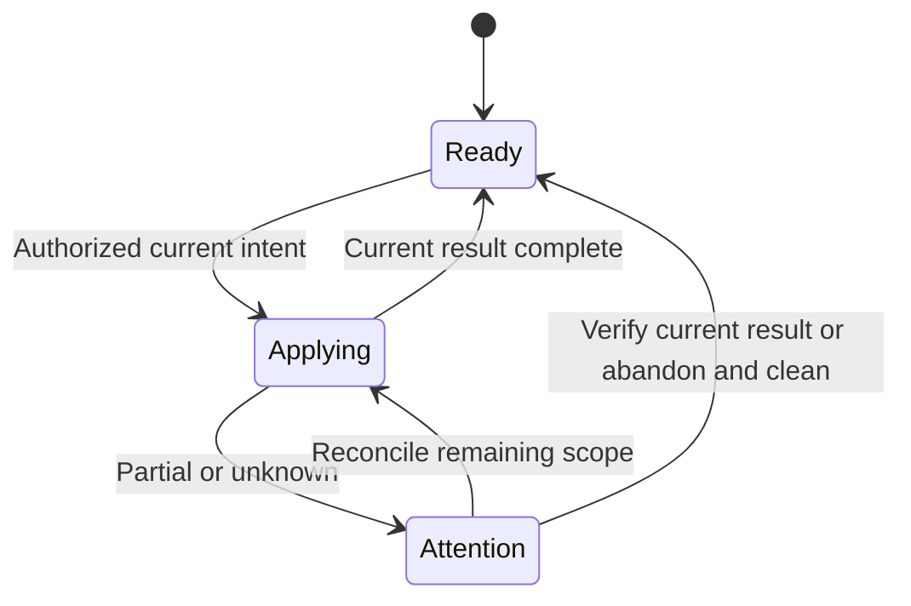

# Current library contract

This is the implementation contract for the single `next` line. Notion owns current
management decisions and Notion-authored content. Git-only, mixed and Notion-native
Skills share this contract. The system does not retain content versions, page
generations, historical graph releases or permanent recovery pins.

The work is tracked by [AH-499](https://linear.app/yoyooyooo/issue/AH-499) and its
[implementation parent](https://linear.app/yoyooyooo/issue/AH-498). This document
defines the destination. It does **not** claim that the existing production tables,
installed CLI or Pi runtime have been converted. The last section names the current
cutover blockers.

## One current owner for each fact

| Table | Current responsibility | Authoritative writer | Rebuildable display |
| --- | --- | --- | --- |
| Skills | Stable Skill/Router/Prompt identity, management metadata, enablement, default discovery, main-file binding, Members and Requires | Human metadata edits and the current management kernel; identity and relationship changes use that kernel | Source-backed main-body rendering and supporting-file navigation |
| Files | Every supporting file, stable File ID, exact Skill owner, logical path, authority and current content locator | Current management kernel; native author bodies remain directly editable in Notion | Full source/resource text rendering, attachments and reading status |
| Sources | Current provider, location, selected revision, selected members, include/exclude/mapping/patch rules and each target's contribution | Current source-management kernel | Last-check result and reciprocal navigation |
| Records | Necessary current exact-byte objects, one current Profile configuration, and unfinished management intents | The corresponding resource, Profile or operation writer | Human labels; no content history |

The main document lives on the Skills page. Its stable `Main File ID` participates
in the same file namespace, but Files does not contain another editable main
document. Every other effective path has one Files row, including files supplied
entirely by Git. A complete local or SDK directory is not a substitute for those
human-readable rows.

Use registered property IDs for access. Display names, including names ending in
`1`, are not identities or sufficient evidence for deletion. The cutover resolves
each actual property ID once, preserves the chosen binding, and removes duplicate
properties only after their current data and inbound relationships have been
accounted for.

## Fields and relationships

### Skills

Keep `Name`, `Description`, `Kind`, `Tags`, `Enabled`, `Default Context`, `Skill ID`,
`Main File ID`, `Members` and `Requires`. Name and Description manage discovery;
they do not silently rewrite source bytes or a file's authored frontmatter.

`Content` holds the main file's current descriptor. `Current State` and `Operation`
decode into either `ready` with no operation, or `applying` / `attention` with one
stable current operation ID. A normal reader stops before body acquisition when
the Skill is not ready. Inspection may return that state for explicit management;
it does not load an old operation journal or reconcile it as a read side effect.

The main file has the same current authority/content descriptor as a supporting
file. Its page body is either the current native author body or a generated reading
projection. The descriptor makes that distinction explicit. Editing a generated
page does not silently transfer authority.

`Supporting Files` is the reciprocal Files-to-Skill relationship. `Origin` names
current Source contributions; native Skills do not need an artificial Source.
Source membership and mount mappings belong to the current contribution, not to a
historical import or publication record. Multiple Sources may contribute to one
Skill, but two contributors cannot claim the same effective path without an
explicit whole-file override.

Retire old `Source` values that select snapshot/archive carriers, `Source Archive`
attachments, publication status/proof fields, and the old `Projection` ownership
marker. A display fingerprint may be retained as disposable projection metadata;
it cannot decide file ownership. Replace the text `References` mirror with current
typed Members/Requires and body references where those carry the intended meaning.
Do not keep both an editable relation and an independently authoritative JSON copy.

### Files and main-file descriptors

Keep `Name` as display, `File ID` as stable identity, `Path` as a canonical relative
path and `Skill` as exactly one owner. Store one `Content` JSON descriptor. Its
discriminant determines authority and representation, so a separately editable
Authority or Status column cannot drift from the locator:

| Current authority and representation | Bytes come from | What the Notion body means |
| --- | --- | --- |
| Notion native Markdown | Current page body plus explicitly stored current file metadata | Editable author content |
| Notion exact resource | Current Records resource locator and exact size/hash/mode | Generated full text for readable resources; an original usable attachment for opaque resources |
| Selected Source file | Current Source contribution, exact selected revision and source path | Generated full reading projection |

The one accepted descriptor union is:

```ts
type Content =
  | { kind: "native"; mode: "100644" | "100755"; frontmatter: string }
  | { kind: "resource"; object_id: string; sha256: string; bytes: number; mode: "100644" | "100755" }
  | { kind: "source"; source_id: string; revision: string; source_path: string; sha256: string; bytes: number; mode: "100644" | "100755" }
```

`native` and `resource` are Notion-owned. A native header is exact current file
metadata; an empty string means known absence. It has no stored body hash to block
a human edit. Resource and Source descriptors require a complete hash, byte count
and mode before publication. An absent descriptor returns `CURRENT_SCHEMA_REQUIRED`
with `next=migrate_current_content`; no Projection, event or title fallback exists.

Authority describes who controls the file. Representation describes how its bytes
are stored. A resource managed by Notion is still Notion-owned even when its exact
bytes are in Records and its Files body is generated. The UI and CLI must say which
body is editable author content. They must never infer authority from whether a
page has Markdown, from its title, or from the presence of a projection hash.

The descriptor contains only applicable current facts: representation, mode,
current native frontmatter where needed, current resource locator or current
Source/path binding. Raw resource and source descriptors include exact byte size
and content identity. Native author bodies are hashed after reading; a stale
stored hash must not prevent a direct Notion edit from being read. Reading that edit
writes only disposable local cache data, never an adoption event or remote object.

For native text, specify normalization and round-trip behavior. Do not claim to
preserve arbitrary source bytes through a native representation that changes them.
If native transport cannot preserve the selected text, retain its **current** exact
resource and render the entire readable text. Import never silently normalizes a
BOM, line ending or executable mode. An explicitly requested conversion is a new
current edit, not a reason to keep both past and present content.

`following/custom/tombstone` event-derived status is retired. Authority is direct.
Deletion removes the active row. If an upstream path still exists, its exclusion
is kept in the current Source contribution so refresh cannot resurrect it. This
exclusion contains no old file bytes. Renaming a source-backed file updates its
current mapping while preserving File ID; it does not leave an old-path file row.

An explicit whole-file takeover changes authority to Notion after writing and
checking the complete selected file. A current origin binding may remain solely to
support an explicit restore-follow action. Restore-follow reads the currently
selected Source and may overwrite current customization; it does not create a
prior-pin backup. Removing a Source preserves Notion-owned files and clears or
reports any now-unusable restore-follow binding.

### Sources

The current Source contains provider/location, a concrete selected revision,
selection and contribution mapping, exclusions and declared transformations.
`Ref` may express the desired upstream branch/tag; the current `Revision` is the
resolved content selection. Ordinary reads do not advance it. A source check may
report a newer revision; only authorized management applies it.

Reuse existing Provider, Location, Ref, Selection, Options, Enabled and Policy
bindings where their meanings fit. `Last Revision` becomes the current selected
revision rather than a history cursor. Last Checked/Result are informational.
Source definitions, member roots and contributions must be reconstructible from
Notion with an empty local cache. Machine paths and credentials remain local
bindings; a missing binding fails explicitly and does not authorize uploading
private local bytes.

A Source needs a complete current manifest. Keep a bounded manifest inline or use
a current exact-resource locator for a large manifest; do not add a manifest-history
table. Shared targets retain each Source's separate contribution. Disabling or
removing a Source must resolve its affected current files explicitly and cannot
silently delete another Source's files or Notion-owned overrides.

The current reader decodes Sources `Content` as `{version: 1, plan}`. The plan owns
the complete selected provider layout and exact upstream identities. `Last Revision`
is the SHA-256 fingerprint of its normalized current plan. Each source-owned File
selects the stable Source ID, that fingerprint and its source path. The underlying
Git commit or other provider identity remains inside the plan; the fingerprint is
not a content-version history or an instruction to follow a moving branch.

Automatic Source Routers derive current active member links. Human Routers retain
their explicitly authored membership. Requires expands mandatory Skill
dependencies; Members provides candidates. Disabled content and permission-denied
content remain distinct results, and a failing dependency identifies its owner.

### Records

Only three durable kinds are needed at the target boundary:

| Kind | Current key and owner | Lifetime |
| --- | --- | --- |
| Resource | Exact current object/chunk identity plus the current Skill/File or Source owner | While referenced by current data or an unfinished authorized write |
| Profile | Stable library/Profile ID; current name, enabled state, default View and freshness rules | One current record, updated in place |
| Operation | Stable current intent ID and its exact affected owner/path set | Only while needed to finish, reconcile or abandon that intent |

Hash, size and mode verify current bytes. They do not promise historical retrieval.
The current resource implementation uses one Record. Readable originals of at
most 32 KiB may be inline Base64. Opaque files and larger originals use the
registered `Resource` attachment, up to 64 MiB of original bytes. Unsupported
upload types use a deterministic ZIP containing that one original path and mode.
The reader checks both the container and extracted original, and export restores
the original bytes. This is a current original, not a Skill bundle or history.
The payload describes current hash, size, mode and storage representation.
It never stores an expiring download URL as identity. The attachment response,
host, timeout, byte bound and final hash are checked before accepting bytes.
Replacing a resource may create its current object before switching the pointer;
unreferenced old objects are collected after checking current and unfinished-write
references. No old pointer or snapshot is retained to preserve a version.

A Profile has no parent revision or revision graph. A current fingerprint may
detect a changed baseline for a management action; it is not a stored predecessor
or a distributed compare-and-swap guarantee. Multiple current rows for one stable
Profile ID are a duplicate to reconcile, not competing branches to replay.

The target removes `file_event`, `snapshot`, `archive`, historical Source bundles,
original-review/completion chains and Profile revision rows. Old `object` rows are
not all garbage: first move any uniquely current bytes they still hold, then
remove the obsolete carrier and all its references.

## Current operations and state

The operation result distinguishes budget exhaustion, user cancellation, partial
success, conflict and unknown remote outcome. The persistent states stay small:



`Ready` is established from the actual current scope, required relationships and
usable content. A missing old ACK, ancestor event or historical completion cannot
invalidate an already-correct current result. An affected incomplete Skill cannot
be reported as a complete tree; unrelated ready members remain usable.

For unknown CREATE outcomes, query the exact stable current identity before any
retry. For replacement, compare current intended content and reconcile only the
remaining work. Do not reconstruct an old success claim. A completed or explicitly
abandoned intent is removed after its current effects and any late duplicate have
been accounted for. There is no second permanent acceptance/completion ceremony.

Notion property writes, `last_edited_time` and local mutexes are not distributed
CAS. Overlapping writers must stop or surface a conflict. The cutover stops old
writers before converting their data. This contract does not introduce a central
coordinator or promise atomic publication of an entire multi-Skill Source batch.

## Consumer and reading projection

List, read, use, resource read and export perform zero semantic remote writes.
They do not repair pages, retain history, update a selected Source or clear residue.
Management owns those actions. A current reader only needs current identities,
permissions, relationships, selected Source data and usable bytes.

Keep a complete file directory separate from the set of locally materialized
paths. Fetch the entry first, then exact requested files. Acquisition v5 has one
library binding and per-file source or resource routes. Each source route carries
its own stable Source ID, current revision and source path, so one Skill can read
multiple declared Sources. There is no singleton source or Git-only reader branch.
It has one accepted schema; old acquisition decoders are removed.
Protocol numbers identify incompatible wire formats, not content versions.

The public SDK is version 2. Hosts must require this exact SDK contract before
using current consumption. Source management methods and the public `readOnly`
input are removed; all consumption is already read only. Consumer and resource
result formats remain version 1. SDK v1 is not an alternate current reader.

A task selection may retain its exact directory and bytes in local cache for
consistent delivery. If that local selection or required content has gone, return
an actionable reselection error. Never replace missing selected bytes with later
page content, revive a remote historical snapshot, or promise permanent/cross-machine
recovery. A historical snapshot cannot be reintroduced under a generic Source kind.

Pure reading columns, generated layout and unrelated library-property bindings
must not change effective content identity. Hash content, path/mode, authority,
selected source revision and required consumption semantics. Refresh current
display metadata separately; a cache hit must not freeze an obsolete owner
descriptor or undo a known permission denial.

Every supporting text file has its **full** current text on its linked Files page.
Markdown uses readable blocks where faithful, and code/JSON/YAML/HTML/scripts use
complete language-appropriate text blocks. Splitting a long text across blocks is
allowed; truncation, hash-only notes, a download link or a cache path is not a full
reading projection. Images and opaque binaries expose the usable original file.
Projection writes are idempotent and never overwrite a native author body.

Explicit export supports a whole Skill or an explicit path set, preserving complete
selected bytes and modes. Missing paths, unsafe paths, collisions and cancellation
are reported accurately. Export/edit/import replaces current selected content
through the same management writer. There is no separate backup/version subsystem.

Pi is the first daily host. Its Notion consumption uses the current paired SDK for
discovery, consume and resource reads; no custom-command or CLI full-export fallback
remains. The CLI remains available for explicit management and diagnostics.
OMP/Tern adaptation and host acceptance are deferred. Their local Skill content
still belongs in the Pro migration inventory.

## Requests, cleanup and the finite cutover

Preserve the existing request engine, complete pagination, scoped metadata batches,
TTL cache, read coalescing and request attribution. A limit applies to one invocation,
including its retries and children. A resumed invocation gets a new budget. A
partial page or exhausted budget cannot establish absence, authorize deletion or
claim a complete inventory. Fetch only changed/requested bodies after metadata
admission; do not scan Records history to answer a current read.

The implementation proceeds on `next` without compatibility readers, dual writers,
legacy flags or a parallel daily protocol:

1. Freeze the current field/owner contract and stop old writers for the selected
   cutover scope. Build the paired CLI/SDK/Broker artifact from that contract.
2. Run a finite conversion that reads old carriers only to extract current unique
   content and current management intent. Old plans, receipts and caches do not
   become authority for the new model.
3. Write current rows and complete reading projections. Verify the selected
   scope, full file paths, bytes/modes, relationships and ordinary zero-write reads.
4. Retire old properties, rows, pages, attachments, source bundles, Profiles,
   navigation, CLI routes, host exposures and writers after current references have
   been resolved. Remove the one-time conversion entry when the scope is complete.
5. Clear incompatible disposable sessions/caches and select current content. Keep
   any still-unique local author copy until that item has a verified current home.

Pro inventory distinguishes active local assets and real host registrations from
copies in old worktrees, package caches and verification exports. Physical
`SKILL.md` counts are not the migration denominator. An uninspected or sensitive
scope remains explicitly unresolved; it is never silently counted as migrated.
AK Models, Agents, providers and unrelated host operations remain separate assets.

Use the existing verification Skills and the
[bounded current-convergence journey](https://github.com/yoyooyooo/notion-skills-cli/blob/next/.cursor/skills/verify-ntn-skills/features/current-convergence.md).
The six checks have explicit stop conditions; do not add another runner, evidence
archive, recursive proof requirement or broad new platform. The final shared
journey is the real Notion → CLI/SDK → Pi use, followed by the scoped residue check.
First daily use does not close the separate Pro-wide migration task.

## Implementation status and remaining cutover blockers

Current tree assembly now reads Skills/Files `Content`, complete current membership
and current Source plans. Native reads use a disposable local body observation.
They never query event DAGs, adopt edits, reconcile operations or require original
completion records. Current native alias completion remains a read-only fidelity
check for actual unsupported Notion export nodes; it is not a historical operation
gate. Acquisition v5 checks current ownership and locators before obtaining missing
selected resource or Source bytes. Old cached selections require reselection.

The Promise SDK exposes only `SDK_VERSION=2`. Ordinary consumption always rejects
remote writes; the old `readOnly` option is rejected before a runtime starts.
Broker requires the matching SDK and package manifest. It does not load an older
SDK or use a CLI consumer fallback. Local ZIP exports follow the portable tree's
128 MiB expanded-size and 10,000-entry limits; remote upload limits do not constrain
local backups.

Current Profile management replaces one stable Record page in place. Fingerprints
describe current rules; duplicate pages fail, unknown writes reconcile without
replay, and completion clears finite local pending state. The public route is
`ctl library profile`, singular.

The registered CLI exposes current consumption, library initialization,
inspection, complete current import, Profiles and local configuration. Import is
`ctl library import INPUT --entry DB --skill-id ID`; `--dry-run` inspects the
replacement, and `--operation ID --resume` supplies the same input to its finite
intent. Default import keeps exact originals as Notion resources and renders
complete text. It preserves the physical Skill, stable retained File IDs and
unspecified enablement, default-context and authored relations. Removed supporting
Files and unreferenced owned resources are trashed after current content is checked.

Portable Members/Requires round-trip as complete current stable-ref sets. Omitted
fields preserve, [] clears, and lists replace. Prompt relations are invalid. The
writer checks same-library single-property schema, complete pagination and unique
enabled ready targets before mutation. Changed sets are limited to 100 targets;
larger unchanged sets are retained. Changed Requires checks its reachable metadata
closure for cycles and rechecks it before ready, including an unfinished resume.
Relation mutations share the same finite current intent and frozen physical IDs.

Import has one default budget of 1000 HTTP attempts, 512 MiB payload bytes and
600000 ms, including initial library lookup and all remaining network work.
--max-requests, --max-bytes and --timeout in ms can choose positive limits. Nested
writers share the allowance, exhaustion stops new dispatch, and a fresh explicit
resume gets a fresh budget. Actual response bytes may overshoot a byte limit at
the boundary of an already admitted response; the result reports that cost.

The writer opens an operation only when an actual change is needed. A complete
no-op performs zero semantic remote writes. One mutable action marker supports
interruption without a permanent ACK log. Completed state becomes ready before
the operation is retired. Unknown CREATE or append is never repeated from absence;
an observed partial append still requires attention and is not automatic recovery.

Old create/apply/write/replace/adopt, Source refresh, sync, archive, graph-release,
repair and migration command families are not active authoring routes. Source
refresh and cross-object governance still need their current implementations.
Removing a command does not prove that every old module, export or guide is gone.

The production data and Pi installation are **not switched yet**. Remaining work:

- Complete current Source writing, cross-object governance and the remaining
  finite-recovery cases: AH-504, AH-507, AH-505.
- Populate every Git-only supporting Files row and render full readable text or
  original usable attachments. A complete provider manifest does not establish
  that all required Notion reading pages exist: AH-501.
- Convert unique current bytes, old Profiles and actual field bindings, then
  retire obsolete Notion rows, properties, attachments, pages and navigation.
  Preserve the actual `Source` property ID even where its old display name is
  `Selected Version` until conversion accounts for it: AH-513.
- Finish caller, package, builtin-reference and obsolete-module retirement,
  selected-path export coverage and remaining cache coordination: AH-517/AH-1142.
- Build and install the matching CLI/SDK/Broker candidate, execute one bounded
  Pro Pi daily-use journey, then finish Pro-wide content and exposure migration:
  AH-617/AH-1063/AH-516.

Run only the applicable checks in the existing current-convergence entry. Current
schema/index, native tree, exact resource, Source, acquisition and complete-import
tests establish their controlled boundaries. They do not certify live table cleanup,
every authoring operation, an installed package or real Pi delivery. The old
resource-lifecycle and ACK recovery models and their dedicated recipes are retired.
The two request-engine models retain their original bounded properties; current
writer safety is checked by the existing implementation and real HTTP tests.
