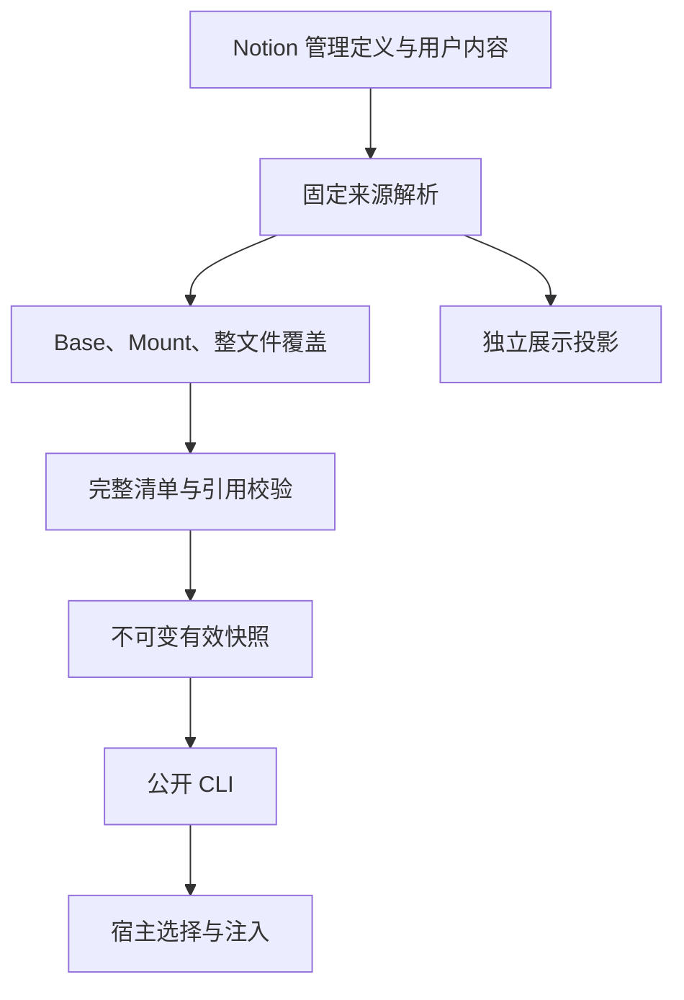

# Notion 共享管理与固定文件供给

本文是 [AH-498](https://linear.app/yoyooyooo/issue/AH-498) 的架构合同，服务于 AH-499。产品决定来自 2026-10-31 重建后的父 Issue。它定义实现必须遵守的状态归属、读取成本和失败边界，不作为功能通过证明。

## 状态与证据

### 2026-11-04 当前 Pi 主线：直连请求与依赖图已交付

[AH-561](https://linear.app/yoyooyooo/issue/AH-561) 及其 21 个子任务已完成。当前交付证据见 [AH-561 验收报告](https://github.com/yoyooyooo/notion-skills-cli/blob/main/docs/ah561-acceptance.md) 与 [逐故事账本](https://github.com/yoyooyooo/pi-context-broker/blob/main/scripts/notion-skill-graph-story-ledger.md)。下方 Sources、三表迁移和更早试点各自保留原场次与范围，不能将历史的“未切换日用”或模型许可失败当作当前主线结论。

该批最终产品为 CLI9/Broker10。Pstack Router 路线 A 使用 H11，普通 Skill 路线 B 使用 H12，两路各为 5/5 样本、3/3 实际运行通过，未运行样本为空；实际执行过 A 生成规程中的独立服务检查。pro 日用 CLI shim 与 Pi 包已切换，正常新会话实际自动加载及 92 个安装文件核对通过。最终 Notion 结果页完成独立逐字读回。这些结果不改写先前失败、超时、未知写入或旧 17 项能力的分层证据。

AH-498 在 2026-11-03 明确将下列目标交由 AH-561 承接。承接按原验收条件分别核对，不以子任务 Done 自动关闭历史父票：

| 原执行入口 | 已承接的实际结果 | 保留边界 |
| --- | --- | --- |
| AH-503 请求调度 | Notion 直连、同机多进程准入、取消、限流和未知写入由 AH-563/564/565 承接；成本与按需准备由 AH-575 验证；Linear 主动来源的官方 Effect HTTP 与可观察成本另有 37 项定向测试及真实 Node 读取 | Linear 后续修订与安装产物单独记账，不能从 Notion 专项推导所有 Provider 路径通过；不宣称 generic Git 的请求账本或全仓历史 Promise 适配已清零 |
| AH-509 固定历史 | AH-578 的真实物理 Mini 使用自身认证与空状态，从 Notion 恢复 A 图的 3 个节点、6 个文件；当时实际为 CLI8，当前 B 不替代旧 A，所有文件和生产者版本向量精确匹配 | 未把本场次写成 Git 所选版本同时推进、旧 mixed fixture 回滚或真实过期签名 URL 的完整验收；原票保持未覆盖条件 |
| AH-259 Router 消费 | AH-573 的 Pstack 根选择由模型自主找到叶子和资源；目录按需消费、固定关系及 Pi 会话行为由对应图切片取证 | 当前验收只覆盖批准的 Pi 主线；OMP、历史 Bundle 全部转换和旧故事的未覆盖条件仍分别保留 |

全局诊断仍有 25 条旧库成员不可用，来自 Agent Kit 人工 catalog 的 open-source-bundle 和 matt-engineering-suite。它们的旧 locator 与当前共享库不一致，Broker 保留不可用成员并继续提供正常 Notion 记录。AH-561 的 Pstack 日用结果不表示全局 Namespace 已通过；修复这些定义与 AK 的配置生成权威属于 AH-516 的独立范围。

AH-498 仍保留原完整 N/k 性能矩阵、共享写入未覆盖边界、AK 移交、全部旧调用者退役和发行总验收。OMP/Tern 继续延期。当前主线完成不把这些目标自动标为通过，也不授权全来源定时同步。

AH-503 后续改动通过现有运行环境提供的官方 Effect HTTP 服务读取 Linear，沿用四并发、整个请求 45 秒、流式原始响应 8 MiB 和凭据脱敏边界。`check/fetch/prepare` 共用既有 opt-in 请求账本。源码、真实服务、安装及日用证据各自绑定实际版本，见 [AH-503 请求引擎补充验收](https://github.com/yoyooyooo/notion-skills-cli/blob/main/docs/ah503-request-engine-acceptance.md)。

### 2026-11-03 当前交付：Sources 四表与主动来源管理

用户在完整内容迁移后明确要求恢复活跃上游管理，并扩展到GitLab、Linear等提供内容的来源。本轮最终正式模型为 **Skills / Files / Sources / Records** 四张独立全页面数据库；没有恢复旧Upstream/Content双轨。Sources保存可变配置，Selected Version继续指向Records中已冻结的完整内容。以下为当前交付，后面的“唯一三表”是先前内容迁移的历史检查点。

| 当前四表及关系 | 完整读回结果 |
| --- | --- |
| Sources | 59份原来源配置完整恢复为活动行，稳定Source ID唯一；Provider、Location、Ref、Selection、Options、Enabled、Policy与保留原始配置一致 |
| Skills | 300入口，298启用；283主Origin关系和精确Source Member已登记，17个无原来源的独立入口不猜测绑定；现有主文、Metadata与内容pin不因来源迁接而改动 |
| Files | 818行原生支持页，路径/身份/Skill绑定不变；Origin通过Skill关系只读rollup，不重复维护可写来源 |
| Records | 4,905行；原4,902个事实的逻辑身份与hash保持不变，新增3条本轮验收归档；59份原来源档案及283份当前资源包关联Sources |
| 用户导航 | 14个原生View设置读回通过；Sources有全部/启用/Git/Linear/需处理视图；Pstack筛选使用活动Origin；旧Source Archive关系留存并从日常View隐藏 |

当前主Origin是一个明确的更新基底。原多贡献者shared_target_set设置完整保留，单来源refresh会拒绝覆盖合并结果，要求明确固定composition。不得根据同名内容猜测零成员来源的归属，也不得把原配置中的历史publisher标签解释成已恢复自动合并发布器。

#### CLI与来源适配

新增公开 `ctl library sources init/attach/providers/list/show/members/put/bind/check/fetch/prepare/apply/reconcile`。配置与固定内容命令分层：复数sources管理活动定义；单数source继续管理精确的不可变资源。list/members完整分页，show读取长属性；真实Synpraxis超过65KB选项原样核对，Pstack正向关系返回57项（56个Skill及1个Router），不依赖反向预览的25项限制。普通list/read不增加Sources扫描或provider抓取。

Git适配使用通用HTTP(S)/SSH仓库、精确解析的commit/tree，不限定GitHubAPI。真实GitHub Humanizer Zh的9文件与GitLab官方skills仓库commit-messages成员5文件均完成check和完整目录导出。Linear从固定官方GraphQL只读明确issue/document，凭据仅取本机LINEAR_API_KEY；真实两类对象映射为2文件并完成读取/导出。Linearrevision绑定实际正文和updatedAt，不冒充服务端历史commit。registry/marketplace复用既有适配，不把本轮Git/Linear结果当作其新增真实验收。

来源变更采用完整fingerprint期望值，bind仅改主关联/member。prepare冻结provider候选与当前ownership、pin和文件树；apply先验证限额、每块/全ZIP/每文件hash，再保留候选并走原共享元数据选择协议；自定义正文和旧pin保留，不回写原生投影，不执行脚本。新refresh v2把精确选择操作直接绑定到审批摘要，避免另建冗余派发映射。已存v1的原门槛与unknown保留；reconcile只观察原选择操作，不能由当前值可见伪造旧操作完成。协议仍是有界单写者与前像核验，不声称Notion原子CAS或跨机锁。

#### 真实更新、安装与保护验收

独立原生Notion条目含custom主文和custom本地检查表；真实Linear文档A→B经公开prepare/dry-run/apply/read/export完成版本推进。两份custom文件逐字节不变，新增Linear资源更新到B，旧A资源pin保持原字节；warm B和旧A读取均零远端请求，空状态消费者重建同一B快照且零provider。没有对生产59来源批量抓取或推进版本。

完整四表最后分页对账验证300个生产pin及Metadata、818个文件绑定、59配置与原4902事实hash不变。实际创建的29个验收页面/记录先归档再可恢复地移入Notion回收站，没有测试条目混入生产目录。原始create因下划线原生转义而失败、v1B的冗余映射请求unknown均保持原结果；单独新原生条目和v2准备的通过不改判这些失败。

pro已经安装新CLI与包含更新后官方Skill指引的Broker候选，日用注册包含四表descriptor，CLI shim和Pi package指向同一安装目录。现有Notion source选择、prefetch:false、其它插件、规则、认证与用户会话保持不变；新开Pi会话加载新版本。实际安装的Pi+真实Notion通过metadata目录、native read、/skill:、美元选择、双向切换、重复去重与续接；provider是受控验收，未运行新的真实模型任务。Broker源码和Tern既有脏产物未改变，只重建/安装Pi候选。

实际安装后的当前298目录为5次Metadata，默认74项View为12次Metadata，正文/写入/provider均为零；这是本库实测，不宣称任意规模常量。共享核心977项（73文件）、Node SQLite10项、公开CLI9项（2文件）、类型/格式和43项独立安装消费检查通过。新增SQLite派发域导致旧测试计数9→12的期望差异已修正后复验，失败原日志保留。没有宣称全仓、全provider或所有宿主矩阵通过，也未公开发布npm。

持久证据在本轮外部验证目录的 `final-audit.json`、`linear-native-a-summary.json`、`linear-native-b-summary.json`、`installed-cli-acceptance.json`、`host/summary.json`、`daily-cutover/summary.json` 与 `acceptance-retirement/summary.json`。Notion父页下00—03文档已改成四表模型，新增04 Sources管理指南。命令和配置见[来源管理](sources-management.md)，验证地图为SS19。

### 以下三表完成记录为 Sources 增补前的历史状态

### 2026-11-02 历史交付：300 个内容入口完整迁入三表，日用入口已切换

2026-11-02 完成用户批准的完整生产数据迁移。当前正式库只使用指定父页下的 **Skills、Files、Records** 三张独立全页面 Database，显示名不带 library 后缀。旧内容表和旧来源表各自完整查询为零遗留行后，已可恢复地移入 Notion 回收站。以下是当前结果；后面的 12 项、3 项和旧恢复试点均为历史检查点，不再表示当前生产库尚未迁完。

| 最终对账 | 数量与结论 |
| --- | --- |
| Skills | 300 项：287 个 Skill、13 个 Router；298 项启用，2 项原本退役内容保持禁用 |
| Files | 818 个原生支持文件行；主文仍在 Skills，逻辑路径和正向 Skill Relation 完整 |
| 完整业务文件 | 1,874 个，39,140,756 字节；含脚本、二进制和 source-only 资源，不强行转成可编辑 Markdown 页 |
| Records | 4,902 条物理/逻辑记录，无重复逻辑身份；archive 76、operation 33、object 3,076、file_event 1,118、source 599 |
| 来源与历史 | 59 个来源配置完整保留；2,529 个历史快照、6,285 个内容对象及旧操作保存在 Notion 归档，三个归档均下载复验 |
| 完整性对账 | 核对全部 Records envelope hash、4,628 份必要事实、全部300份资源包、文件路径/字节/绑定/Metadata/成员关系 |
| 原生正文 | 搬迁的1,103份当前正文逐字节读回通过；另12个先前完整副本完成当前资源收束、read/export及旧pin保留 |
| 公开 CLI | 24个代表性用例完整read/export通过，包含全部13个Router；原12份完整副本另行验证，不冒充300项各自跑过完整CLI |
| 独立物理机器 | mini用自身认证、空状态/缓存及安装包，读到298项目录；Resin、archify全部203文件及Pstack56成员索引与pro哈希/快照一致；未复制凭据/SQLite/内容 |
| 安装后真实 Pi | 在本生产库通过metadata-only目录、native read、`/skill:`、`$`、双向切换、重复去重和持久续接；provider为受控验收 |

完成方式是保存原生页面并搬到新 data source，按稳定身份补齐最终元数据和不可变归属；不用重新渲染全部旧正文来复制页面。只有原本空的入口按完整保留的输入补齐。archify读回的两处原生段落包装差异经独立精确审阅接受，原失败预测保留，未放松普通正文写入比较。跨Skill引用通过明确的逐文件引用映射承接，不能以删除链接或猜测basename来通过验收。旧原件、失败副本和未知操作均有Notion归档，不把迁移完成改写为旧请求已成功。

当前完整来源选择为Notion-resident `retained_bundle`：完整manifest和ZIP精确字节块都在Records，冷客户端按精确对象集合批量读取并验证，无旧数据库或Git/provider补齐路径。原始Git/registry/patch/范围配置保留为可审计事实；旧自动发布器不再是当前管理入口，未来来源推进是显式管理操作。原生正文仍持久保持其已确认custom/following归属，修改主文时保留来源的额外frontmatter。记录限额保持64KiB，完整资源和大原生历史正文通过有界块处理，不扩大普通编辑计划的上限。

**pro的日用切换已完成。** `ntn-skills`指向实际安装的新CLI，正式库注册为 `skills`，旧业务库注册与旧upstream配置移除；创建默认值指向新库。日常消费明确使用 `ntn-skills list --database skills`。裸 `list` 仍是工作区发现，`default_database` 不被悄悄重新解释为所有读取的过滤器。首次切换验收误用裸list触发广域发现，已保留超时与本地回退记录，随后以正确显式入口完成切换。Pi source已指向同一新库、安装新Broker，`prefetch:false`保留74项目录但只在选中时加载正文。无关本地技能、规则、插件与凭据不变，已有用户会话未终止；新开/重启Pi后加载新扩展。

实际安装CLI的完整298项目录为5次Metadata，默认74项View为12次Metadata，均零正文/写入/provider；这是本次样本，不是任意规模常量或普遍性能承诺。Router关系超过25项已完整分页。一次Router测试oracle多加了主文末尾换行，已从精确原生正文修正预期；实际数据、CLI输出和旧失败记录均未改写。

独立真实模型 `magpie/group/flash-free` 返回“需要Premium许可”，没有调用读取工具，本次真实模型验收明确失败。不得用受控provider结果或成功HTTP响应替代任务完成，也未切换到未经指定的模型。本次仍完成数据迁移、双机内容消费、实际Pi加载和日用配置切换；OMP/Tern、npm公开发布、全N/k性能矩阵及外部模型许可不纳入已通过结论。AH-498的其它工程矩阵不因本次迁移完成自动Done。

本次共享核心 **940 pass / 69 files**、真实Node SQLite **10 pass**、独立安装消费 **43项**、typecheck与格式检查通过。Broker检查与66项共享适配/View测试通过，验证入口另有19项host/pack/prefetch回归。初次将Node专用测试放进Bun导致的失败及临时网络失败均保留，正确分道/独立重试的通过单独记录，未宣称全仓所有测试已跑。

完整私有输入、原API响应、三表全分页、逐项对账、当前/历史导出、安装包hash、pro/mini和Pi证据保存在checkout外持久目录。统一证据入口为 `complete-data-audit.json`、`daily-cutover-explicit/summary.json`、`retire-old-tables/summary.json` 与 `mini/summary.json`；可复跑边界见[SS18](https://github.com/yoyooyooo/notion-skills-cli/blob/main/.cursor/skills/verify-ntn-skills/features/shared-ssot.md#ss18--complete-single-library-consolidation)。用户指定父页下的四份文档也按本最终状态更新。

### 以下为保留的历史执行检查点

### 2026-11-02：批量迁入推进到 12 个完整生产 Skill

本轮新增 **9 个 Skill、12 个业务文件**：bro、in-your-own-words、benchmark-checklist、blast-radius、automate-me、create-formal-verification-skill、arena、correct、better-layout。加上前批三项，累计 **12 个完整生产副本、18 个业务文件**。它们是批准目标三表库中的真实记录，不是新建测试库。主文、完整资源、固定 Git commit/root、原 Tags 和 Default Context 均有迁移前后记录；原生文件按已证明的来源保留 following。better-layout 的四个业务文件包括原先只存在于 source archive 中的资源，没有漏掉资源或虚构对应的旧子页。

一次性迁移证明补齐 source-bundle v2 和 current-metadata v3。v2 对没有原生页的来源文件仍要求 ZIP、旧快照、Git blob 和 authored export 全部相同。v3 仅将 Default Context 与正文归属分离：原完整 guard 可由该布尔值的两种候选精确重建，保留发布时/当前值；来源、成员、修订号与正文不得一起变化。旧 target_mode 作为原始分类标签保留，不引入 source patch/mapping/shared target-set 的新解释。已保存历史证明的校验不变；这些是迁入新模型的离线解释，不是旧库运行态兼容或双写。

新原生投影 v6 在发出写入前预测段落/简单列表换行、裸 HTTP 链接与支持的链接内样式，保留原请求、原文和期望正文。代码、链接目的地及历史 v1–v5 投影保持原语义，读回仍严格相等。主文消费采用既有 canonicalMain 序列化：YAML key 顺序/引号可变化，但额外 frontmatter 和实际正文必须完整；资源保持原始字节。曾将该 YAML 排版差异误判为迁移验证失败的 bro 只补做观察核对，没有第二次创建。

剩余真实阻塞保持可见：ketchup 的 `../bro/SKILL.md` 跨 Skill 引用在创建前拒绝；better-ui 一次原写返回 WRITE_OUTCOME_UNKNOWN，后续只读页面观察为 disabled，原请求未重发；better-accessibility 读回与预先冻结候选不同，保持禁用。一次共享 provider 元数据文件的并发创建冲突发生在目标写入前，已串行化这份共享观察并在独立保留目录完成 better-layout；失败记录不覆盖。该批另三项尚未派发。前批失败、来源语义、跨 Skill 引用、Views/Profile 与完整历史迁入仍不能算作完成。

本轮核心专项 **365 pass / 29 files**、公开 CLI **10 pass / 2 files** 和 typecheck 通过；重叠专项不叠加，未重跑全仓全部矩阵。独立空本地状态逐项核对新副本的固定快照与完整导出；这是同一台 pro 的独立消费者，不冒充第二物理机。完整输入、原始响应、逐项结果及 347 源行更新台账均保存在 checkout 外的持久目录。全局 CLI/Pi 默认配置、旧库原件及长期单轨目标不变：完整数据和依赖核验之前不切断现有日用入口。

### 最新执行目标：唯一三表库与正式数据迁入

2026-11-02 用户进一步批准：最终仅 Skills、Files、Records 三张业务 Database 参与管理与消费，全部受管内容和共享事实迁入指定父页；不保留长期新旧兼容、双写或隐藏 fallback。旧原件在完整迁移和依赖核验后归档，归档保留不再参与正常读取。Pi 优先，OMP/Tern 继续延期。以下进度是执行检查点，不代表全量切换已完成。

三个目标库的标题已实际改为 **Skills、Files、Records**，仍是独立 `is_inline:false` 页面。Notion 会随表标题同步调整 data-source 显示名，因此验证比较稳定 ID，而非错误地要求整个带名称的 data_sources 数组不变。原数据库、data-source、property ID、Relation、父页和库 descriptor 均保留；新构建的 `init --parent ... --operation ...` 在三表改名后返回 reused，未重新创建。

初始化代码不再从标题后缀推断角色或原操作。新表在同一次 POST 中携带内部 `ntn-skills-table:v1` 描述，绑定原 operation/parent/role；完成后的 Skills descriptor 仍是库身份入口。注册前未知结果、角色缺失、重名或未登记表不会授权重放。回归先在旧代码复现三项失败，再通过 20 项初始化测试；与 Files 查询及普通 create 合计 87 项定向测试通过。该变化不改判旧写入结果，也不增加旧数据兼容路径。

生产原始数据源已按完整游标分页冻结：内容表 **288 行 / 3 页**、来源表 **59 行 / 1 页**。旧 CLI 消费目录返回 300 个可见项目，但有一项来源解析失败，因此它不是全量迁移清单；源行分页完成也不代表全部正文、资源和历史已核验。已建立覆盖这 347 个源行身份的逐项台账，未触及项明确保留为未迁移。

首批六个独立原生内容对象经正式 CLI 完整读取并保留 source/snapshot 导出。其中 **3 个新原生副本完成创建及完整文件树核对，共 6 个业务文件**，并由另一套空本地状态读取和导出相同新快照；这仍是同一台 pro，不冒充第二物理机器。原数据、旧 pin 和输入保留，Metadata/Tags 按原数据逐项核对。**2 个创建因正文转换差异停止并保持禁用；1 个因附带二进制文件在写前拒绝**。链接自动序列化、混合 native callout/段落形态和二进制资源边界分别保留，没有删文件、放松正文比较或重发原创建来提高通过数。

两个正文异常随后均从原用户页面取得完整原生 v2 正文；离线预测证明这些正文已经处于稳定格式。一次受控尝试仍在公开 dry-run 返回 `SHARED_CREATE_PENDING`，说明不能用另一份输入绕过原创建状态；没有派发新的 create。为该尝试临时回收的本轮失败副本已恢复到原禁用状态，原用户页面始终未移动或回收。冻结的 v2 输入可用于后续正式迁入设计，不当作迁移成功，也不扩展历史兼容恢复分支。

新增的一次真实 Pi 运行确实从这个新库读取了已复制 Skill 的完整入口和同快照资源，但其最终回复仅表示已获取信息，没有交付所需说明；另一独立运行达到模型 RPC 时限而失败。前者通过加载层断言不等于任务完成，本轮不据此增加生产 Pi 完整验收通过的结论。前述独立测试库的成功证据保持原范围。当前代码另通过 43 项独立安装离线消费检查，仍未重跑全仓所有矩阵。

指定 Notion 父页下已实际创建并读回四份总览、数据模型、管理/Pi 使用及迁移状态文档。源码协议、公开 help、作者指南与验证地图同步反映简洁命名和单轨目标。完整输入、原始 API 响应、旧新映射及失败证据保存在 checkout 外的持久验证目录；当前全局 CLI 默认库、Pi 日用配置和旧业务实现尚未切换或退役。下一步仍属于正式数据迁移主线，不能因为三表和少量副本可用而宣布完成。

### 当前主线：Notion → CLI → Pi

2026-11-02 用户收敛当前交付范围：Notion 管理 Skill、ntn-skills CLI 消费远程 Skill、Pi 通过 context-broker 实际使用。OMP/Tern 延后；旧迁移对象和全量切换保持原状态，不再作为正常对象纵向验收的前置。下方较早的全量矩阵仍是历史范围，不能据此把延期项目算作当前 Pi 主线失败，也不能反向用 Pi 结果将它们标成通过。

本轮正常路径使用独立的两文件原生 Skill，与旧七文件迁移试点无关。公开 create 的 dry-run 与实际创建均通过，完整校验后启用。随后通过官方 Notion API 直接修改主文、支持文件和 Description，完整 GET 精确匹配；普通过期 read 观察新内容并持久保存两文件归属。此对象创建时就是 native/custom，结果不冒充 Git following → custom 的完整上游生命周期，也不冒充手工浏览器编辑验收。

| 本轮三段链路 | 实际结果 | 范围 |
| --- | --- | --- |
| Notion 管理 | 主文、支持文件、描述编辑被观察；禁用后目录移除且 current read 返回 SKILL_NOT_FOUND；重新启用后身份、正文与原快照 B 相同 | 独立两文件原生 Skill，官方 API 管理 |
| CLI 远程消费 | B 的完整导出包含更新资源；旧 pin A 保留原文且零远端请求；warm B 零远端请求；独立空本地状态恢复同一 B | 同一物理 pro，不宣称 mini 或全库迁移 |
| 安装后的 Broker → Pi | 实际 Pi 1.4.0 / Node 24.20.0；metadata-only 目录、原生 read、/skill:、美元选择、双向切换、重复、持久续接通过 | npm 候选独立安装；真实 Notion，受控 provider；只运行 Pi |
| Pi 终端交互 | 两个冷 PTY 实际输入前缀、Tab 接受、Enter 提交，覆盖 dollar → native → dollar 与 native → dollar；两个进程均自然退出 | 真实 Pi 终端，source/provider 为受控夹具，单独于真实 Notion 和模型报告 |
| Pi 真实模型使用 | magpie/group/flash-free 自主读取完整入口和同一固定快照的资源，4 次 provider 请求后产生 stop 成功回复，明确引用修改后的两个版本标记和三项风险 | 1 次独立成功运行；入口读取 1 次、资源读取 2 次；非发布或性能总验收 |

首次真实模型运行在原 120 秒 RPC 预算内未完成 final，保留为失败。模型多步路径随后使用单独的 300 秒有界 prompt budget，普通受控 RPC 和 Notion 单请求预算未改；新运行记录 elapsedMs=124061，并仍检查完整入口/资源回执、实际 provider 消费与非空成功 final。不能把收到 HTTP 200 或读到资源单独记为模型完成，也不将首轮失败覆盖为通过。

Broker 新增 `build:broker`、`check:broker`、`pack --target broker` 和 integration `--host pi` 路径；未选宿主不探测、不启动、不计入通过。默认双宿主行为保留，跨宿主专项拒绝单宿主降级。现有 Tern 脏产物保持原字节。完整 `check:broker` 通过，包含包内行为回归、completion、类型检查、共享 adapter/View 的 66 项测试，以及 host/pack/model-budget 的 17 项测试；共享 adapter 的独立 62 项复验与前述集合重叠，不相加宣称总数。未运行整个双宿主验收。输入、原始响应、目录导出、安装包、宿主和模型证据保存在 checkout 外的持久验证目录，不再只依赖临时目录。

当前已证明这条正常三段链路的功能闭环。用户日用全局 Pi 配置、原生产库、npm 发布、旧管理链退役均未在本轮替换；独立安装的候选不冒充已切换的日用默认。实际用法见[共享库指南](shared-authoring.md#use-the-remote-skill-in-pi)，可复跑步骤见 [Pi 主线验收](https://github.com/yoyooyooo/notion-skills-cli/blob/main/.cursor/skills/verify-ntn-skills/features/broker-consumption.md#pi-only-mainline)。

### 较早检查点与历史完整范围

**2026-11-02 UTC 开发检查点：AH-498 尚未全部完成。** 下表中的真实 CLI 指本次源码构建后由 Node.js 执行的正式命令，不代表已发行 npm 包、已安装宿主、两台物理机或模型/UI 验收。原始命令、私人页面身份、完整共享 pin 和备份位置保留在外部运行证据中，本文只记录可公开的范围与结果。

| 项目 | 当前结论 | 尚不能由该结果推出的结论 |
| --- | --- | --- |
| Notion 共享管理权威、本地状态可重建 | 已确定产品边界；共享 Records、精确来源与历史读取已接线 | 全部管理工作流、空缓存独立物理机验收 |
| 隔离库初始化与 descriptor | 真实 `ctl library init/inspect` 成功；三表及稳定属性身份可读回。当前新库初始化已加入 Members 自关联 | 既有库已自动升级、新增 Members 分支的全部真实故障验收、生产迁移或通用幂等事务 |
| 主文和支持文件布局 | 真实 Skills 主文与两个 Files 行的扁平索引已验证 | 101+ 真实分页、原生 UI 直达体验 |
| 共享文件状态 | DAG、Records、正文观察与普通 `read` 已接线；真实整页接管后改回原文仍为 custom；独立七文件 fixture 的显式恢复跟随、fresh read 与旧 pin 核对已通过 | 完整文件生命周期、全部跨机并发验收 |
| 保留正文 | 真实 Notion 历史对象按精确内容摘要恢复已证 | 任意大正文、所有资源类型或跨物理机完整快照恢复 |
| 共享 snapshot save/restore | 真实公开 CLI 保存三个文件，`verification=objects_and_manifest`；新本地状态根恢复并导出的三个文件 SHA-256 全部一致 | 任意资源类型、历史故障全矩阵和独立物理机恢复 |
| 固定 Git 来源 | inspect 固定 commit/tree/root 的 18 文件清单；真实消费产出 20 文件，17 个 Git 资源逐一核对 Git OID，三个 custom 文件保留原 SHA-256 | 完整来源选择管理、二进制全覆盖、投影写回或私有仓库支持 |
| 固定 manifest 登记 | `source register --manifest` 接受完整 inspect JSON 或裸固定 manifest，登记过程零 provider 请求；保留精确候选身份 | 登记即选中来源、建立 following 基线或改写正文 |
| 低请求标准 CLI | 单个 native fixture 的 warm / exact-pin 各 20 次零远端请求，expired 20 次每次 20 Metadata、零正文；已记录实际 CLI 进程 p50/p95 | 全 N/k 规模矩阵、安装包或宿主端到端性能；零正文不代表普遍低延迟 |
| 原生 View metadata | 真实三成员 View 使用五次 Metadata 请求，正文、写入、provider 均为零；保留原生成员与顺序、Enabled 和稳定身份校验 | Profile 管理或宿主供给通过 |
| Router Members | 新库真实原生 Members 验证；两成员 Router 冷读 14 请求且无成员正文，warm 为零；成员描述更新后 7 次 Metadata、零正文/写入/provider，旧 pin 保留旧目录 | 原生 UI、已安装宿主或实际模型消费通过；旧库已隐式升级 |
| 在途合并与请求准入 | Notion 服务内同请求合并、默认四个并发 permit；permit 与 SQL 准入受原五分钟 deadline 约束，网络 timeout 独立 | 跨进程或跨机器全局并发锁、全部真实服务负载矩阵 |
| 迁移审阅计划 | `ctl library migration plan --input` 已提供只读映射、冻结证据和 blockers；`reviewable` 与 `blocked` 均 `apply_allowed:false` | 已获得生产切换授权、已实际迁移或可以清理旧数据 |
| SQLite 派生域 | 四类 cache 与七类 dispatch 显式地址；新增恢复 journal 与原始响应域。0010 独立持久 local 内容限制不受 cache clear 影响；本轮真实 Node shared SQLite 10 项及空库首次读取复验通过 | 本地状态成为管理权威或跨机器锁 |
| 类型、构建与专项测试 | 当前 typecheck 与公开 CLI 构建通过；本轮相关核心 40 项（含 recovery 11 项）、公开 migration CLI 5 项、真实 Node shared SQLite 10 项通过。前次完整 Node/Vitest 为 739 pass（50 files），Node 24 inventory 为 7 pass；前次完整 unit 为 2931 pass、1 skip、14 fail，修正边界后六文件 121 项与 inventory 7 项复验通过 | 14 个历史失败分别为 8 次宿主 Trash 超时、6 次 Node 专用测试被 Bun 执行；失败记录保留，未重跑一次完整全绿 suite。专项存在重叠，不相加宣称总数；默认 unit 的官方 CLI 回环场景仍为条件 skip |
| 真实大规模 fixture | 两个独立 101 文件 fixture 均未完成：第一套第 77 个创建 unknown，76 个可见且原操作未结清；第二套第 97 个 unknown，96 个可见 | 两套都不记作真实 101 文件通过；受控分页测试分开报告 |
| 当前生产目录盘点 | 只读返回 300 条，Guizang 来源 coverage 失败；已保留 2509 个历史快照候选、483 份原操作记录，3105 个引用对象全部校验。只读计划稳定输出 8647 项显式 blockers | 快照候选不等于用户指定 pin；不能视作完整批准清单或迁移成功 |
| 现有本地状态保护 | 公开 backup 返回 `verified:true`；两个旧 scoped operation 的 `external_assets` schema 未知，已备份诊断且未删除 | 不推断这些旧操作完成、可安全重放或可以清理 |
| 原未知操作 | 已有冻结 plan → object → event 与本地派生 dispatch 恢复；保留原 ID | 首次 plan unknown 且共享不可见时，空客户端仍无法判定；N09 未完成 |
| 可编辑页写入 | 完整 old_str 的单次 update_content 真实验证：保留外部追加、内部漂移拒绝、两次连续竞争第二次拒绝；正文写入先保留原文/候选/plan，原 applied outcome 才能结清 | 不是原子 CAS；警告、不完整返回、不同实际结果或 unknown 保留待处理，不能用当前文本相等推断原写成功 |
| mini 独立环境 | 同一候选包已在 pro/mini 独立前缀安装；空状态、各自认证得到相同四页 Metadata 和 uninitialized 归属，mini 也拒绝结清缺少 completion 的恢复 | 此次验证共享未完成事实与阻塞可从另一物理机恢复；七文件完整消费、宿主/UI 仍未通过 |
| 全量迁移、生产切换、发行与主机 | 本轮未完成；候选版本的双机完整内容消费、UI 与实际模型仍未验 | AH-513 至 AH-518 不得因源码切片通过而统一 Done |

隔离初始化中遇到过调用输出丢失而远端创建成功。通过固定父页下的实际成员及公开 inspect 读回确认结果，没有盲目重发创建。这验证的是一次具体恢复，不能推广为 Notion 提供通用幂等事务。

### 2026-11-01：混合来源的引用负例与证据版本

同一既有 mixed fixture 的 N07 `file add --dry-run` 实际返回 `SHARED_REFERENCE_BROKEN`：固定 HTTP 挂载的 README 中有七条未纳入最终目录的相对资源引用。新增生命周期文件自身没有引用；此次停止发生在 mutation 之前，没有产生 file-management operation ID。原停止记录保持为真实 negative，不能通过换来源、改 HTTP 字节或省略全树检查改判为通过。

此前该 mixed fixture 的 N11 来源切换、旧 pin、对象复用和 rollback 已按各自保留的 CLI 版本与请求证据完成；那些执行版本尚未对消费侧最终树执行此引用门槛。本次发现补齐了该漏检，不能把旧 N11 PASS 重新标为新版引用校验通过，也不回写其历史快照、原操作或原验收记录。后续 lifecycle 正例应单独记录已有完整 native 对象的实际运行，不能冒充该 mixed run 的结果。

### 2026-11-01：保留发布副本的迁移试点

`copy_to_new_native_v2` 从完整保留的 committed publication、固定来源及所选页面原始正文派生新副本。真实 `lark-shared` 七文件输入通过了公开 review 和 apply dry-run；目标绑定与单项批准分别保留，原 300 行目录、483 份操作、2509 个 pin 候选及 coverage 失败没有被删改。review 为 4 次 Metadata 请求，dry-run 为 3 次，正文、写入与 provider 均为零。这证明所选历史副本可以单独审阅，不证明整个旧目录可切换。旧 policy 和已保存 review 继续使用原门槛。

一次实际 apply 使用已冻结的 Markdown projection 4。主文件的 4558 字节原生正文完全匹配；首个支持文件在段落与后续列表之间多出一个换行，返回 `SHARED_CREATE_BODY_MISMATCH`。新 Skill 保持禁用，仅主文件和该支持文件两页已分配，其余五文件尚未创建。原 create 保留 `needs_review`；随后一次公开 reconcile 返回 `SHARED_CREATE_REVIEW_REQUIRED`，没有重复创建或补写。该试点不能记为迁移完成，也没有授权清理旧数据或进行生产切换。

后续两个原生 Markdown GET 只用于诊断当前正文，不冒充原 mutation response。新增 projection 5 对段落后接列表的分隔进行独立预测，两份诊断正文均与新预测逐字节相等；projection 1–4、原失败候选和 operation digest 保持原解释。新 policy 的离线比较不能改判原 v4 操作，也不替代完整七文件创建的真实验收。

打包检查已在独立 Node 24 consumer 中安装源码候选 tarball 并完成 43 项 `seeded_offline_consumer` 检查。该候选的包版本仍为 0.1.0；这不是 npm 发行、mini 安装或真实服务端到端通过。

正式测试入口只发现 package test 目录，Node 24 专用 inventory 测试由 Node lane 执行，历史 debug 取证文件未改。六套纯发布 fixture 使用同一精确限定的进程适配器，将各自已释放的锁目录实际移到自有保留目录，核对 inode、owner 收据与原路径消失；其它进程仍由真实 spawner 执行。生产 `local-locks` 的同步 Trash 行为没有改动，这些纯测试不承担系统 Trash 集成验收。

### 2026-11-02：原 partial create 的限定恢复与新的 unknown

公开 `ctl library migration recovery review/apply/reconcile` 为上述 v4 原操作提供限定的 v5 恢复：校验原七文件输入、完整保留的 origin、原失败摘要及两页身份；新投影必须保持原提交 wire 不变，当前 GET 单独标记为 `post_failure_current_read`。原 `needs_review` 不改判，完成恢复需要另存覆盖完整文件集与新事件的 completion。该入口不 PATCH 已有正文，不自动续发未知写入，也不是通用可恢复事务。

真实 review 使用 13 次 Metadata、2 次当前正文及 22 次保留正文请求，零写入/provider。首次 dry-run 在读取新恢复 journal 时发现生产 SQLite 地址尚未登记，写前停止；补齐两个显式 dispatch 域并通过真实 Node 存储测试后，同一 review 的 dry-run 返回原两页、待补五页。复验为 14 次 Metadata、2 次当前正文、23 次保留正文，零写入/provider；原批准输入及 review digest 均未改变。

随后只发送一次实际 recovery apply。`lark-shared-output-contract.md` 创建成功，其原 mutation response 和后续 GET 分别保留；创建下一个 `lark-shared-update-notice.md` 时超时，返回 `WRITE_OUTCOME_UNKNOWN`。公开 Metadata 读回确认主文件及三个支持页可见：原两页身份和基线未动，两个新页可见，尚缺另外三个文件，Skill 仍禁用。超时页的可见性属于后续观察，不能补成丢失的原响应或完整恢复证明。

公开 recovery reconcile 返回 `SHARED_CREATE_RECOVERY_REQUIRED`：完整 completion 不存在，原失败和恢复 journal 继续保留，没有重发 POST/PATCH。公开 state 将四个文件均判为 `uninitialized`，尚无完成创建所需的初始事件，不能把展示属性中的 following 当成已确认归属。现有协议不能凭可见页面继续剩余写入；后续若要接受当前可见分配，必须有独立审阅和可验证的继续边界。这次运行是原对象上的真实中断/保护证据，不记为七文件迁移、pro/mini 独立消费或生产切换通过。

同一候选程序随后在 pro（Node 24.20.0）和 mini（Node 24.21.0）独立安装，安装包与 CLI 文件摘要一致，各自从空配置/状态/缓存读取，仅使用本机已有认证。没有复制 SQLite、凭据或另一机器生成的内容目录。两机公开 files 的完整 Metadata 与 state 的四个 uninitialized 结果相同；各自 files 为 3 次 Metadata，state 为 4 次，正文/写入/provider 均为零。mini 的公开 recovery reconcile 也返回相同原 operation/recovery 身份及 `SHARED_CREATE_RECOVERY_REQUIRED`。这证明已可见共享恢复事实的跨物理机阻塞边界；缺失的三文件、七文件完整消费、未知分配的显式接受与继续协议仍待完成。候选包另通过 43 项 `seeded_offline_consumer` 检查，不能替代这些真实正例。

### 2026-11-02：限定 continuation 与历史证据缺口

新增 `migration recovery continuation review/apply`。实际恢复的页面 POST 返回 unknown 后，串行执行器保留独立 terminal，绑定原 review、已确认前缀、失败文件、尚未尝试的后缀及原错误。它只在页面 POST 的失败分支生成；成功 POST 的响应记录保存失败不能被误记为页面 POST unknown。新的 review 接受当前可见分配，但不改判原写入；apply 仍须完整原批准输入，跳过所有已接受页面，只创建有终止证据约束的未尝试文件。

完成记录 v2 绑定原恢复 review、terminal、独立 continuation 决定、完整页映射和初始事件。空状态消费者通过紧凑共享证明核验，不为这项历史证明加载大 origin 或当前正文。已有 terminal/continuation 不能降级为 v1 completion；continuation 再次 unknown 即停止，也不能再生成下一轮 continuation。

受控六文件正例通过：原两页、一次成功恢复创建、一次可见 unknown，随后仅补其余两页；现有正文及原失败证据保留。相关四组核心测试共 54 项通过，真实 Node SQLite 10 项通过，公开 CLI 5 项通过，完整类型检查与 12 个 TypeScript 文件格式检查通过。安装候选包通过 43 项 seeded offline consumer 检查。这些计数分别描述所运行的集合，不是整个仓库或真实迁移验收。同步更新协议、help、作者指南、Skill 与验证地图；未声称新的独立模型使用效果通过。

真实原目标继续受保护：本轮公开 files 确认四页、原身份与固定 Source、disabled 状态；recovery reconcile 仍无完成记录。新的只读 continuation review 返回 `SHARED_CREATE_CONTINUATION_EVIDENCE_REQUIRED`，旧运行没有保存当时的 terminal。当前机器上原临时证据目录已不在，完整原批准输入尚未恢复；共享 origin 只保留所选 candidate 及原输入摘要，不能补造完整批准输入。事后整理或当前 GET 也不能补成原 terminal。本轮没有执行真实 continuation apply，原 unknown 与未完成目标保留；原七文件迁移、跨机完整消费及后续真实编辑/上游推进仍未完成。

同一候选 CLI 在 pro（Node 24.20.0）与 mini（Node 24.21.0）独立安装，程序 SHA-256 相同。两机各用空配置/状态/缓存及本机已有认证，未复制 SQLite、凭据或生成内容目录。公开 files 的完整四页 Metadata、Source 与 disabled 状态相同，各为 3 次 Metadata，正文/写入/provider 为零；新的 continuation review 均返回相同的证据缺失错误和原 operation/recovery/target 身份。这是实际跨机只读阻塞验证，仍不替代七文件内容消费。mini 的原 checkout、全局安装与用户配置保留。

### 2026-11-01：独立 fixture 恢复跟随通过

此前独立 N07 fixture 的 v3 restore-follow 因原生读回差异停止，已通过另一明确审阅接受观察正文并保持 custom。本次从 fresh read 为主文件创建新的 v5 restore-follow，实际返回 `applied` 和 `following_restored`，父事件指向原 review adoption；原 4558 字节自定义正文仍保留为历史对象。新事件绑定原固定 Git commit，当前投影基线与完整原生正文逐字节相等，旧 v3 操作没有被改判或重放。由于候选与当前正文已相等，本例没有发送正文 PATCH，实际提交的是恢复跟随的管理事实；不能将它记成 v5 改变正文的写回验收。执行共 82 请求：54 Metadata、25 正文、3 写入，provider 为零。

执行后的 fresh read 为 20 次 Metadata、1 次当前正文、零写入/provider；公开 state 显示 following。公开 files 和 snapshot export 得到七文件完整目录：主文件等于当前 read 的物化字节，六个资源逐字节等于固定 Source archive。恢复前旧 pin 的主文和 snapshot identity 不变，读取为零远端请求。该正例属于既有 N07 对象，不替代上述迁移 create 的未完成结果，也不覆盖完整生命周期或第二物理机。

### 真实请求观察

以下均为本次指定范围的实测样本，不是所有库的固定常数。没有独立多次样本时不报告 p50/p95。

| 路径 | 已观察请求 | 范围和限制 |
| --- | --- | --- |
| explicit shared 冷目录 | 3 Metadata，约 10 KB | 零正文/provider；已修复此前误混 Upstream 造成的 6 Metadata、约 1.6 MB 路径 |
| 同一目录 warm | 0 | 完整且未过期的既有观察 |
| 三成员 shared View | 5 Metadata；0 正文、0 写入、0 provider | 原生成员 Metadata 供给；不等于 Profile 或宿主验收 |
| native 三文件首次 read | 27：9 Metadata、3 当前正文、6 保留正文查询、9 写入 | 三个文件各建立 plan/object/event；不当作普通重复读取成本 |
| 早期三文件 fixture 普通过期 `read --max-age 1s` | 6 Metadata；0 正文、0 写入、0 provider | 与前次相同 snapshot；不是下述已有 write/review 历史对象的成本 |
| 已审阅历史 native fixture 冷消费 | 27：20 Metadata、2 当前正文、5 保留正文查询；0 写入/provider | 空缓存填充的一次实际观察，43.548 秒；与首次 adoption 的 27 请求分开记录 |
| 同一历史对象过期复验 | 20 个样本各为 20 Metadata；0 正文、0 写入、0 provider | 2 个逻辑文件、3 个物理文件的单一 fixture；进程 p50 28.692 秒、p95 35.386 秒，详见读取成本章节 |
| TTL 内 files 与 pinned resource | 0 | 使用已完整验证的本地版本 |
| 三文件 snapshot save | 14：7 Metadata、3 保留正文查询、4 写入 | 当前正文 0、provider 0；精确 chunks + manifest |
| 新本地状态根 snapshot restore | 8：5 Metadata、3 保留正文查询 | 当前正文、provider、写入均为 0；导出的三个文件 SHA-256 全部相同，尚非另一物理机 |
| 固定 Git inspect | 2 provider Metadata；0 blob | `https://github.com/anthropics/skills`，commit `ca45fc496a3436251f191354091d557da31c15b5`，root `skills/skill-creator`，18 文件 |
| 固定 Git read | 7 Metadata、1 当前正文、18 provider；0 写入；并发峰值 4 | 同一固定来源，最终 20 文件：17 个 Git 资源 OID 核对、三个 custom 保留原 SHA-256；15.807 秒仅一个样本 |
| 固定 Git 完整快照 warm files | 0 | 已物化文件清单，不替代冷读取或独立机器验收 |

公开入口全部使用 `ctl library`；root `list/read/files` 支持 `--metrics`。共享 `files/state/source inspect/register/snapshot save/restore` 默认带 `request_metrics`，初始化和 descriptor inspect 当前不带。操作、对象与历史的 Payload 如含正文，必须归入保留正文传输，不能因调用 query endpoint 就计为零正文。

验证步骤见 [shared SSOT recipe](https://github.com/yoyooyooo/notion-skills-cli/blob/main/.cursor/skills/verify-ntn-skills/features/shared-ssot.md)，实际命令合同见 [protocol](protocol.md#shared-notion-library)。本检查点不会把新增 recipe、架构描述或未执行的测试定义当作验收结果。

## 已接线的公开创作与管理入口

普通 `create/apply/replace/write/update` 已按目标 descriptor 接到 shared native 路径。普通 Skill 文件夹无需手写 manifest：create 冻结完整 UTF-8 输入，验证全部正文后才启用新 Skill；二进制和不支持的投影在创建前拒绝。apply 把已有绑定文件和显式 Metadata 变更放入一个冻结顺序批次，先检查全部输入及完整候选树，再逐项执行。它不是事务；后项失败保留前项已验证结果和原剩余意图。单独一项 add/delete 可走文件协议，混合或多项布局变更目前明确拒绝，不能绕过全树引用检查。

独立文件入口为 `ctl library file add/delete/move/restore-follow`。新增创建稳定 File 身份；移动保留身份、正文绑定和原来源路径；删除保留 tombstone 与正文页。restore-follow 从 Notion 当前选择的固定来源取得精确内容，先保留自定义版本。Git 来源选择由 `source select prepare` 生成计划，`select apply` 只改原生 Source；HTTP/local composition 仍消费显式固定计划。Profile 通过 `profile list/show/set/bind/unbind` 管理，机器只绑定库入口与 Profile ID，显式 View 优先。

共享 create/body/metadata/apply/restore 的原操作由 current read 核对；add/delete/move 另有 `file reconcile`。unknown 不续发，`verified:true` 的 `not_applied/partial` 仅证明结论，不等于用户编辑完成。共享 ID 不传给 legacy `operation resume`。源码接线和公开帮助不替代真实服务、双机、宿主或迁移验收；具体命令见[共享库创作指南](shared-authoring.md)，结果字段见[协议](protocol.md#shared-authoring)。

## 用户行为

用户在 Notion 修改 Skill 主文或支持文件正文。CLI 下次确认正文与该文件最后实际投影基线不同后，持久登记整个文件由 Notion 接管。同一 Skill 的其他文件仍按所选来源更新。

接管持续到明确的恢复跟随动作。改回原文、上游追平、重命名、换机器、删除本地缓存都不解除接管。恢复跟随先保存自定义版本，再采用 Notion 当前选择的准确来源版本；任何一步失败都不能先丢弃自定义内容。

名称、Description、Tags、View、启停与 Profile 是独立管理事实。变更这些属性可以改变目录、供给与派生文件，但不自动改变正文所有者。用户无需预先勾选接管、提交 Patch 或编辑 Manifest。

Skill、Router、Prompt 保留现有语义。发现只读取 Metadata；选中 Router 不预取所有成员正文；Prompt 显式提交只作用于当轮；读取或编辑内容不授权执行其中脚本。

## 物理布局

使用三类数据源，避免为每个领域建立一张表。

| 位置 | 拥有的共享事实 | 常用查询 |
| --- | --- | --- |
| Skills | Skill 稳定身份、Kind、名称、Description、Tags、启停、主文文件身份、当前可编辑主文 | 目录分页、目标 Skill 的属性 |
| Files | 文件稳定身份、所属 Skill 原生 Relation、逻辑路径、正文页、显示状态 | 原生 Relation 筛选目标 Skill 后完整分页 |
| Records | 来源选择、Profile、文件归属事件、操作结果、不可变历史与快照记录 | 按 Kind、Skill、精确记录身份过滤 |

Skills database ID 是库入口。数据库 description 中保存版本化 descriptor，包含本库身份、各表 database/data_source ID、必要 property ID 与 schema 版本。它是库发现契约，不放凭据，不复制到外部仓库成为另一份管理权威。

新库初始化在最终登记 descriptor 前，创建指向自身 Skills data source 的原生 Members relation，并记录其稳定 property ID。字段改名后仍按 ID 验证。旧 descriptor 可以没有这个可选绑定，普通 Skill 继续可读；Router 必须明确报缺失，不能按显示名猜选关系。普通 attach/read 不自动升级旧库。带原 operation 的初始化恢复只读核对已存在的表、Members 和 descriptor；unknown 后缺失不允许重发 PATCH。

初始化必须能区分同名库、不同父页及不同 schema。重复运行只附着已确定的同一库，不以显示名猜选目标，不覆盖用户 Metadata。创建结果未知时先保留原操作身份并读回；无法排除重复时返回未结清状态，不自动重放。

### 唯一正文入口

主文默认直接使用 Skills 行正文。它与 Files 行使用同一个逻辑文件模型和归属规则，只有正文绑定位置不同。不得另外创建一份可编辑的 SKILL.md 副本。

支持文件直接是 Files 数据源条目。Files.Skill 使用原生双向 Relation，在 Skills 显示 Supporting Files，提供点击直达入口。该反向属性只负责呈现。消费始终正向查询 Files.Skill，不能依赖反向关系前 25 个值，不能逐个 GET 关系中的页面。

关联字段改动可能改变页面更新时间；正文指纹只来自正文读取结果。状态显示使用属性，不向用户正文追加受管 footer。逻辑路径保留目录结构，物理表中的平铺不改变 `references/x.md` 或 `scripts/y.ts`。

未展示的 Git 二进制和资源可以只存在于固定来源清单。不会为整个上游仓库的每个文件创建 Notion 编辑页。

### 其他布局的取舍

| 方案 | 决定与理由 |
| --- | --- |
| 主文单独放 Files | 当前不采用。会增加主文发现关联和点击成本；若将来切换，必须保持唯一入口并重新测请求图 |
| Files 只放普通子页链接 | 不采用。索引行时间不能代表真正正文页的变更，仍需要 N+1 查询 |
| Sources、Profiles、History 各建一表 | 当前合并到 Records，以 Kind/Skill 过滤；只有实测隔离或查询成本证明必要时才拆分 |
| 本地 SQLite 保存接管权威 | 不采用。SQLite 只保留观察、索引和缓存，丢失后必须能重建 |
| 外部 Git/HTTP 保存管理 Metadata | 不采用。它们提供资源与固定版本，管理决定仍由 Notion 持有 |

## 领域身份与状态

### 身份

Skill ID 和 File ID 是创建后不随名称、逻辑路径、页面位置或主机变化的身份。资源身份为 `(scope, owner Skill ID, file_id)`；不同 owner 可以使用相同的 File ID，各自的公开 ref 与真实页面绑定必须准确。Notion page ID 是正文位置绑定，不等同于业务身份。文件重命名保留 File ID；同一 owner 内的路径碰撞、一个 File ID 对应多个当前位置、多个 File ID 占用同一路径都必须明确拒绝。同一个物理 File 页面不能同时归属多个 owner，或与当前读取的绑定发生 owner、File ID、路径冲突。

Revision ID 由版本化规范化规则、实际内容摘要及必要 Metadata 确定。固定对象以字节 SHA-256 和长度标识；短期签名 URL 只是下载地址。Snapshot ID 固定文件清单、各文件版本、来源选择、管理代次和转换版本。

具体字段编码由 Schema 与协议定义，不能由多个模块各自拼接。外部 JSON、路径、Relation 与 provider 返回值在适配边界解析，核心只处理已验证类型。

### 文件状态

| 状态 | 有效内容 | 允许的自动行为 |
| --- | --- | --- |
| following | Notion 所选固定来源对象 | 确认投影未被编辑后使用固定来源字节 |
| custom | Notion 接管记录指向的精确内容 | 用户进一步编辑产生新自定义版本；不吸收上游变化 |
| tombstone | 无当前文件，保留删除意图与历史 | 上游同路径再次出现不能自动复活 |
| unresolved | 缺失基线、未完整读取、未结清写入或不可兼容事件 | 保留内容、候选与原操作，返回可诊断失败 |

`following` 不等于页面刚完成投影。来源选择与显示投影是两条事实。只要已有可编辑页的归属能够确定，来源消费可以独立推进；无法确认用户是否编辑过时，不能静默回退到 Git。

归属不由一个可变 boolean 单独表示。共享事件引用父事件和必要版本，使恢复跟随、删除、路径变更和接管能保留因果与历史。相同语义的幂等事实可归并；不兼容的并发 head 必须报告冲突，不按时间、机器名或查询顺序选赢家。

### 所有者

| 事实 | 权威位置 | 本地可保存内容 |
| --- | --- | --- |
| 身份、Metadata、启停、View、Profile | Notion | 目录缓存、机器 Profile 绑定 |
| 来源地址、范围、Base/Mount、所选 commit/version、更新策略 | Notion | Git 对象、下载缓存、解析树 |
| 实际投影基线、持续接管、tombstone、逻辑路径 | Notion | 最近观测、验证水位、计算结果 |
| 历史自定义字节、共享快照清单与所需可变资源 | Notion 记录或托管附件 | 哈希对象、物化目录 |
| 请求在途状态、并发 permit、同 key 合并 | 当前进程或本机派生状态 | 不具有跨机锁含义 |
| 当前会话选择、注入时机、会话 pin | 宿主 | 会话状态；内容版本仍来自 CLI |

## 正文观察与整页接管

1. 取得目标 Skill、Files 和共享记录的完整 Metadata 观察；保留查询范围、分页与权限覆盖。
2. 对更新时间、身份、属性归属变化或完整校验到期的文件读取正文。
3. 校验正文完整性，拒绝截断或不支持的未知内容；规范化版本必须与基线一致。
4. 与该文件最后一次实际投影后的规范化指纹比较。不能与最新 Git 原文直接比较。
5. 内容有实质变化时，先保留精确内容并持久追加接管事实，再对外发布新快照。
6. 后续观察即使内容回到原值仍保持 custom，直到明确恢复跟随。

当前最小规范化只统一 CRLF 与 LF。它不删除空格、代码、链接、指令或受用户控制的段落，也不把 Notion 渲染差异任意归一。任何扩展规则必须版本化，并用正文差异反例证明不会吞掉实质变化。

`validated_at` 表示 Metadata/最新观察的验证时刻；正文的 `downloaded_at` 固定实际完整观察时间，参与独立完整复验期限，恢复旧计划时不得刷新。Notion 原生更新时间仅是重新观察的信号。每个文件分别保存基线和检查时刻，不能用整个 Skill 的同步时间推进所有文件。当前完整正文期限为 24 小时；持续 Metadata 续期不得延后它。

常规 TTL 检查只更新本地观察，不写远端状态。Records 上的接管事件不会通过受管正文文本影响指纹。状态属性引发主页面时间变化时，可验证正文未变，但不得继续写回状态形成循环。

### 原始观察计划与未知写入

观察接管使用三个独立共享事实：先以 `Kind=operation` 保存冻结计划，再保存正文对象，最后保存接管事件。计划固定 Skill、File、正文 page ID、原始父事件集合、规范化字节、摘要、准确字节数、原始 `downloaded_at` 和目标事件身份。事件 ID 仍由 File、父事件和内容决定；计划 ID 还绑定原始观察时间，恢复时不重新取时钟或当前正文。三个事实的完整 canonical envelope 均须在任何派生 pending 记录或远端写入前通过 64 KiB 预检。

未完成计划通过一次按 Skill 的完整 operation 索引扫描发现。索引只投影 Record ID、Entity ID、Kind、Skill 和 Hash，不下载 Payload；计划 ID 中的事件摘要可以与完整 file-event 集合对应。只有未结清的原计划才按准确 Record ID 读取完整 Payload，该请求必须计入保留正文传输。已完成历史计划不能使普通过期检查重新下载所有历史正文。

`reconcile` 只核对原计划、原对象和原事件，不重新发送任何创建请求。计划存在不能证明对象或事件从未发出；任一步暂未可见就保持未结清。三个原事实都已验证后，本次操作返回 `SHARED_OBSERVATION_RECONCILED`，要求下一次重新读取页面。不能将计划中的旧正文和原始观察时间绑定到恢复时刚查询到的 Metadata 时间，也不能直接据此发布当前快照。

本地派生 pending 记录在首次远端发送前保存完整恢复凭据，用于阻止同一客户端重启后重新生成计划。它不能宣布共享操作完成；完成只来自 Notion 中原事实的核对。已共享可见的原计划也能被没有该本地记录的另一客户端发现。

**仍未解决的边界：** 首次计划 POST 结果未知、共享查询尚不可见，且另一客户端没有原恢复凭据时，该客户端无法区分“先前已发送但尚未可见”和“从未发送”。Notion 当前没有已证的原子去重或条件写能力；不能把额外日志、稳定 ID、查询为空或重复事实合并当作分布式锁或物理恰好一次证明。错误必须保留原计划、原 ID 与该限制，不能据此声明 N09 的全部未知操作验收已经完成。

代码中新增的受控测试覆盖隐藏已接受响应、第二服务恢复、后续正文修改、原始时间冻结及 101 个已完成计划的紧凑分页。受控测试不替代真实服务可见性、进程崩溃和独立机器实测；实际通过状态以对应测试输出和验收证据为准。

## 无 CAS 时的写入边界

Notion 当前已核对的页面与 Markdown 接口没有能够证明原子条件替换的 page revision precondition。`last_edited_time`、`is_locked`、checkbox、旧字符串匹配和写后读取都不能提供比较并交换。

因此，不允许把“读正文、比较、覆盖、读回成功”写成并发安全协议。用户可以在比较与覆盖之间修改正文，写后读取也无法恢复被覆盖而未观察到的字节。

### 可以安全实施的动作

- 创建新的逻辑对象和独立候选，明确处理结果未知，不盲重放。
- 向共享 Records 追加具有操作身份与父事实的版本记录，保留冲突候选。
- 从固定来源与已确认的自定义对象构建不可变快照，不修改正文页。
- 在无法证明安全覆盖时保存候选并返回冲突或待处理，保留当前正文与原操作。
- 对已观察的完整事件图检测不兼容分叉，要求明确收束。

事件图只描述完整观察到的事实集合。Notion 的一次或一组查询不能被称作全局原子快照，也不能证明另一机器稍后不会写出分叉。所有输出必须绑定其观察边界；后续发现分叉时重新判定，不伪称线性一致。

### 新正文页与绑定切换

创建新正文页并追加新的绑定事实，可以避免覆盖旧正文。它可以作为后续候选方案，但不能只创建新页后立刻归档旧页就宣称完成并发安全。

旧页面可能被人持续编辑或通过书签打开。绑定切换需要保留前任页面、切换的父事实、明确的唯一当前入口，以及对未结清前任的检查。竞争切换产生多个 head 时必须拒绝；发现前任晚到编辑时必须保留并报告，不能悄悄丢弃。若需要长期扫描所有前任才能成立，它会违背低请求目标，必须另行给出可执行边界和预算。

当前实现可以推进来源选择和消费，同时暂停不安全的投影回写。AH-511 的既有正文原地编辑，以及自动更新现有可编辑投影，只有真实保护协议通过后才能声明完成。架构文档不能替代这一证据。

### 可审查的 COW 实验

以下只是隔离实验方案，不是当前已采纳的正常写入协议。

1. 读取当前绑定、事件 frontier 和正文版本，将操作 ID、父绑定、原字节摘要及候选内容作为独立记录保留。
2. 创建后继正文候选页，记录确定 page ID 与实际读回摘要；候选尚不具有当前正文权威。创建结果未知时停止并定向核查。
3. 对旧页执行可恢复归档，以关闭普通编辑入口；这一步没有替换正文。
4. 读取归档后的实际正文，将完整字节保存在共享历史。若内容与操作基线不一致，保留用户修改并拒绝激活候选。
5. 只有旧页冻结、历史字节和候选均可确认时，才追加以旧绑定为父的激活事实。并发不兼容后继形成分叉，消费必须拒绝。
6. UI 中的当前入口只是该事件结果的投影。更新关系失败或结果未知时保留恢复任务，不能以本机成功记录冒充已展示。

该方案首先要验证：归档后 UI/API 是否真正拒绝正文修改，归档前已提交的编辑是否可能在最终读回之后迟到生效，以及恢复旧页能否通过当前 Files 成员查询可靠发现。未结清前任可定向检查；若已结清前任仍需每次逐页检查，方案必须重新评估成本，不能无界增长。

它不提供全局原子切换。两个 Agent 可以各自创建并激活后继，事件查询只会在看见两条事实后拒绝；原生 Relation 属性不能成为原子 DAG 指针。当前入口的短暂缺失、分叉提示和修复需要真实 UI 验收。

主文留 Skills 正文时，轮换整个 Skills 行还会影响 Metadata 与关系。并发名称、Description、Tags 修改必须独立保留，不能将正文安全问题转化为管理数据丢失。主文迁到 Files 可以避免移动稳定的 Skills 管理行，但必须重新证明唯一入口和同等直达体验。本轮不在未完成这些实验时静默更改已选择布局。

## 固定来源与快照

当前候选来源登记提供两种输入：`ctl library source register --url ... --commit ... --root ...` 解析固定选择；`--manifest FILE` 使用完整 `source inspect` 产品 JSON 或裸固定 manifest，登记时不再访问 provider。两种输入互斥。后者仍需要 Notion 身份、权限和共享事实验证；零 provider 不等于零请求。候选登记不改变 Source 选择、不建立投影基线、不改写正文。unknown 后保留相同 manifest/目标并只做原身份 reconcile。

依赖顺序如下。

Provider 接收固定选择，返回完整范围、字节身份与获取方法。Git 分支 HEAD 变化不改变已经选择的 commit。HTTP 对象必须以摘要或明确版本约束；需要支持历史恢复的可变字节应先保存在 Notion。机器本地来源必须携带 machine/workspace scope，另一机器不可达时明确失败。

Base 与 Mount 组合时检查路径逃逸、重复路径和大小写冲突。确定性的相对 Markdown 链接与图片在整文件 custom、tombstone、逻辑路径移动以及主文 Metadata/Router 索引生成全部完成后，对最终有效树校验。custom 文件可以补齐来源引用，也可以完整替换含断链的上游正文；不能只检查尚未应用覆盖的 provider 子树。任何最终缺失引用返回 `SHARED_REFERENCE_BROKEN`，不发布该 current 快照。普通 TTL 命中和 unpinned offline current 也从已校验 hash 的本地对象执行同一检查，不增加网络请求。下载不执行脚本。

固定来源 inspect/register 的完整 paths 与字节摘要不证明某个 Skill 的最终引用闭合。尤其在上游更换脚本路径后，保留的 custom 主文若仍引用旧路径，current 读取必须失败并列出缺失目标，不能交付已知残缺目录。明确指定的历史 pin 仍按原 manifest 与字节读取；它是历史内容证据，不证明今天的 current 引用完整。

快照清单固定每个文件的准确对象。允许按需获取已固定对象，不能把尚未固定的当前 Notion 正文延迟读入旧 pin。清空缓存后恢复旧 pin 时，必须使用共享历史的精确字节；缺失就失败，不能代入当前正文。

当前公开历史入口是 `ctl library snapshot save/restore`。普通 `s_<hash>` 是本地权限 scope 下的固定快照；共享 `snapshot-<manifest hash>` 固定独立内容清单。save 先保存精确字节 chunks，再保存 manifest；已存在的完成 manifest 可返回 `verification=manifest`，不宣称今天每个对象仍可读。restore 必须逐对象验证摘要和长度，并验证当前所选 Skill 的身份与访问权限，再在当前 scope 物化完整本地快照。它不推进 latest、不读当前正文、不以 provider 当前版本补洞。真实 save 与新本地状态根的三文件 restore 已分别通过；独立物理机恢复仍需单独证据。

名称、Description 等 Metadata 影响派生入口时，快照应固定生成输入与转换版本。旧 pin 的派生内容也不能随现在的 Metadata 改变。

### Router 的固定成员索引

共享 Router 按登记的 Members property ID 读取原生成员关系，完整分页后批量查询本库 Skills Metadata。所选成员必须同库、Enabled 且 Kind 为 Skill；重复稳定身份、非成员对所选身份的有效冲突、缺权限或不完整关系均明确失败。缺 Members 的拒绝发生在正文观察或保留写入之前。

当前 Router 读取生成现有 `## Members` 名称、稳定 ref 与 Description 列表。每个 Router snapshot 固定 `router_members` 及生成输入；固定版本不会套用现在的成员或名称。成员正文不预取，选择成员时才读取其自己的快照；Router pin 不等于已经固定所有成员的正文版本。生成索引不写回用户正文。

旧的、不含完整成员 Metadata 的共享 Router snapshot 即使离线也拒绝成功，不能把缺失索引当空成员，也不能用今天的 Notion 信息补成旧 pin。原生 UI 和宿主如何选择成员仍按独立验收记录，不由 CLI 元数据测试推出。

## 读取成本与缓存

分别缓存目录、文件 Metadata、共享记录、来源清单、正文对象和物化快照。缓存键包含权限/凭据 scope、库身份和相关选择；不能跨权限复用正文。同一内容哈希的对象复用也不能被当成最新权限许可。

| 路径 | 预算约束 |
| --- | --- |
| 冷目录 | Skills 分页与必要入口常数；零正文、零 provider 下载 |
| 冷消费一个 Skill | 只查目标 Files 和相关 Records；只获取必要缺失对象 |
| TTL 内完整命中 | 在声明策略下零远端请求，访问不延长验证时刻 |
| TTL 过期且未变 | Metadata 分页加必要常数；零正文、零资源下载、零常规状态写回 |
| 单页正文变化 | 只读变化目标和解释明确的固定复查；其他对象复用 |
| 仅 Metadata 变化 | 更新管理结果，必要时重生成派生入口；不误接管或重下完整树 |
| 明确完整校验 | 读取声明范围的正文；单独记录代价和时间，不冒充轻量刷新 |

对 N=1/10/100/101/300、k=0/1/多文件变化运行同一预算检查。Metadata 成本应为实际分页 P 加固定 K，不能退化为每文件一个 GET。K 必须解释 auth、入口发现、schema 或共享记录查询，不能用一个模糊常数掩盖线性工作。

分页必须校验 `has_more`、cursor 进展、重复身份和响应完整性。增量水位需要重叠与去重，并定期完整成员对账；最近修改的当前结果不能独自证明删除、离开 View 或权限丢失。未完整覆盖的查询不授权删除。

轻量检查与完整正文检查分别计时。持续轻量续期不能无限延后完整校验，避免同时间戳变化永久不可见。强制刷新、写入前检查和缺失基线使用明确路径。

### 已审阅历史正文的消费缓存

正常 current 消费可以复用已经完整验证的 Records Payload。边界位于 `shared-records.ts`，只在消费范围内、明确 Record ID 的正文读取及原事实 reconcile 中启用；`readOnly` authoring preflight、公开 review dry-run 和默认 Records 调用保持原行为。原 `needs_review` outcome、独立 `accepted_observed` review、原文和候选都继续保留，复用缓存不改变任何操作的终局。

每次复验先用相同筛选条件完整分页查询不含 Payload 的 Metadata，验证父库、Skill 关系、Kind、Record ID、Entity ID、Hash、页面身份和 `last_edited_time`。本地小型验证记录绑定权限 scope、凭据身份、库及 Records 属性身份和该页面版本；canonical envelope 使用现有内容寻址 `objects` 保存，命中后仍重新校验对象 SHA-256、envelope 格式和 canonical hash。既有 SQLite cache 域只增加严格地址，不形成新的共享权威。远端事实消失、重复 ID 冲突、缺失 review 环节或对象损坏不能由缓存补成完成。这是当前 Metadata 与此前完整 Payload 观察一致时的复用，不是本轮重新下载 Payload 或原子快照的证明。

首次消费、升级后尚无验证记录或缓存缺失时，需要额外 Metadata 查询和完整 Payload 补证；未命中的页面版本也必须重新读取并验证正文。冷读成本单列，不能把这轮补证计作已命中的廉价 expiry。实际正文查询仍计入 `retained_body`；对这些含正文的 Records，只有传输时确实排除 Payload 的查询才属于 Metadata。按完整分页读取相关记录，不引入每个 native 文件的额外 GET，也不能把随历史数量增加的工作隐藏进固定 K。

2026-11-01 的真实 negative：同一个已经完成独立 review 的 native 对象在 `--max-age 1s` 过期读取中返回相同 snapshot，但实际发生 14 次 Metadata 和 6 次 retained-body 请求，违反零正文预算。正式仓库在产品修复前的受控 RED 同样得到 `retained_body=6`。修复后的单条 reviewed-history 回归为恰好 15 次 Metadata、零正文/写入/provider：三页 Files/events/operations，加一个 Skill 请求和 11 个明确历史查询；这是该测试形态的预算，不能推广成所有规模或历史的常数。缺失事实、冲突、页面版本变化、账户隔离和缓存损坏的边界测试也已通过。原真实失败及停止记录继续保留，以下独立新运行不会把它们改为 PASS。

#### N02：同一 native fixture 的真实重复样本

源码提交 `6df0c30143d3de5d74dae45e20d30c131f85045a` 的 Node CLI 在同一宿主完成 61 个有效进程样本：cold 一次，warm、expired 和 exact-pin 各 20 次。范围为同一个 2 逻辑文件、3 物理文件的 native fixture；exact-pin 使用原 N13 固定历史 pin。各组分别核验其目标版本与字节，不把一次零请求推导成所有内容或历史的预算。

| 路径 | 有效样本 | 每次远端请求 | 进程耗时（ms） | min–max（ms） |
| --- | --- | --- | --- | --- |
| cold，填充当前与历史缓存 | 1 | 27：20 Metadata、2 current-body、5 retained-body；0 写入/provider | 单次 43,548.159，不报百分位 | — |
| warm current | 20 | 全部为 0 | p50 329.364；p95 668.813 | 302.879–706.972 |
| expired current | 20 | 全部为 20 Metadata；0 current-body / retained-body / 写入 / provider | p50 28,691.717；p95 35,386.392 | 23,465.101–39,016.385 |
| 原 N13 exact pin | 20 | 全部为 0 | p50 314.781；p95 389.819 | 281.967–404.577 |

cold 单样本另记录请求 6,512 B、响应 189,995 B、并发峰值 1、重复请求 0、retry wait 0；它需要读取尚未缓存的当前正文和历史 Payload，不能并入 warm 或廉价 expiry。真实 expired 的 20 次 Metadata 包含本对象分页、Skill 身份和原 write/review 历史管理查询。这里的历史 K 是必须付出的实际工作；不能把新增逐文件 GET 或随历史增长的查询隐藏进固定 K，也不能对所有历史长度承诺常数 20。受控单条历史的 15 次查询不能替代这个对象的实测成本。零正文预算已经达到，但 23.465–39.016 秒的真实 expired 延迟仍然存在，不能据此宣称普遍低延迟。

每条计时取已核对的 `cli_process_timing`：实际 Node CLI spawn 至 process close，不含构建、执行文件/参数哈希或回执写入。百分位使用 nearest rank，即排序后的第 `ceil(p × n)` 个样本；表格仅将毫秒显示值四舍五入到三位小数。它们不是逐请求 `request_duration`，也不是缺少样本的 `operation_duration`。此次 `full_N_k_matrix_claimed=false`，N=1/10/100/101/300 与不同变化文件数仍按各自范围验收。

外部证据保留完整进程样本与请求指标：summary SHA-256 `85320a5c643056b40c62680d1bf4b0ad0a919736cf6bf792f3b21bf73416a81d`；samples SHA-256 `2d222433d5da147470d70c408d0332398f8fe6a5fcecc3dd437f4e058707586a`。此处不公开私人页面、历史 pin 或本机状态路径。

## Effect 与故障

使用仓库 exact pin Effect v4 及实际安装 API。先减少 I/O 和重复工作，再为必要工作设置有界并发。正式路径统一处理并发上限、速率准入、队列背压、同 key 请求合并、依赖串行、超时、取消和 Scope 释放。

同 key 合并包含权限 scope；取消一个 waiter 不应中断仍有其他消费者的共享工作。取消最终消费者或会话代次失效后，不能迟到发布快照，也不能遗留子进程与 permit。

当前 Notion 服务已接在途只读合并与有界 permit，默认并发为 4。`NTN_SKILLS_NOTION_CONCURRENCY` 未设置或空值使用 4；非空值必须是 1 至 64 的整数字面值。合并身份包含凭据、method、path 和请求数据，只覆盖服务内正在执行的同请求；完成结果不由这层缓存，写请求与带文件的请求不合并。该配置不控制 provider 的下载并发。

每次实际 attempt 的 permit 等待及本机 SQL 准入等待，共用 logical request 原有的五分钟 deadline，不因拿到 permit 或 retry 重新起算。permit 包围准入与实际请求，backoff 在其外；超时或取消释放 permit。网络 attempt 另用 `NTN_SKILLS_REQUEST_TIMEOUT_MS`，默认 30 秒，已发出的请求不会因准入 deadline 到期而被当作未发送。permit 等待、SQL 等待以及发送前超时/取消均进入队列指标。这些控制不改变未知写入的原操作规则。

只读查询、明确未执行的拒绝、结果未知的 mutation 使用不同重试策略。429/529 遵守服务端退避并计入总时间预算。未知写入保留原操作，先观察效果，不盲重放；权限失败不重试成成功。

本机 semaphore、进程内 map 与本地 SQLite 都不提供跨机器锁。多机各自使用保守配额和服务端退避，不建设新的中心调度服务。

记录 Metadata/正文/写入/provider 请求数、传输字节、重复请求、并发峰值、排队与重试等待、端到端 p50/p95 和独立样本数。受控时钟结果与真实服务耗时分开。预算脚本必须有一个故意 N+1 的失败样本，证明它会拒绝超支。

## 现有模块的迁移边界

`ctl library migration plan --input FILE` 当前只审阅显式冻结的证据：批准的旧身份范围、备份、含 coverage 的目录/文件/正文清单，以及来源、View、Router、旧 pin 和原操作的保留清单。输出固定输入 hash、稳定映射、完整原始证据、blockers 与 stop conditions。`reviewable` 只说明这些输入没有发现阻塞，`blocked` 保留缺口；两种结果都为 `apply_allowed:false`，不授权迁移、清理或未结清操作重放。它不会现场核实输入中的外部事实，不能把生产目录返回的 300 行当成完整批准范围。

计划另外输出逐项及批准批次的 `readiness`，其含义固定为 `frozen_evidence_structure_only`，且 `receipt_content_verified:false`。可选 `readiness_evidence` 用排除自身后的完整输入 hash 绑定原始记录和批准范围；只有完整保留、原始家族身份一致，并提供完整影响范围、隔离及原身份恢复引用的 operation，才能在这一结构分析中按声明影响范围定位相关诊断。缺少证据时仍保守阻断，空批准集合不会产生 ready 项。原始 payload、terminal 状态、全部 blockers 和整体 `apply_allowed:false` 保持不变。后续执行端仍须独立核实实际 receipt 内容及 hash；这一字段不能作为可执行授权。

| 当前模块 | 新职责或处理 |
| --- | --- |
| `model.ts` 的 ContentRecord/locator | 保留消费种类，逐步引入稳定业务身份、正文绑定和独立管理选择 |
| `catalog.ts` | 只做 Metadata 发现与完整覆盖，不加载正文 |
| `references.ts` 与普通子页遍历 | 调用者迁移到 Files 原生筛选；历史恢复工具保留旧格式读取 |
| `snapshot.ts` | 接受固定有效文件树与共享历史，退出必须 Notion 展示往返的依赖 |
| `source-bundle-cache.ts` | 保留可重建的固定对象缓存；不承载接管或管理权威 |
| `upstream-plan.ts` 与 tracked/fork | 来源选择、整文件归属与更新策略分离；不把整个 Skill 变成单一 fork 开关 |
| `publication.ts` 与相关恢复模块 | 正常消费不依赖发布回执；真实 Notion 写入保护与旧操作恢复单独保留 |
| `views.ts` | Notion 管理 View/Profile；宿主只保留本机会话选择 |
| `commands-content.ts` 与公开 schema | 迁入同一有效快照链；逐项保留或明确破坏式变更 |
| `pi-context-broker` / Tern | 消费统一 CLI 契约，保留选择、pin、注入时机 |
| Agent Kit | 移交已迁移 Skill 的内容接纳与默认供给；保留无关机器、模型、Agent、Squad 职责 |

源代码定位仍需结合最终 diff 核对调用关系。以上是职责变更合同，不声明这些模块已经全部迁移。

先迁移调用者，再移除旧业务入口。历史恢复工件不能被正常启动隐式双读，也不能因清理旧代码丢失尚未结清的操作。既有脏文件、旧 pin、用户内容和原始来源全部按可恢复方式保留。

## 旧目标与本轮执行所有者

下表依据 AH-498 当前正文中的旧票映射。映射表示执行归属，不能代替逐条历史故事和证据的核对；旧票只有对应实际目标通过后才能按原关闭条件收口。

| 历史目标 | 本轮按职责划分的执行所有者 | 旧票收口条件 |
| --- | --- | --- |
| AH-254 总体架构与迁移主线 | AH-498，模型由 AH-499 拥有 | 全部未完故事有映射及实际结果，不以新建规格关闭 |
| AH-258 文件/引用布局 | AH-501 | 扁平 Files、真实分页与直接编辑入口通过 |
| AH-259 Metadata 与供给 | AH-510 管理、AH-512 宿主消费 | Notion 管理定义及真实宿主供给链通过 |
| AH-260 宿主接入 | AH-512 | 已安装宿主的真实选择、pin 和注入通过 |
| AH-261 共享状态与历史 | AH-507 操作收敛、AH-509 固定历史 | 独立机器恢复管理事实与精确历史字节 |
| AH-262 来源直接供给 | AH-501 文件布局、AH-502 固定来源消费 | 扁平文件发现、完整文件树及真实冷消费者通过 |
| AH-263 用户修改与归属 | AH-504 接管、AH-505 恢复/文件生命周期、AH-506 缓存 | 自然编辑、持续整页归属、恢复跟随和文件增量通过 |
| AH-264 来源与资源覆盖 | AH-508 多来源、AH-513 盘点、AH-515 全量迁移 | 来源完整性、范围清单和逐条迁移台账通过 |
| AH-265 写入与创作 | AH-507 共享操作、AH-511 写入/创作边界 | 真实冲突/恢复、正常公开写入及保留证据通过 |
| AH-269 代表性迁移 | AH-514 | pro/mini 分别独立消费代表性真实内容 |
| AH-270 迁移清单与全量范围 | AH-513 盘点、AH-515 全量迁移 | 冻结清单、用户编辑和未结清操作全量核对 |
| AH-271 AK 管理权移交 | AH-516 | 每项限定范围有新消费证据与旧更新边退役记录 |
| AH-272 综合验收/日用 | AH-517 调用者退役、AH-518 总验收 | 单轨安装产物、新发行、两台物理机、宿主和性能矩阵通过 |
| AH-423 及已 Done 子票 | 保持原状态；本轮新验收由 AH-518 汇总 | 不撤销旧证据，不把旧 PASS 代替新架构验收 |

## 剩余验收不能被文档替代

| 子票 | 必须实际发生的验证 |
| --- | --- |
| AH-499 | 时间传播、schema/关系能力探针与全部旧未完目标映射 |
| AH-500 | 可执行预算，完整规模/变更矩阵，故意超预算失败与真实基线 |
| AH-501 | 主文和至少两个真实文件页、101+ 分页、UI 直达、幂等和权限反例 |
| AH-502 | Git 含 Markdown/脚本/二进制的固定完整树、纯展示失败和独立安装消费 |
| AH-503 | 实际并发/合并/退避/取消与 unknown-write，资源释放证据 |
| AH-504 | 主文与支持页自然编辑、接管事实持久化、缓存丢失和双机一致归属 |
| AH-505 | 恢复跟随保留自定义版本，新增/删除/移动/tombstone 和引用失败 |
| AH-506 | TTL、同时间戳完整校验、单文件增量、成员对账和损坏补取 |
| AH-507 | 两机独立状态、并发事实、丢失响应、中断恢复与实际冲突拒绝 |
| AH-508 | Git/Notion/HTTP/local 混合、作用域、路径碰撞和权限反例 |
| AH-509 | 旧 pin 在空缓存机器恢复精确字节，历史缺失明确失败 |
| AH-510 | Notion Metadata/View/Profile 实际决定供给，两机无需复制配置秘密 |
| AH-511 | Agent 写入、本地创作/分发及无 CAS 的既有正文安全边界 |
| AH-512 | 真实 Broker/Tern/已安装宿主的选择、默认注入、pin 与模型消费 |
| AH-513 | 冻结真实内容、旧 pin、来源映射、用户编辑与未结清操作清单 |
| AH-514 | 代表性真实迁移及 pro/mini 各自独立消费 |
| AH-515 | 批准范围全量迁移，逐条台账与保护用户内容 |
| AH-516 | AK 限定移交、旧调度不夺回管理权、可恢复保留，未动延期主机 |
| AH-517 | 调用者全部迁移、旧业务链退出安装包、历史工具仍能检查原操作 |
| AH-518 | 正式发行/冷装/升级，真实双机、UI、模型、完整性能与故障总验收 |

验证继续使用 `.cursor/skills/verify-ntn-skills/` 和 Broker 现有地图。真实 Notion、受控 provider、安装产物、两台物理机、真实 UI 和真实模型分别留证。两个 HOME 不能替代两台机器；源码通过不能替代安装包；页面创建成功不能替代文件树与消费成功。

完成每个切片时同步更新协议、公开 help/schema、内置 Skill、文档及验证地图。仅对当前已实际通过的子票推进状态；失败、未测和延期逐项保留。
