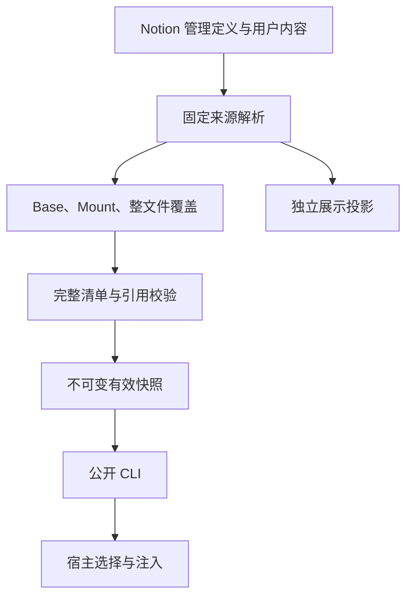

# Notion 共享管理与固定文件供给

本文是 [AH-498](https://linear.app/yoyooyooo/issue/AH-498) 的架构合同，服务于 AH-499。产品决定来自 2026-10-31 重建后的父 Issue。它定义实现必须遵守的状态归属、读取成本和失败边界，不作为功能通过证明。

## 状态与证据

**2026-11-01（Asia/Shanghai）开发检查点：AH-498 尚未全部完成。** 下表中的真实 CLI 指本次源码构建后由 Node.js 执行的正式命令，不代表已发行 npm 包、已安装宿主、两台物理机或模型/UI 验收。原始命令、私人页面身份、完整共享 pin 和备份位置保留在外部运行证据中，本文只记录可公开的范围与结果。

| 项目 | 当前结论 | 尚不能由该结果推出的结论 |
| --- | --- | --- |
| Notion 共享管理权威、本地状态可重建 | 已确定产品边界；共享 Records、精确来源与历史读取已接线 | 全部管理工作流、空缓存独立物理机验收 |
| 隔离库初始化与 descriptor | 真实 `ctl library init/inspect` 成功；三表及稳定属性身份可读回。当前新库初始化已加入 Members 自关联 | 既有库已自动升级、新增 Members 分支的全部真实故障验收、生产迁移或通用幂等事务 |
| 主文和支持文件布局 | 真实 Skills 主文与两个 Files 行的扁平索引已验证 | 101+ 真实分页、原生 UI 直达体验 |
| 共享文件状态 | DAG、Records、正文观察与普通 `read` 已接线；真实整页接管后改回原文仍为 custom | 恢复跟随、完整文件生命周期、全部跨机并发验收 |
| 保留正文 | 真实 Notion 历史对象按精确内容摘要恢复已证 | 任意大正文、所有资源类型或跨物理机完整快照恢复 |
| 共享 snapshot save/restore | 真实公开 CLI 保存三个文件，`verification=objects_and_manifest`；新本地状态根恢复并导出的三个文件 SHA-256 全部一致 | 任意资源类型、历史故障全矩阵和独立物理机恢复 |
| 固定 Git 来源 | inspect 固定 commit/tree/root 的 18 文件清单；真实消费产出 20 文件，17 个 Git 资源逐一核对 Git OID，三个 custom 文件保留原 SHA-256 | 完整来源选择管理、二进制全覆盖、投影写回或私有仓库支持 |
| 固定 manifest 登记 | `source register --manifest` 接受完整 inspect JSON 或裸固定 manifest，登记过程零 provider 请求；保留精确候选身份 | 登记即选中来源、建立 following 基线或改写正文 |
| 低请求标准 CLI | explicit shared catalog、native cold read、过期 Metadata 复验和固定资源零请求已观察 | 全规模矩阵、p50/p95、安装包或宿主端到端性能 |
| 原生 View metadata | 真实三成员 View 使用五次 Metadata 请求，正文、写入、provider 均为零；保留原生成员与顺序、Enabled 和稳定身份校验 | Profile 管理或宿主供给通过 |
| Router Members | 新库真实原生 Members 验证；两成员 Router 冷读 14 请求且无成员正文，warm 为零；成员描述更新后 7 次 Metadata、零正文/写入/provider，旧 pin 保留旧目录 | 原生 UI、已安装宿主或实际模型消费通过；旧库已隐式升级 |
| 在途合并与请求准入 | Notion 服务内同请求合并、默认四个并发 permit；permit 与 SQL 准入受原五分钟 deadline 约束，网络 timeout 独立 | 跨进程或跨机器全局并发锁、全部真实服务负载矩阵 |
| 迁移审阅计划 | `ctl library migration plan --input` 已提供只读映射、冻结证据和 blockers；`reviewable` 与 `blocked` 均 `apply_allowed:false` | 已获得生产切换授权、已实际迁移或可以清理旧数据 |
| SQLite 派生域 | 六类白名单 cache/dispatch 地址；0010 独立持久 local 内容限制不受 cache clear 影响。真实 Node SQLite 基础 7 项及 shared 9 项通过 | 本地状态成为管理权威或跨机器锁 |
| 类型、构建与专项测试 | 当前 typecheck/build 通过；Notion + coalescer 70 项无 skip，通过实际官方 CLI 的多行错误响应；固定资源/复合来源/限制 87 项、写入接线 83 项、Profile/Records/history 62 项通过 | 这些专项存在重叠，不相加宣称总数；此前完整 Node lane 为 737 pass，后续新增模块仅按专项结果记录；完整产品 unit lane 仍在运行 |
| 真实大规模 fixture | 两个独立 101 文件 fixture 均未完成：第一套第 77 个创建 unknown，76 个可见且原操作未结清；第二套第 97 个 unknown，96 个可见 | 两套都不记作真实 101 文件通过；受控分页测试分开报告 |
| 当前生产目录盘点 | 只读返回 300 条，Guizang 来源 coverage 失败；已保留 2509 个历史快照候选、483 份原操作记录，3105 个引用对象全部校验。只读计划稳定输出 8647 项显式 blockers | 快照候选不等于用户指定 pin；不能视作完整批准清单或迁移成功 |
| 现有本地状态保护 | 公开 backup 返回 `verified:true`；两个旧 scoped operation 的 `external_assets` schema 未知，已备份诊断且未删除 | 不推断这些旧操作完成、可安全重放或可以清理 |
| 原未知操作 | 已有冻结 plan → object → event 与本地派生 dispatch 恢复；保留原 ID | 首次 plan unknown 且共享不可见时，空客户端仍无法判定；N09 未完成 |
| 可编辑页写入 | 完整 old_str 的单次 update_content 真实验证：保留外部追加、内部漂移拒绝、两次连续竞争第二次拒绝；正文写入先保留原文/候选/plan，原 applied outcome 才能结清 | 不是原子 CAS；警告、不完整返回、不同实际结果或 unknown 保留待处理，不能用当前文本相等推断原写成功 |
| mini 独立环境 | 已通过登记的 SSH 连通，独立认证 available；现安装版本为 0.3.0 | 本轮候选包尚未安装或验收，不能算第二物理机消费通过 |
| 全量迁移、生产切换、发行与主机 | 本轮未完成；候选版本的双机、UI 与实际模型仍未验 | AH-513 至 AH-518 不得因源码切片通过而统一 Done |

隔离初始化中遇到过调用输出丢失而远端创建成功。通过固定父页下的实际成员及公开 inspect 读回确认结果，没有盲目重发创建。这验证的是一次具体恢复，不能推广为 Notion 提供通用幂等事务。

### 真实请求观察

以下均为本次指定范围的实测样本，不是所有库的固定常数。没有独立多次样本时不报告 p50/p95。

| 路径 | 已观察请求 | 范围和限制 |
| --- | --- | --- |
| explicit shared 冷目录 | 3 Metadata，约 10 KB | 零正文/provider；已修复此前误混 Upstream 造成的 6 Metadata、约 1.6 MB 路径 |
| 同一目录 warm | 0 | 完整且未过期的既有观察 |
| 三成员 shared View | 5 Metadata；0 正文、0 写入、0 provider | 原生成员 Metadata 供给；不等于 Profile 或宿主验收 |
| native 三文件首次 read | 27：9 Metadata、3 当前正文、6 保留正文查询、9 写入 | 三个文件各建立 plan/object/event；不当作普通重复读取成本 |
| 普通过期 `read --max-age 1s` | 6 Metadata；0 正文、0 写入、0 provider | 与前次相同 snapshot；不同于强制完整 `--refresh` |
| TTL 内 files 与 pinned resource | 0 | 使用已完整验证的本地版本 |
| 三文件 snapshot save | 14：7 Metadata、3 保留正文查询、4 写入 | 当前正文 0、provider 0；精确 chunks + manifest |
| 新本地状态根 snapshot restore | 8：5 Metadata、3 保留正文查询 | 当前正文、provider、写入均为 0；导出的三个文件 SHA-256 全部相同，尚非另一物理机 |
| 固定 Git inspect | 2 provider Metadata；0 blob | `https://github.com/anthropics/skills`，commit `ca45fc496a3436251f191354091d557da31c15b5`，root `skills/skill-creator`，18 文件 |
| 固定 Git read | 7 Metadata、1 当前正文、18 provider；0 写入；并发峰值 4 | 同一固定来源，最终 20 文件：17 个 Git 资源 OID 核对、三个 custom 保留原 SHA-256；15.807 秒仅一个样本 |
| 固定 Git 完整快照 warm files | 0 | 已物化文件清单，不替代冷读取或独立机器验收 |

公开入口全部使用 `ctl library`；root `list/read/files` 支持 `--metrics`。共享 `files/state/source inspect/register/snapshot save/restore` 默认带 `request_metrics`，初始化和 descriptor inspect 当前不带。操作、对象与历史的 Payload 如含正文，必须归入保留正文传输，不能因调用 query endpoint 就计为零正文。

验证步骤见 [shared SSOT recipe](https://github.com/yoyooyooo/notion-skills-cli/blob/main/.cursor/skills/verify-ntn-skills/features/shared-ssot.md)，实际命令合同见 [protocol](protocol.md#shared-notion-library)。本检查点不会把新增 recipe、架构描述或未执行的测试定义当作验收结果。

## 用户行为

用户在 Notion 修改 Skill 主文或支持文件正文。CLI 下次确认正文与该文件最后实际投影基线不同后，持久登记整个文件由 Notion 接管。同一 Skill 的其他文件仍按所选来源更新。

接管持续到明确的恢复跟随动作。改回原文、上游追平、重命名、换机器、删除本地缓存都不解除接管。恢复跟随先保存自定义版本，再采用 Notion 当前选择的准确来源版本；任何一步失败都不能先丢弃自定义内容。

名称、Description、Tags、View、启停与 Profile 是独立管理事实。变更这些属性可以改变目录、供给与派生文件，但不自动改变正文所有者。用户无需预先勾选接管、提交 Patch 或编辑 Manifest。

Skill、Router、Prompt 保留现有语义。发现只读取 Metadata；选中 Router 不预取所有成员正文；Prompt 显式提交只作用于当轮；读取或编辑内容不授权执行其中脚本。

## 物理布局

使用三类数据源，避免为每个领域建立一张表。

| 位置 | 拥有的共享事实 | 常用查询 |
| --- | --- | --- |
| Skills | Skill 稳定身份、Kind、名称、Description、Tags、启停、主文文件身份、当前可编辑主文 | 目录分页、目标 Skill 的属性 |
| Files | 文件稳定身份、所属 Skill 原生 Relation、逻辑路径、正文页、显示状态 | 原生 Relation 筛选目标 Skill 后完整分页 |
| Records | 来源选择、Profile、文件归属事件、操作结果、不可变历史与快照记录 | 按 Kind、Skill、精确记录身份过滤 |

Skills database ID 是库入口。数据库 description 中保存版本化 descriptor，包含本库身份、各表 database/data_source ID、必要 property ID 与 schema 版本。它是库发现契约，不放凭据，不复制到外部仓库成为另一份管理权威。

新库初始化在最终登记 descriptor 前，创建指向自身 Skills data source 的原生 Members relation，并记录其稳定 property ID。字段改名后仍按 ID 验证。旧 descriptor 可以没有这个可选绑定，普通 Skill 继续可读；Router 必须明确报缺失，不能按显示名猜选关系。普通 attach/read 不自动升级旧库。带原 operation 的初始化恢复只读核对已存在的表、Members 和 descriptor；unknown 后缺失不允许重发 PATCH。

初始化必须能区分同名库、不同父页及不同 schema。重复运行只附着已确定的同一库，不以显示名猜选目标，不覆盖用户 Metadata。创建结果未知时先保留原操作身份并读回；无法排除重复时返回未结清状态，不自动重放。

### 唯一正文入口

主文默认直接使用 Skills 行正文。它与 Files 行使用同一个逻辑文件模型和归属规则，只有正文绑定位置不同。不得另外创建一份可编辑的 SKILL.md 副本。

支持文件直接是 Files 数据源条目。Files.Skill 使用原生双向 Relation，在 Skills 显示 Supporting Files，提供点击直达入口。该反向属性只负责呈现。消费始终正向查询 Files.Skill，不能依赖反向关系前 25 个值，不能逐个 GET 关系中的页面。

关联字段改动可能改变页面更新时间；正文指纹只来自正文读取结果。状态显示使用属性，不向用户正文追加受管 footer。逻辑路径保留目录结构，物理表中的平铺不改变 `references/x.md` 或 `scripts/y.ts`。

未展示的 Git 二进制和资源可以只存在于固定来源清单。不会为整个上游仓库的每个文件创建 Notion 编辑页。

### 其他布局的取舍

| 方案 | 决定与理由 |
| --- | --- |
| 主文单独放 Files | 当前不采用。会增加主文发现关联和点击成本；若将来切换，必须保持唯一入口并重新测请求图 |
| Files 只放普通子页链接 | 不采用。索引行时间不能代表真正正文页的变更，仍需要 N+1 查询 |
| Sources、Profiles、History 各建一表 | 当前合并到 Records，以 Kind/Skill 过滤；只有实测隔离或查询成本证明必要时才拆分 |
| 本地 SQLite 保存接管权威 | 不采用。SQLite 只保留观察、索引和缓存，丢失后必须能重建 |
| 外部 Git/HTTP 保存管理 Metadata | 不采用。它们提供资源与固定版本，管理决定仍由 Notion 持有 |

## 领域身份与状态

### 身份

Skill ID 和 File ID 是创建后不随名称、逻辑路径、页面位置或主机变化的身份。Notion page ID 是正文位置绑定，不等同于业务身份。文件重命名保留 File ID；路径碰撞、一个 File ID 对应多个当前位置、多个 File ID 占用同一路径都必须明确拒绝。

Revision ID 由版本化规范化规则、实际内容摘要及必要 Metadata 确定。固定对象以字节 SHA-256 和长度标识；短期签名 URL 只是下载地址。Snapshot ID 固定文件清单、各文件版本、来源选择、管理代次和转换版本。

具体字段编码由 Schema 与协议定义，不能由多个模块各自拼接。外部 JSON、路径、Relation 与 provider 返回值在适配边界解析，核心只处理已验证类型。

### 文件状态

| 状态 | 有效内容 | 允许的自动行为 |
| --- | --- | --- |
| following | Notion 所选固定来源对象 | 确认投影未被编辑后使用固定来源字节 |
| custom | Notion 接管记录指向的精确内容 | 用户进一步编辑产生新自定义版本；不吸收上游变化 |
| tombstone | 无当前文件，保留删除意图与历史 | 上游同路径再次出现不能自动复活 |
| unresolved | 缺失基线、未完整读取、未结清写入或不可兼容事件 | 保留内容、候选与原操作，返回可诊断失败 |

`following` 不等于页面刚完成投影。来源选择与显示投影是两条事实。只要已有可编辑页的归属能够确定，来源消费可以独立推进；无法确认用户是否编辑过时，不能静默回退到 Git。

归属不由一个可变 boolean 单独表示。共享事件引用父事件和必要版本，使恢复跟随、删除、路径变更和接管能保留因果与历史。相同语义的幂等事实可归并；不兼容的并发 head 必须报告冲突，不按时间、机器名或查询顺序选赢家。

### 所有者

| 事实 | 权威位置 | 本地可保存内容 |
| --- | --- | --- |
| 身份、Metadata、启停、View、Profile | Notion | 目录缓存、机器 Profile 绑定 |
| 来源地址、范围、Base/Mount、所选 commit/version、更新策略 | Notion | Git 对象、下载缓存、解析树 |
| 实际投影基线、持续接管、tombstone、逻辑路径 | Notion | 最近观测、验证水位、计算结果 |
| 历史自定义字节、共享快照清单与所需可变资源 | Notion 记录或托管附件 | 哈希对象、物化目录 |
| 请求在途状态、并发 permit、同 key 合并 | 当前进程或本机派生状态 | 不具有跨机锁含义 |
| 当前会话选择、注入时机、会话 pin | 宿主 | 会话状态；内容版本仍来自 CLI |

## 正文观察与整页接管

1. 取得目标 Skill、Files 和共享记录的完整 Metadata 观察；保留查询范围、分页与权限覆盖。
2. 对更新时间、身份、属性归属变化或完整校验到期的文件读取正文。
3. 校验正文完整性，拒绝截断或不支持的未知内容；规范化版本必须与基线一致。
4. 与该文件最后一次实际投影后的规范化指纹比较。不能与最新 Git 原文直接比较。
5. 内容有实质变化时，先保留精确内容并持久追加接管事实，再对外发布新快照。
6. 后续观察即使内容回到原值仍保持 custom，直到明确恢复跟随。

当前最小规范化只统一 CRLF 与 LF。它不删除空格、代码、链接、指令或受用户控制的段落，也不把 Notion 渲染差异任意归一。任何扩展规则必须版本化，并用正文差异反例证明不会吞掉实质变化。

`validated_at` 表示 Metadata/最新观察的验证时刻；正文的 `downloaded_at` 固定实际完整观察时间，参与独立完整复验期限，恢复旧计划时不得刷新。Notion 原生更新时间仅是重新观察的信号。每个文件分别保存基线和检查时刻，不能用整个 Skill 的同步时间推进所有文件。当前完整正文期限为 24 小时；持续 Metadata 续期不得延后它。

常规 TTL 检查只更新本地观察，不写远端状态。Records 上的接管事件不会通过受管正文文本影响指纹。状态属性引发主页面时间变化时，可验证正文未变，但不得继续写回状态形成循环。

### 原始观察计划与未知写入

观察接管使用三个独立共享事实：先以 `Kind=operation` 保存冻结计划，再保存正文对象，最后保存接管事件。计划固定 Skill、File、正文 page ID、原始父事件集合、规范化字节、摘要、准确字节数、原始 `downloaded_at` 和目标事件身份。事件 ID 仍由 File、父事件和内容决定；计划 ID 还绑定原始观察时间，恢复时不重新取时钟或当前正文。三个事实的完整 canonical envelope 均须在任何派生 pending 记录或远端写入前通过 64 KiB 预检。

未完成计划通过一次按 Skill 的完整 operation 索引扫描发现。索引只投影 Record ID、Entity ID、Kind、Skill 和 Hash，不下载 Payload；计划 ID 中的事件摘要可以与完整 file-event 集合对应。只有未结清的原计划才按准确 Record ID 读取完整 Payload，该请求必须计入保留正文传输。已完成历史计划不能使普通过期检查重新下载所有历史正文。

`reconcile` 只核对原计划、原对象和原事件，不重新发送任何创建请求。计划存在不能证明对象或事件从未发出；任一步暂未可见就保持未结清。三个原事实都已验证后，本次操作返回 `SHARED_OBSERVATION_RECONCILED`，要求下一次重新读取页面。不能将计划中的旧正文和原始观察时间绑定到恢复时刚查询到的 Metadata 时间，也不能直接据此发布当前快照。

本地派生 pending 记录在首次远端发送前保存完整恢复凭据，用于阻止同一客户端重启后重新生成计划。它不能宣布共享操作完成；完成只来自 Notion 中原事实的核对。已共享可见的原计划也能被没有该本地记录的另一客户端发现。

**仍未解决的边界：** 首次计划 POST 结果未知、共享查询尚不可见，且另一客户端没有原恢复凭据时，该客户端无法区分“先前已发送但尚未可见”和“从未发送”。Notion 当前没有已证的原子去重或条件写能力；不能把额外日志、稳定 ID、查询为空或重复事实合并当作分布式锁或物理恰好一次证明。错误必须保留原计划、原 ID 与该限制，不能据此声明 N09 的全部未知操作验收已经完成。

代码中新增的受控测试覆盖隐藏已接受响应、第二服务恢复、后续正文修改、原始时间冻结及 101 个已完成计划的紧凑分页。受控测试不替代真实服务可见性、进程崩溃和独立机器实测；实际通过状态以对应测试输出和验收证据为准。

## 无 CAS 时的写入边界

Notion 当前已核对的页面与 Markdown 接口没有能够证明原子条件替换的 page revision precondition。`last_edited_time`、`is_locked`、checkbox、旧字符串匹配和写后读取都不能提供比较并交换。

因此，不允许把“读正文、比较、覆盖、读回成功”写成并发安全协议。用户可以在比较与覆盖之间修改正文，写后读取也无法恢复被覆盖而未观察到的字节。

### 可以安全实施的动作

- 创建新的逻辑对象和独立候选，明确处理结果未知，不盲重放。
- 向共享 Records 追加具有操作身份与父事实的版本记录，保留冲突候选。
- 从固定来源与已确认的自定义对象构建不可变快照，不修改正文页。
- 在无法证明安全覆盖时保存候选并返回冲突或待处理，保留当前正文与原操作。
- 对已观察的完整事件图检测不兼容分叉，要求明确收束。

事件图只描述完整观察到的事实集合。Notion 的一次或一组查询不能被称作全局原子快照，也不能证明另一机器稍后不会写出分叉。所有输出必须绑定其观察边界；后续发现分叉时重新判定，不伪称线性一致。

### 新正文页与绑定切换

创建新正文页并追加新的绑定事实，可以避免覆盖旧正文。它可以作为后续候选方案，但不能只创建新页后立刻归档旧页就宣称完成并发安全。

旧页面可能被人持续编辑或通过书签打开。绑定切换需要保留前任页面、切换的父事实、明确的唯一当前入口，以及对未结清前任的检查。竞争切换产生多个 head 时必须拒绝；发现前任晚到编辑时必须保留并报告，不能悄悄丢弃。若需要长期扫描所有前任才能成立，它会违背低请求目标，必须另行给出可执行边界和预算。

当前实现可以推进来源选择和消费，同时暂停不安全的投影回写。AH-511 的既有正文原地编辑，以及自动更新现有可编辑投影，只有真实保护协议通过后才能声明完成。架构文档不能替代这一证据。

### 可审查的 COW 实验

以下只是隔离实验方案，不是当前已采纳的正常写入协议。

1. 读取当前绑定、事件 frontier 和正文版本，将操作 ID、父绑定、原字节摘要及候选内容作为独立记录保留。
2. 创建后继正文候选页，记录确定 page ID 与实际读回摘要；候选尚不具有当前正文权威。创建结果未知时停止并定向核查。
3. 对旧页执行可恢复归档，以关闭普通编辑入口；这一步没有替换正文。
4. 读取归档后的实际正文，将完整字节保存在共享历史。若内容与操作基线不一致，保留用户修改并拒绝激活候选。
5. 只有旧页冻结、历史字节和候选均可确认时，才追加以旧绑定为父的激活事实。并发不兼容后继形成分叉，消费必须拒绝。
6. UI 中的当前入口只是该事件结果的投影。更新关系失败或结果未知时保留恢复任务，不能以本机成功记录冒充已展示。

该方案首先要验证：归档后 UI/API 是否真正拒绝正文修改，归档前已提交的编辑是否可能在最终读回之后迟到生效，以及恢复旧页能否通过当前 Files 成员查询可靠发现。未结清前任可定向检查；若已结清前任仍需每次逐页检查，方案必须重新评估成本，不能无界增长。

它不提供全局原子切换。两个 Agent 可以各自创建并激活后继，事件查询只会在看见两条事实后拒绝；原生 Relation 属性不能成为原子 DAG 指针。当前入口的短暂缺失、分叉提示和修复需要真实 UI 验收。

主文留 Skills 正文时，轮换整个 Skills 行还会影响 Metadata 与关系。并发名称、Description、Tags 修改必须独立保留，不能将正文安全问题转化为管理数据丢失。主文迁到 Files 可以避免移动稳定的 Skills 管理行，但必须重新证明唯一入口和同等直达体验。本轮不在未完成这些实验时静默更改已选择布局。

## 固定来源与快照

当前候选来源登记提供两种输入：`ctl library source register --url ... --commit ... --root ...` 解析固定选择；`--manifest FILE` 使用完整 `source inspect` 产品 JSON 或裸固定 manifest，登记时不再访问 provider。两种输入互斥。后者仍需要 Notion 身份、权限和共享事实验证；零 provider 不等于零请求。候选登记不改变 Source 选择、不建立投影基线、不改写正文。unknown 后保留相同 manifest/目标并只做原身份 reconcile。

依赖顺序如下。

Provider 接收固定选择，返回完整范围、字节身份与获取方法。Git 分支 HEAD 变化不改变已经选择的 commit。HTTP 对象必须以摘要或明确版本约束；需要支持历史恢复的可变字节应先保存在 Notion。机器本地来源必须携带 machine/workspace scope，另一机器不可达时明确失败。

Base 与 Mount 组合后检查路径逃逸、重复路径、大小写冲突和确定性的相对引用。下载不执行脚本。只有完整文件树与摘要验证完成后才能对外发布目录；失败不得留可见半成品。

快照清单固定每个文件的准确对象。允许按需获取已固定对象，不能把尚未固定的当前 Notion 正文延迟读入旧 pin。清空缓存后恢复旧 pin 时，必须使用共享历史的精确字节；缺失就失败，不能代入当前正文。

当前公开历史入口是 `ctl library snapshot save/restore`。普通 `s_<hash>` 是本地权限 scope 下的固定快照；共享 `snapshot-<manifest hash>` 固定独立内容清单。save 先保存精确字节 chunks，再保存 manifest；已存在的完成 manifest 可返回 `verification=manifest`，不宣称今天每个对象仍可读。restore 必须逐对象验证摘要和长度，并验证当前所选 Skill 的身份与访问权限，再在当前 scope 物化完整本地快照。它不推进 latest、不读当前正文、不以 provider 当前版本补洞。真实 save 与新本地状态根的三文件 restore 已分别通过；独立物理机恢复仍需单独证据。

名称、Description 等 Metadata 影响派生入口时，快照应固定生成输入与转换版本。旧 pin 的派生内容也不能随现在的 Metadata 改变。

### Router 的固定成员索引

共享 Router 按登记的 Members property ID 读取原生成员关系，完整分页后批量查询本库 Skills Metadata。所选成员必须同库、Enabled 且 Kind 为 Skill；重复稳定身份、非成员对所选身份的有效冲突、缺权限或不完整关系均明确失败。缺 Members 的拒绝发生在正文观察或保留写入之前。

当前 Router 读取生成现有 `## Members` 名称、稳定 ref 与 Description 列表。每个 Router snapshot 固定 `router_members` 及生成输入；固定版本不会套用现在的成员或名称。成员正文不预取，选择成员时才读取其自己的快照；Router pin 不等于已经固定所有成员的正文版本。生成索引不写回用户正文。

旧的、不含完整成员 Metadata 的共享 Router snapshot 即使离线也拒绝成功，不能把缺失索引当空成员，也不能用今天的 Notion 信息补成旧 pin。原生 UI 和宿主如何选择成员仍按独立验收记录，不由 CLI 元数据测试推出。

## 读取成本与缓存

分别缓存目录、文件 Metadata、共享记录、来源清单、正文对象和物化快照。缓存键包含权限/凭据 scope、库身份和相关选择；不能跨权限复用正文。同一内容哈希的对象复用也不能被当成最新权限许可。

| 路径 | 预算约束 |
| --- | --- |
| 冷目录 | Skills 分页与必要入口常数；零正文、零 provider 下载 |
| 冷消费一个 Skill | 只查目标 Files 和相关 Records；只获取必要缺失对象 |
| TTL 内完整命中 | 在声明策略下零远端请求，访问不延长验证时刻 |
| TTL 过期且未变 | Metadata 分页加必要常数；零正文、零资源下载、零常规状态写回 |
| 单页正文变化 | 只读变化目标和解释明确的固定复查；其他对象复用 |
| 仅 Metadata 变化 | 更新管理结果，必要时重生成派生入口；不误接管或重下完整树 |
| 明确完整校验 | 读取声明范围的正文；单独记录代价和时间，不冒充轻量刷新 |

对 N=1/10/100/101/300、k=0/1/多文件变化运行同一预算检查。Metadata 成本应为实际分页 P 加固定 K，不能退化为每文件一个 GET。K 必须解释 auth、入口发现、schema 或共享记录查询，不能用一个模糊常数掩盖线性工作。

分页必须校验 `has_more`、cursor 进展、重复身份和响应完整性。增量水位需要重叠与去重，并定期完整成员对账；最近修改的当前结果不能独自证明删除、离开 View 或权限丢失。未完整覆盖的查询不授权删除。

轻量检查与完整正文检查分别计时。持续轻量续期不能无限延后完整校验，避免同时间戳变化永久不可见。强制刷新、写入前检查和缺失基线使用明确路径。

## Effect 与故障

使用仓库 exact pin Effect v4 及实际安装 API。先减少 I/O 和重复工作，再为必要工作设置有界并发。正式路径统一处理并发上限、速率准入、队列背压、同 key 请求合并、依赖串行、超时、取消和 Scope 释放。

同 key 合并包含权限 scope；取消一个 waiter 不应中断仍有其他消费者的共享工作。取消最终消费者或会话代次失效后，不能迟到发布快照，也不能遗留子进程与 permit。

当前 Notion 服务已接在途只读合并与有界 permit，默认并发为 4。`NTN_SKILLS_NOTION_CONCURRENCY` 未设置或空值使用 4；非空值必须是 1 至 64 的整数字面值。合并身份包含凭据、method、path 和请求数据，只覆盖服务内正在执行的同请求；完成结果不由这层缓存，写请求与带文件的请求不合并。该配置不控制 provider 的下载并发。

每次实际 attempt 的 permit 等待及本机 SQL 准入等待，共用 logical request 原有的五分钟 deadline，不因拿到 permit 或 retry 重新起算。permit 包围准入与实际请求，backoff 在其外；超时或取消释放 permit。网络 attempt 另用 `NTN_SKILLS_REQUEST_TIMEOUT_MS`，默认 30 秒，已发出的请求不会因准入 deadline 到期而被当作未发送。permit 等待、SQL 等待以及发送前超时/取消均进入队列指标。这些控制不改变未知写入的原操作规则。

只读查询、明确未执行的拒绝、结果未知的 mutation 使用不同重试策略。429/529 遵守服务端退避并计入总时间预算。未知写入保留原操作，先观察效果，不盲重放；权限失败不重试成成功。

本机 semaphore、进程内 map 与本地 SQLite 都不提供跨机器锁。多机各自使用保守配额和服务端退避，不建设新的中心调度服务。

记录 Metadata/正文/写入/provider 请求数、传输字节、重复请求、并发峰值、排队与重试等待、端到端 p50/p95 和独立样本数。受控时钟结果与真实服务耗时分开。预算脚本必须有一个故意 N+1 的失败样本，证明它会拒绝超支。

## 现有模块的迁移边界

`ctl library migration plan --input FILE` 当前只审阅显式冻结的证据：批准的旧身份范围、备份、含 coverage 的目录/文件/正文清单，以及来源、View、Router、旧 pin 和原操作的保留清单。输出固定输入 hash、稳定映射、完整原始证据、blockers 与 stop conditions。`reviewable` 只说明这些输入没有发现阻塞，`blocked` 保留缺口；两种结果都为 `apply_allowed:false`，不授权迁移、清理或未结清操作重放。它不会现场核实输入中的外部事实，不能把生产目录返回的 300 行当成完整批准范围。

| 当前模块 | 新职责或处理 |
| --- | --- |
| `model.ts` 的 ContentRecord/locator | 保留消费种类，逐步引入稳定业务身份、正文绑定和独立管理选择 |
| `catalog.ts` | 只做 Metadata 发现与完整覆盖，不加载正文 |
| `references.ts` 与普通子页遍历 | 调用者迁移到 Files 原生筛选；历史恢复工具保留旧格式读取 |
| `snapshot.ts` | 接受固定有效文件树与共享历史，退出必须 Notion 展示往返的依赖 |
| `source-bundle-cache.ts` | 保留可重建的固定对象缓存；不承载接管或管理权威 |
| `upstream-plan.ts` 与 tracked/fork | 来源选择、整文件归属与更新策略分离；不把整个 Skill 变成单一 fork 开关 |
| `publication.ts` 与相关恢复模块 | 正常消费不依赖发布回执；真实 Notion 写入保护与旧操作恢复单独保留 |
| `views.ts` | Notion 管理 View/Profile；宿主只保留本机会话选择 |
| `commands-content.ts` 与公开 schema | 迁入同一有效快照链；逐项保留或明确破坏式变更 |
| `pi-context-broker` / Tern | 消费统一 CLI 契约，保留选择、pin、注入时机 |
| Agent Kit | 移交已迁移 Skill 的内容接纳与默认供给；保留无关机器、模型、Agent、Squad 职责 |

源代码定位仍需结合最终 diff 核对调用关系。以上是职责变更合同，不声明这些模块已经全部迁移。

先迁移调用者，再移除旧业务入口。历史恢复工件不能被正常启动隐式双读，也不能因清理旧代码丢失尚未结清的操作。既有脏文件、旧 pin、用户内容和原始来源全部按可恢复方式保留。

## 旧目标与本轮执行所有者

下表依据 AH-498 当前正文中的旧票映射。映射表示执行归属，不能代替逐条历史故事和证据的核对；旧票只有对应实际目标通过后才能按原关闭条件收口。

| 历史目标 | 本轮按职责划分的执行所有者 | 旧票收口条件 |
| --- | --- | --- |
| AH-254 总体架构与迁移主线 | AH-498，模型由 AH-499 拥有 | 全部未完故事有映射及实际结果，不以新建规格关闭 |
| AH-258 文件/引用布局 | AH-501 | 扁平 Files、真实分页与直接编辑入口通过 |
| AH-259 Metadata 与供给 | AH-510 管理、AH-512 宿主消费 | Notion 管理定义及真实宿主供给链通过 |
| AH-260 宿主接入 | AH-512 | 已安装宿主的真实选择、pin 和注入通过 |
| AH-261 共享状态与历史 | AH-507 操作收敛、AH-509 固定历史 | 独立机器恢复管理事实与精确历史字节 |
| AH-262 来源直接供给 | AH-501 文件布局、AH-502 固定来源消费 | 扁平文件发现、完整文件树及真实冷消费者通过 |
| AH-263 用户修改与归属 | AH-504 接管、AH-505 恢复/文件生命周期、AH-506 缓存 | 自然编辑、持续整页归属、恢复跟随和文件增量通过 |
| AH-264 来源与资源覆盖 | AH-508 多来源、AH-513 盘点、AH-515 全量迁移 | 来源完整性、范围清单和逐条迁移台账通过 |
| AH-265 写入与创作 | AH-507 共享操作、AH-511 写入/创作边界 | 真实冲突/恢复、正常公开写入及保留证据通过 |
| AH-269 代表性迁移 | AH-514 | pro/mini 分别独立消费代表性真实内容 |
| AH-270 迁移清单与全量范围 | AH-513 盘点、AH-515 全量迁移 | 冻结清单、用户编辑和未结清操作全量核对 |
| AH-271 AK 管理权移交 | AH-516 | 每项限定范围有新消费证据与旧更新边退役记录 |
| AH-272 综合验收/日用 | AH-517 调用者退役、AH-518 总验收 | 单轨安装产物、新发行、两台物理机、宿主和性能矩阵通过 |
| AH-423 及已 Done 子票 | 保持原状态；本轮新验收由 AH-518 汇总 | 不撤销旧证据，不把旧 PASS 代替新架构验收 |

## 剩余验收不能被文档替代

| 子票 | 必须实际发生的验证 |
| --- | --- |
| AH-499 | 时间传播、schema/关系能力探针与全部旧未完目标映射 |
| AH-500 | 可执行预算，完整规模/变更矩阵，故意超预算失败与真实基线 |
| AH-501 | 主文和至少两个真实文件页、101+ 分页、UI 直达、幂等和权限反例 |
| AH-502 | Git 含 Markdown/脚本/二进制的固定完整树、纯展示失败和独立安装消费 |
| AH-503 | 实际并发/合并/退避/取消与 unknown-write，资源释放证据 |
| AH-504 | 主文与支持页自然编辑、接管事实持久化、缓存丢失和双机一致归属 |
| AH-505 | 恢复跟随保留自定义版本，新增/删除/移动/tombstone 和引用失败 |
| AH-506 | TTL、同时间戳完整校验、单文件增量、成员对账和损坏补取 |
| AH-507 | 两机独立状态、并发事实、丢失响应、中断恢复与实际冲突拒绝 |
| AH-508 | Git/Notion/HTTP/local 混合、作用域、路径碰撞和权限反例 |
| AH-509 | 旧 pin 在空缓存机器恢复精确字节，历史缺失明确失败 |
| AH-510 | Notion Metadata/View/Profile 实际决定供给，两机无需复制配置秘密 |
| AH-511 | Agent 写入、本地创作/分发及无 CAS 的既有正文安全边界 |
| AH-512 | 真实 Broker/Tern/已安装宿主的选择、默认注入、pin 与模型消费 |
| AH-513 | 冻结真实内容、旧 pin、来源映射、用户编辑与未结清操作清单 |
| AH-514 | 代表性真实迁移及 pro/mini 各自独立消费 |
| AH-515 | 批准范围全量迁移，逐条台账与保护用户内容 |
| AH-516 | AK 限定移交、旧调度不夺回管理权、可恢复保留，未动延期主机 |
| AH-517 | 调用者全部迁移、旧业务链退出安装包、历史工具仍能检查原操作 |
| AH-518 | 正式发行/冷装/升级，真实双机、UI、模型、完整性能与故障总验收 |

验证继续使用 `.cursor/skills/verify-ntn-skills/` 和 Broker 现有地图。真实 Notion、受控 provider、安装产物、两台物理机、真实 UI 和真实模型分别留证。两个 HOME 不能替代两台机器；源码通过不能替代安装包；页面创建成功不能替代文件树与消费成功。

完成每个切片时同步更新协议、公开 help/schema、内置 Skill、文档及验证地图。仅对当前已实际通过的子票推进状态；失败、未测和延期逐项保留。
