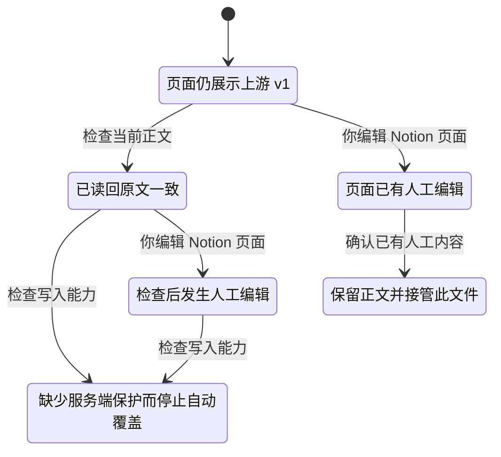
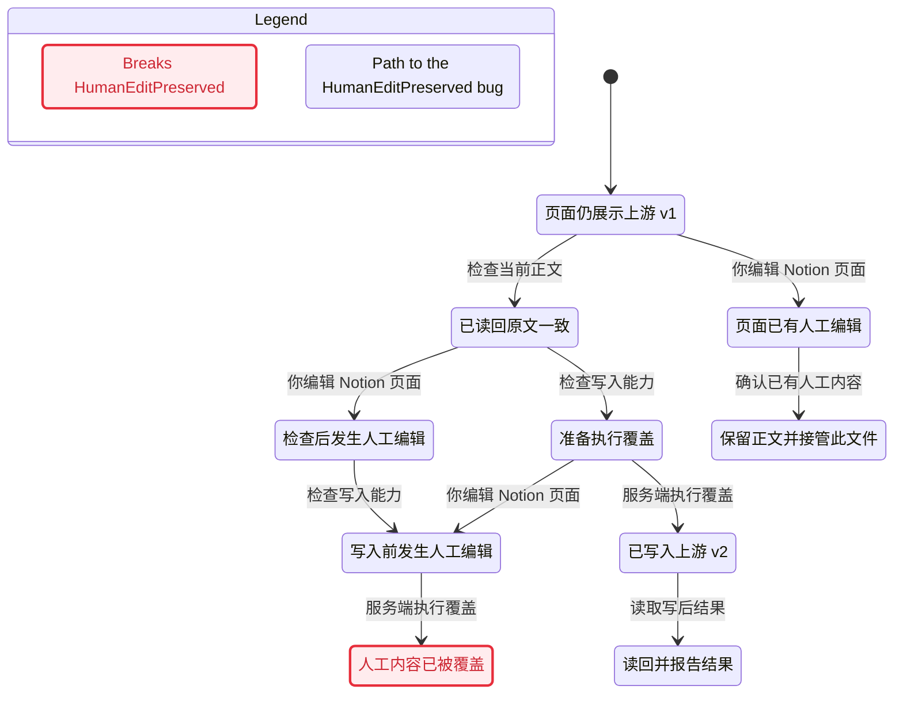
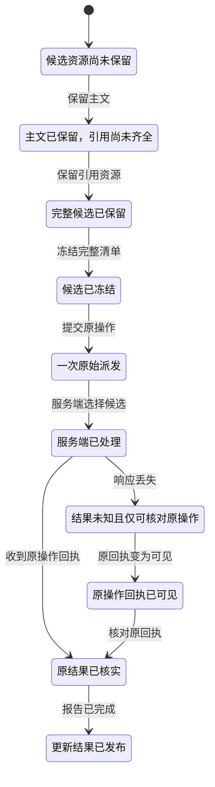
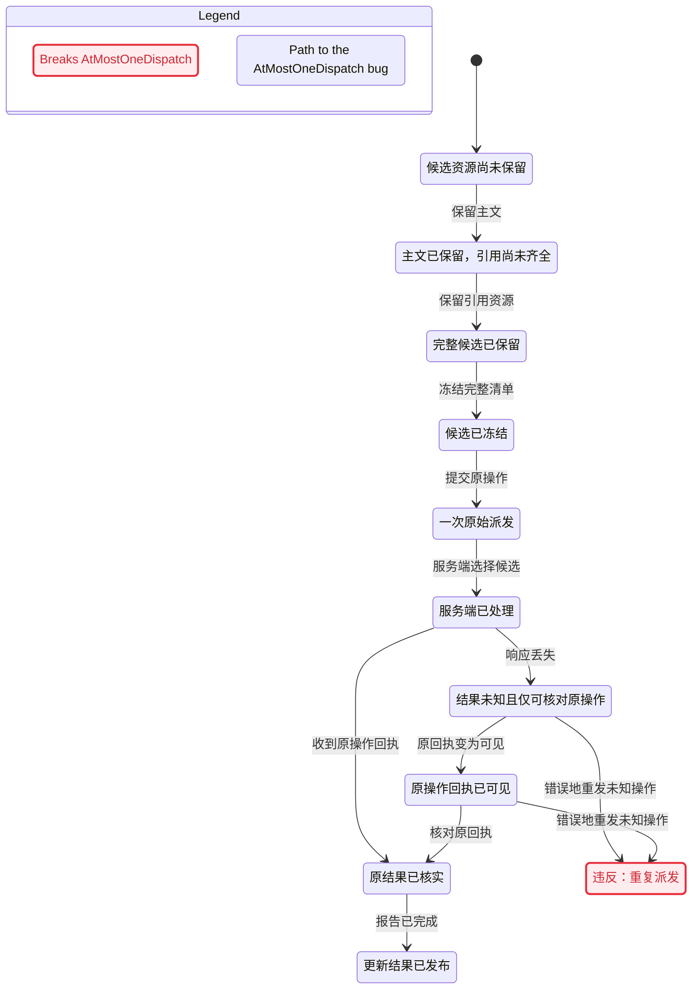
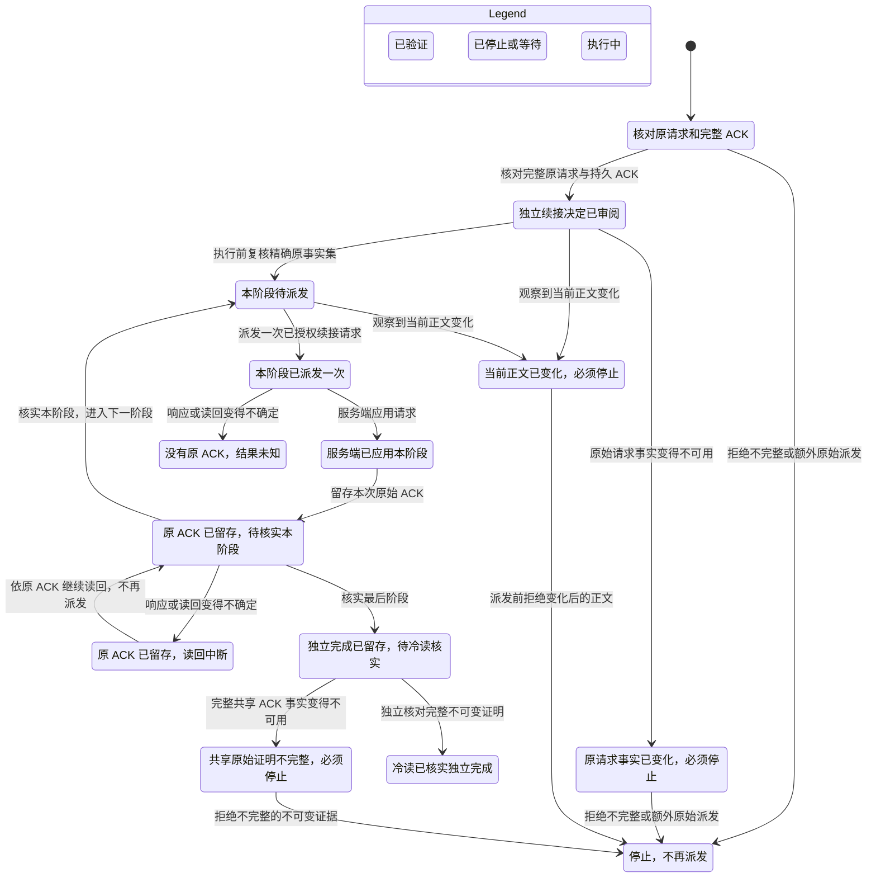
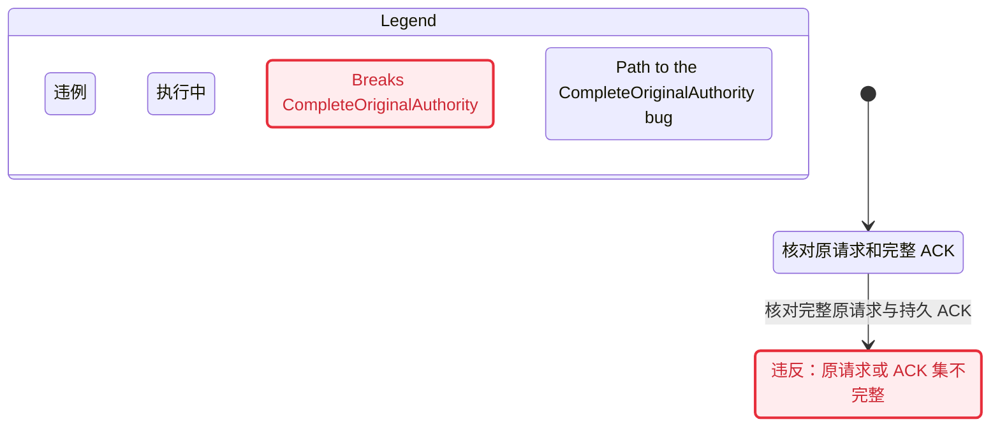
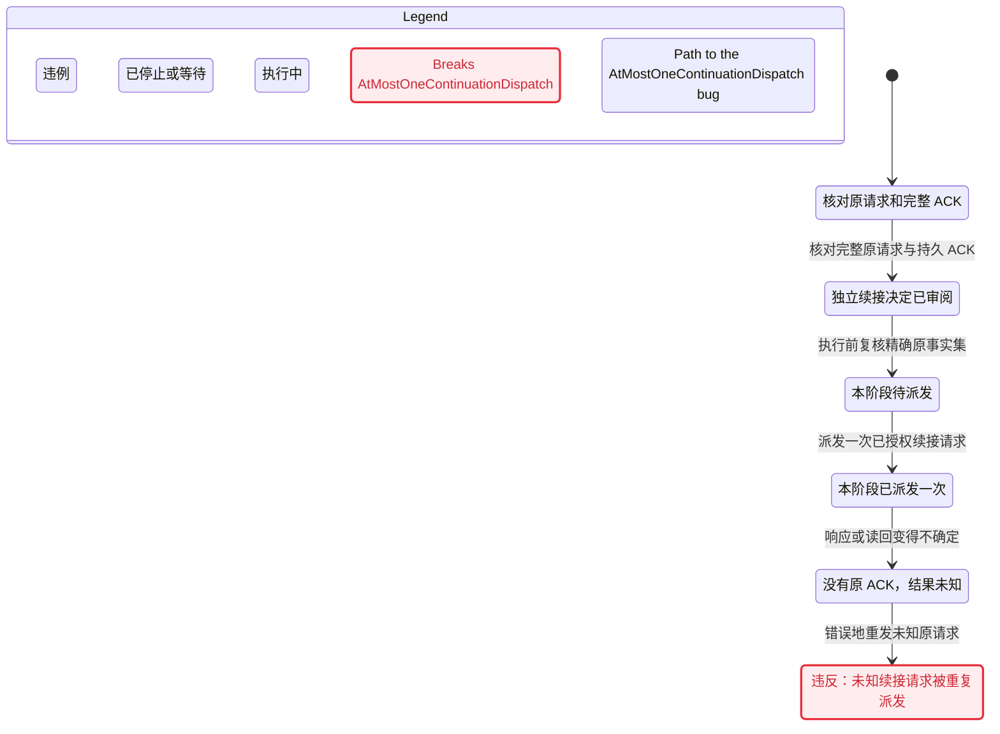

# CLI 核心状态图（2026-11-12）

这组图来自现有 TLA+ 模型的真实 TLC 检查与锁定的 Pstack statechart 编译。模型和配置与产品基线 `ee4e712df6cd85fe268fbafe16d9d19a47794666` 的原件完全相同；本次只调整中文 view，并保存生成图、报告和可核对的清单。

检查了 ProjectionRace、UpdateCommit 和 AcknowledgedContinuation 三组共 **18 个配置：4 个正例、14 个负例**。每组都完成有限状态空间探索，正例没有性质破坏，负例恰好破坏预期性质。这里选择 8 张图，每张包含初始箭头在内不超过 20 条。其余完整配置和原始 TLC 输出保留在证据目录。

这些图回答指定有限模型中的保护边界，不等于产品全链路、真实 Notion、安装包或任意规模验证。负例是有意移除模型保护后的结果，不能直接写成当前产品 bug。本轮没有执行代码 guard mutation 或 live 操作；既有代码对应关系在[模型说明](../../../verification/models/resource-lifecycle/README.md#code-correspondence-and-mutation-replay)中。

项目入口：[Notion Skills](https://app.notion.com/p/4125636c236e81f28894e4bbb4eab711)。正式生成图册与验证策略：[安全性、状态机与验证策略](https://app.notion.com/p/4125636c236e819bba12c71af9a0c0f5)。后续验证 Skill 治理批次：[AH-1006](https://linear.app/yoyooyooo/issue/AH-1006)。

## 阅读入口

图中粉色节点是违反性质的状态，蓝色边框标出最短反例路径。每张图下方提供未改写的生成报告、Mermaid 原件与同名 SVG。正文 Mermaid 只把生成器的 title frontmatter 提到章节标题，图体保留原文。

| 图 | 配置 | TLC 状态数 | 图中状态 / 业务箭头 | 结果 |
| --- | --- | ---: | ---: | --- |
| [自动投影保护人工编辑](#projection-safe) | `ProjectionRace.cfg` | 7 | 6 / 6 | 全部性质成立 |
| [移除保护后覆盖人工编辑](#projection-unsafe) | `ProjectionRace.broken.cfg` | 11 | 10 / 10 | 反例：`HumanEditPreserved` |
| [完整候选与固定版本消费](#update-safe) | `UpdateCommit.cfg` | 15 | 10 / 10 | 全部性质成立 |
| [未知结果被错误重发](#update-retry) | `UpdateCommit.retry.cfg` | 31 | 11 / 12 | 反例：`AtMostOneDispatch` |
| [已分配三页的原 ACK 续接](#continuation-retained) | `AcknowledgedContinuation.cfg` | 88 | 14 / 19 | 全部性质成立 |
| [原主文同页恢复后的续接](#continuation-native) | `AcknowledgedContinuation.native.cfg` | 61 | 14 / 19 | 全部性质成立 |
| [缺少原请求或 ACK 仍接受续接](#continuation-missing-original) | `AcknowledgedContinuation.original.cfg` | 717 | 2 / 1 | 反例：`CompleteOriginalAuthority` |
| [原主文恢复后的未知续接被重发](#continuation-native-retry) | `AcknowledgedContinuation.native.replay.cfg` | 698 | 6 / 5 | 反例：`AtMostOneContinuationDispatch` |

业务箭头数采用 statechart 报告的计数；每张图另有一条初始箭头。两个超过 500 个状态的配置按工具固定规则只画最短反例：原事实缺失 717 个状态、native 重发 698 个状态。其余状态仍已完整检查，画图预算没有缩小模型，也没有改变不变量。

## ACK 两分支的有限阶段

两条正图使用相同的单阶段派发／ACK／核实循环，但模型分别固定以下阶段次序。每阶段只有一次原始派发；没有 ACK 的未知请求不可重发，已经保留精确原 ACK 的读回中断可以继续观察。原页面和原 `needs_review` 历史保持不变，最后得到的是独立续接完成。

| 分支 | 初始有限对象 | 有序阶段 |
| --- | --- | --- |
| retained | 已分配的主文与两个引用页 | 留存原 ACK → 发布精确元数据及完整初始事件 → 启用完整树 → 留存独立完成 |
| native restoration | 已恢复的原主文与一个从未派发的引用 | 留存原主文 ACK／恢复审阅 → 分配未派发引用 → 发布完整初始事件 → 启用完整树 → 留存独立完成 |

### 展示层的省略

- 终态和显式等待的自环由工具省略；模型仍保留这些步骤。
- UpdateCommit 把主文、引用的保留分成三个可见状态，以保留最短重发反例的完整准备顺序；固定 pin 的内部读取若不改变展示标签仍省略。
- ACK view 不为 4／5 个阶段复制同样的派发循环；阶段编号和精确变量保留在原始模型输出中。
- ACK view 省略“服务端应用后、留存 ACK 前变得未知”的重复箭头；图中保留派发后进入同一个无 ACK 未知状态的代表路径。
- ACK view 省略“正文已经变化后，原请求事实又变得不可用”的第二种拒绝原因；正文变化仍有停止出口，原事实变化仍从审阅状态可达。
- 已审阅与待派发阶段中的正文变化合并为同一个必须停止的可见状态；所有违例组合仍各自独立，不与安全状态合并。原始报告与 TLC 输出保留每一步，本页四条所选最短反例均完整显示。

## 有限假设与未覆盖范围

ProjectionRace 只有一个可编辑页面；它表达自动投影拒绝无保护替换，不证明显式全旧正文匹配 restore 的并发原子性。UpdateCommit 只有主文和一个引用、一次逻辑选择和既存会话 pin，不证明多写者事务。ACK 模型只抽象完整原事实、正文新鲜度、有序阶段和共享证明谓词，不展开每个 immutable Record 子请求。

本批只包含安全性质与有限死锁检查，没有 AuditRun 的公平性／活性配置；未知操作允许等待，不承诺最终完成。Notion 的实际权限、网络、并发编辑、JSON／字节序列化、任意文件数、SQLite 与冷启动代码行为需要其独立证据。

独立 `accept-add`、native inventory 的 Record 前缀恢复、Management 业务 Request／反馈、exact ACK-bound Record GET 仍明确未建模。本次生成新图没有扩大它们的形式化覆盖。

## 复现与原件

工具：Pstack `c742dd61706fbacc1b95f1a20b7b988cf096ce6c`；TLC 1.7.4 jar SHA256 `936a262061c914694dfd669a543be24573c45d5aa0ff20a8b96b23d01e050e88`；Node 24.20.0；Java 21；Pele 1.9.0。31 个工具文件已逐个和锁定 Git blob 比对，87 个产品源码绑定全部匹配。

在配置好锁定的 `PSTACK_STATECHART_ROOT`、`TLA2TOOLS` 后，分别使用一个全新的输出目录运行：

```sh
node scripts/verify-resource-lifecycle.mjs --model ProjectionRace --out /absolute/new/projection-run
node scripts/verify-resource-lifecycle.mjs --model UpdateCommit --out /absolute/new/update-run
node scripts/verify-resource-lifecycle.mjs --model AcknowledgedContinuation --out /absolute/new/ack-run
```

用 Pele 1.9.0 的 `render(mmd, { limit: 1000000, outputLimit: 8000000, maxEdges: 10000 })` 生成同名 SVG。当前可复现组、每份输入／图／报告哈希及原件清单哈希见 [manifest.json](manifest.json)。证据根为 `/Users/yoyo/Documents/code/personal/verification-evidence/statecharts-20261112/cli/`；早期 view 迭代也保留，其结果不混入这次最终 18 配置清单。

源 view：[ProjectionRace](../../../verification/models/resource-lifecycle/ProjectionRace.view.mjs)、[UpdateCommit](../../../verification/models/resource-lifecycle/UpdateCommit.view.mjs)、[AcknowledgedContinuation](../../../verification/models/resource-lifecycle/AcknowledgedContinuation.view.mjs)。

## 自动投影保护人工编辑

<a id="projection-safe"></a>

缺少服务端保护时停止自动覆盖；提前读到相同正文不能授权后续无条件覆盖。

**范围：** `ProjectionRace.cfg`；7 个模型状态，6 个可见状态，6 条业务箭头。

[Mermaid 原件](projection-safe.mmd) · [SVG](projection-safe.svg) · [生成报告](projection-safe.report.md)



## 移除保护后覆盖人工编辑

<a id="projection-unsafe"></a>

这是被否决的无条件覆盖方案：先读原文，再发生人工编辑，随后覆盖。反例不表示当前生产代码已经发生内容丢失。

**范围：** `ProjectionRace.broken.cfg`；11 个模型状态，10 个可见状态，10 条业务箭头。

[Mermaid 原件](projection-unsafe.mmd) · [SVG](projection-unsafe.svg) · [生成报告](projection-unsafe.report.md)



### 最短反例原文

## HumanEditPreserved breaks
The shortest path has 4 steps:
0. 页面仍展示上游 v1
1. 检查当前正文: 已读回原文一致
2. 检查写入能力: 准备执行覆盖
3. 你编辑 Notion 页面: 写入前发生人工编辑
4. 服务端执行覆盖: 人工内容已被覆盖

## 完整候选与固定版本消费

<a id="update-safe"></a>

先保留主文与引用，再冻结候选并派发。未知结果只核对原操作；旧会话继续使用原 pin。

**范围：** `UpdateCommit.cfg`；15 个模型状态，10 个可见状态，10 条业务箭头。

[Mermaid 原件](update-safe.mmd) · [SVG](update-safe.svg) · [生成报告](update-safe.report.md)



## 未知结果被错误重发

<a id="update-retry"></a>

移除禁止重发的边界后，一次原操作的派发次数超过一。

**范围：** `UpdateCommit.retry.cfg`；31 个模型状态，11 个可见状态，12 条业务箭头。

[Mermaid 原件](update-retry.mmd) · [SVG](update-retry.svg) · [生成报告](update-retry.report.md)



### 最短反例原文

## AtMostOneDispatch breaks
The shortest path has 7 steps:
0. 候选资源尚未保留
1. 保留主文: 主文已保留，引用尚未齐全
2. 保留引用资源: 完整候选已保留
3. 冻结完整清单: 候选已冻结
4. 提交原操作: 一次原始派发
5. 服务端选择候选: 服务端已处理
6. 响应丢失: 结果未知且仅可核对原操作
7. 错误地重发未知操作: 违反：重复派发

## 已分配三页的原 ACK 续接

<a id="continuation-retained"></a>

初始已分配主文与两个引用页，仍须核对完整原请求和 ACK。四个有序阶段共用下图的单阶段循环。

**范围：** `AcknowledgedContinuation.cfg`；88 个模型状态，14 个可见状态，19 条业务箭头。

[Mermaid 原件](continuation-retained.mmd) · [SVG](continuation-retained.svg) · [生成报告](continuation-retained.report.md)



## 原主文同页恢复后的续接

<a id="continuation-native"></a>

初始原主文已经显式恢复到冻结候选；模型不证明恢复正文的过程。主文加一个从未派发的引用，按五个有序阶段续接。

**范围：** `AcknowledgedContinuation.native.cfg`；61 个模型状态，14 个可见状态，19 条业务箭头。

[Mermaid 原件](continuation-native.mmd) · [SVG](continuation-native.svg) · [生成报告](continuation-native.report.md)


## 缺少原请求或 ACK 仍接受续接

<a id="continuation-missing-original"></a>

移除完整原事实门槛后，审阅一步就可能授予没有依据的续接 authority。这里展示 retained 分支；native 同类负例也在本次十配置检查中通过预期判据。

**范围：** `AcknowledgedContinuation.original.cfg`；717 个模型状态，2 个可见状态，1 条业务箭头。本图只显示工具生成的最短反例。

[Mermaid 原件](continuation-missing-original.mmd) · [SVG](continuation-missing-original.svg) · [生成报告](continuation-missing-original.report.md)



### 最短反例原文

## CompleteOriginalAuthority breaks
The shortest path has 1 step:
0. 核对原请求和完整 ACK
1. 核对完整原请求与持久 ACK: 违反：原请求或 ACK 集不完整

## 原主文恢复后的未知续接被重发

<a id="continuation-native-retry"></a>

已有一次派发但未留存 ACK，结果未知；重发同一原请求立即违反一次派发边界。最短反例发生在第一个抽象阶段，不能改称某个真实后缀写入事故。

**范围：** `AcknowledgedContinuation.native.replay.cfg`；698 个模型状态，6 个可见状态，5 条业务箭头。本图只显示工具生成的最短反例。

[Mermaid 原件](continuation-native-retry.mmd) · [SVG](continuation-native-retry.svg) · [生成报告](continuation-native-retry.report.md)



### 最短反例原文

## AtMostOneContinuationDispatch breaks
The shortest path has 5 steps:
0. 核对原请求和完整 ACK
1. 核对完整原请求与持久 ACK: 独立续接决定已审阅
2. 执行前复核精确原事实集: 本阶段待派发
3. 派发一次已授权续接请求: 本阶段已派发一次
4. 响应或读回变得不确定: 没有原 ACK，结果未知
5. 错误地重发未知原请求: 违反：未知续接请求被重复派发

