# Skill 维护状态图

本图册承接 AH-1024 的渐进维护合同。SVG 和 Mermaid 来自同一份 TLA/config/view；不是另外手画的理想流程。原报告、输入摘要和渲染信息见 [manifest.json](manifest.json)。产品对应为 `d5159127d0ca927a5f3540b79423ec9b11bc98ea`，源码验证冻结于 `03f2b217742106a3baee7989ff2d36aebb0a1105`。随后只折叠了重复的子操作序号标签，六个 MaintenanceApply 配置的模型字节、配置字节、状态数、性质和违规集合均保持。

## 目标检查与全库反向审计



[Mermaid](audit-target.mmd) · [原始检查报告](audit-target.report.md)

目标可达检查只为已观察到的 owner 事实作结论，不能由此声明全库没有失联对象。全库反向盘点是独立范围。预算耗尽保留原进度；续跑不更换范围、不增加远端写。图中四类事实是有限抽象，不表示真实 HTTP 请求恰好四次。

反例：[把目标完整误报成全库完整](audit-scope-counterexample.svg) · [Mermaid](audit-scope-counterexample.mmd) · [报告中的最短路径](audit-scope-counterexample.report.md)。此配置故意启用错误规则，必须恰好违反 `GlobalCoverageNeedsReverse`。

## 整树变更、原操作恢复与当前消费



[Mermaid](maintenance.mmd) · [原始检查报告](maintenance.report.md)

完整父计划冻结三个有序子操作。图把三个重复的子步骤折叠成“当前子操作”，但保留原意图、派发、服务端应用、ACK、精确结果和父进度之间的区别。已确认前缀可以继续；未知结果不能重发，也不能越过。已知人工改动停止未派发后缀。父操作完成前，新消费不能把半套树当成完整新版本；旧 pin 保持原内容及现有权限边界。

反例：[重复派发未知写入](maintenance-replay-counterexample.svg) · [Mermaid](maintenance-replay-counterexample.mmd) · [报告中的最短路径](maintenance-replay-counterexample.report.md)。错误配置必须恰好违反 `UnknownNeverRepeated`。

## 展示和证明范围

MaintenanceApply 正例为 88 个有限状态，图面为 12 个状态、16 条箭头；目标审计正例为 292 个有限状态。图不绘制停留在同一可见状态的步骤和终局空转，精确计数见原报告。消费请求会导致违规时，其箭头和坏状态仍保留。不同性质的坏状态没有合并成一个泛化“失败”。

这些图不证明 Notion 多页原子事务、服务端 compare-and-swap、无限规模计划、实际 Markdown 字节、权限查询可见性或所有私人 pin。独立审查发现的 repair query 不可见和权限拒绝后预算暂停，是具体实现回归；不能把它们算成本图新增的形式化性质。对应实现审阅见 [维护验证说明](../../maintenance-verification-review.md)。

## 复现

从仓库根目录，使用项目锁定的 statechart 工具和 TLC，选择新的空输出目录：

```sh
node scripts/verify-resource-lifecycle.mjs --suite lifecycle --model AuditScope --out /absolute/new-audit-output
node scripts/verify-resource-lifecycle.mjs --suite operation-recovery --model MaintenanceApply --out /absolute/new-maintenance-output
```

工具路径、完整性质检查及 Pele 1.9.0 的渲染步骤见 [形式化维护合同](../../formal-verification-maintenance.md)。需要修改图面时，先复跑受影响模型的全部正负配置，保留最短坏路径与退出关系，再更新图件和 manifest。模型通过不替代独立安装、真实 Pi 或真实 Notion 的验收。
